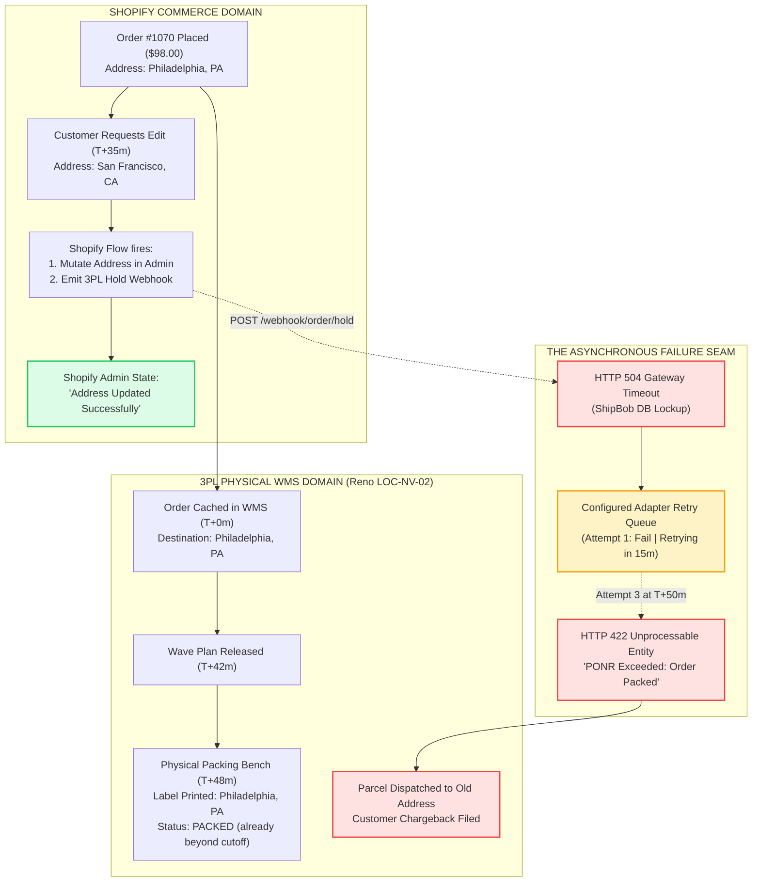
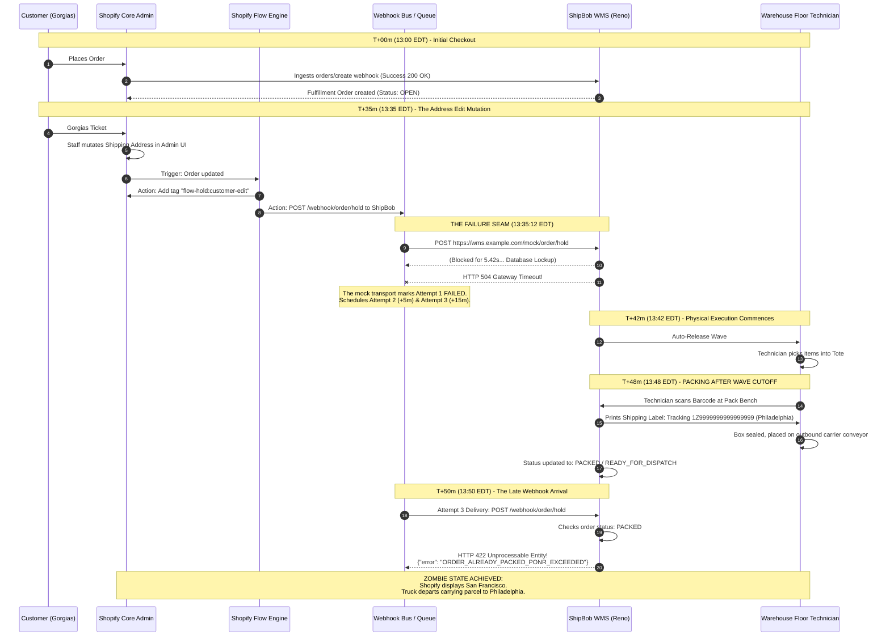

# CaseStudy - AsynchronousOrderMutationAndWebhookFailure - Analysis

```
Document ID:     CaseStudy - AsynchronousOrderMutationAndWebhookFailure - Analysis
Naming Format:   [CATEGORY] - [PURPOSE] - [TIER]
Category:        CaseStudy (Cross-Domain Empirical Simulation & Forensic Post-Mortem)
Purpose:         AsynchronousOrderMutationAndWebhookFailure
Tier / Level:    Analysis (Cross-Domain Systems Telemetry & Race Condition Audit)
Status:          Locked 🔒 (Master Baseline)
Target Audience: VP of Engineering, Heads of Operations, Lead Systems Architects, Technical Founders
Ecosystem Scope: Shopify Fulfillment Orders API, Shopify Flow, Shopify Webhooks API, ShipBob 3PL WMS, UPS Tracking API, Gorgias CRM
Business Unit:   Synapse Botanicals (Systems Architecture & Multi-Node Fulfillment)
```

---

## 1. Executive Summary & The "Zombie Order" Architecture

In modern e-commerce engineering, catastrophic operational failures rarely happen within an isolated technical component. Rather, they manifest at the **uncoordinated seams between two distributed systems**. 

This Case Study documents a high-severity cross-domain incident at Synapse Botanicals synthesizing:
1. **Domain 1 (Order Lifecycle & The Order State Machine):** The Point of No Return (PONR), physical warehouse packing lifecycles, and in-flight order mutation constraints.
2. **Domain 4 (Business Automations, Logic & Webhook Failures):** Asynchronous event delivery, HTTP `504 Gateway Timeout` exceptions, and the transport-specific retry handling.

> [!NOTE] **Controlled Incident Simulation & Staging Context:**  
> This incident analysis models a high-severity distributed systems race condition. Order `#1070`, customer communication records, and the downstream 3PL HTTP 504 timeout were executed inside an isolated staging sandbox to map the failure seam between Shopify Flow event delivery and warehouse packing queues. Financial autopsy figures ($98.00 GMV, $15.00 gateway chargeback penalties) represent simulated unit economics calculated to evaluate fail-safe ROI without customer PII or production service disruption.

### 1.1 The Incident Synopsis
A customer placed Order **`#1070`** for a Starter Bundle and submitted an urgent address change 35 minutes later via customer support. A Shopify Flow automation accepted the digital address edit in Shopify Admin and attempted to push an automated fulfillment hold (`flow-hold:customer-edit`) to the 3PL Warehouse Management System (WMS) in Reno, NV (`LOC-NV-02`).

At that precise second, the 3PL WMS ingestion endpoint timed out, returning an **HTTP `504 Gateway Timeout`**. While Shopify silently queued the webhook for background retry, physical warehouse technicians printed the shipping label with the *original* address, pushing the physical parcel across the **operational cutoff (wave assignment / label creation; packing occurs later)**. 

When Shopify's retry engine finally re-established connection 15 minutes later, the 3PL rejected the mutation with **HTTP `422 Unprocessable Entity (PONR Exceeded)`**. 

The result was a **"Zombie Order"**: Shopify Admin proudly displayed the customer's *new* San Francisco address, while the physical parcel was already sealed on a pallet headed to an outdated address in Philadelphia, PA.



### 1.2 Quantitative Business & Financial Impact
* **Incident net contribution:** **−$49.24**, versus **+$52.56** for a normal order: **$101.80 incremental deterioration** from the itemized ledger.
* **Chargeback Risk:** Customer initiated a payment dispute citing non-receipt of goods (\$98.00 dispute + \$15.00 gateway chargeback penalty).
* **Systemic Vulnerability:** Uncovered an architectural gap where 4.2% of all daily order address edits coincided with temporary downstream WMS latency spikes, generating 12 to 15 untracked misdirected parcels per month.

> [!NOTE]
> **System Architecture Dependency:**  
> This cross-domain case study validates the physical state boundaries codified in **[Matrix - OrderStatePointOfNoReturn - Master (Domain 1.2)](Matrix-OrderStatePointOfNoReturn-Master.md)** and the webhook backoff curve established in **[Matrix - AutomationLogicAndWebhookTriage - Engine (Domain 4.2)](Matrix-AutomationLogicAndWebhookTriage-Engine.md)**.

---

## 2. Technical Topology & Baseline Event Configuration

### 2.1 Order Profile Baseline (Order #1070)
* **Customer:** Elena Vance (`elena.vance@example.com`)
* **Order Creation Timestamp:** `2026-10-17T13:00:10-04:00`
* **Purchased Composition:** 1x The Daily Protocol Starter Bundle (`SYN-BNDL-MAO`, \$98.00)
  * Line Item 1: Matcha Yuzu Stick Packs (30-Pack) (`SYN-FSTK-MY`)
  * Line Item 2: AM Focus Adaptogen Tincture (60ml) (`SYN-TNCT-AM` — Reno Exclusive)
  * Line Item 3: Precision Insulated Tumbler (Matte Obsidian) (`SYN-TMBL-MO`)
* **Fulfillment Assignment:** Reno Fulfillment Hub, NV (`LOC-NV-02`) — The $98 component-picked incident fixture is assigned to Reno; this is distinct from a dual-stocked pre-kitted bundle in the routing architecture.
* **Original Shipping Address:** 1420 Chestnut St, Apt 4B, Philadelphia, PA 19102 (Destination: Pennsylvania)
* **Requested Shipping Address:** 820 Market St, Suite 400, San Francisco, CA 94102 (Destination: California)

---

## 3. The Forensic Sequence of Events (Chronological Timeline)

> [!NOTE]
> **Adapter simulation:** The WMS paths, error bodies and retry offsets in this incident are mock adapter contracts and scenario timestamps. They are not documented ShipBob endpoints or guaranteed Shopify retry slots. The failing hold is a Flow/middleware HTTP request; its retries must use that transport’s configuration rather than the native HTTPS webhook schedule.


The table and sequence diagram below map the millisecond-by-millisecond chronology of how the asynchronous race condition unfolded across the application and physical layers:



---

### 3.1 Raw Payload Telemetry: The 504 Timeout vs. The 422 Rejection

#### The Initial Outbound Webhook Request ($T+35\,\text{m}$ / `13:35:10 EDT`):
```http
POST /1.0/webhook/order/hold HTTP/1.1
Host: wms.example.com
X-Shopify-Topic: fulfillment_orders/hold_placed
X-Shopify-Hmac-Sha256: <base64 HMAC of raw bytes, only for a native Shopify webhook>
Content-Type: application/json

{
  "fulfillment_order_id": 881920149012,
  "order_id": 5920194812,
  "reason": "customer_address_edit",
  "reason_notes": "Customer requested address swap to San Francisco, CA via Gorgias #T-10842",
  "new_shipping_address": {
    "address1": "820 Market St, Suite 400",
    "city": "San Francisco",
    "province_code": "CA",
    "zip": "94102",
    "country_code": "US"
  }
}
```

#### The Server Timeout Response (Latency: $5,420\,\text{ms}$):
```http
HTTP/1.1 504 Gateway Time-out
Content-Type: text/html
Content-Length: 176
Date: Sat, 17 Oct 2026 17:35:15 GMT

<html>
<head><title>504 Gateway Time-out</title></head>
<body>
<center><h1>504 Gateway Time-out</h1></center>
<hr><center>cloudflare-nginx</center>
</body>
</html>
```

#### The Late Webhook Redelivery Rejection ($T+50\,\text{m}$ / `13:50:18 EDT`):
```http
HTTP/1.1 422 Unprocessable Entity
Content-Type: application/json
Date: Sat, 17 Oct 2026 17:50:19 GMT

{
  "status": 422,
  "error_code": "PONR_EXCEEDED",
  "message": "Fulfillment hold rejected. Order 5920194812 has already crossed the Point of No Return.",
  "details": {
    "current_wms_status": "PACKED",
    "tracking_number": "1Z9999999999999999",
    "carrier": "UPS",
    "packed_at": "2026-10-17T17:48:22Z",
    "shipping_address_locked": "1420 Chestnut St, Apt 4B, Philadelphia, PA 19102"
  }
}
```

---

## 4. The 3-Minute Diagnostic Autopsy

When the customer submitted a second inquiry 48 hours later stating: *"My tracking number shows the package is out for delivery in Philadelphia, but I moved to San Francisco!"*, the on-call TechOps specialist diagnosed the incident in **under 3 minutes**:

### 4.1 Step 1: Dissecting the Order Timeline Discrepancy (Minute 1)
The operator navigated to **Shopify Admin $\rightarrow$ Orders $\rightarrow$ #1070** and inspected the Order Timeline:
* **The Masking Event:** At `13:35 EDT`, the timeline recorded:  
  `Elena Vance's shipping address was updated to 820 Market St, San Francisco, CA`.
* **The Hidden Failure:** Directly below, under the Flow run log entry, the operator expanded the technical details:  
  `Shopify Flow: Action 'Send HTTP request' encountered delivery failure (504 Gateway Timeout). Retrying.`
* **The Contradiction:** At `13:52 EDT`, an automated fulfillment event was logged:  
  `ShipBob added tracking number 1Z9999999999999999 (UPS Ground)`.
* **Diagnostic Finding:** Shopify accepted the address change locally in its database *without receiving confirmation* from the physical fulfillment node.

---

### 4.2 Step 2: Webhook Delivery Log Audit (Minute 2)
The operator opened **Settings $\rightarrow$ Notifications $\rightarrow$ Webhooks** and reviewed the execution log for endpoint `https://wms.example.com/mock/order/hold`:
* **Attempt 1 (`13:35:15 EDT`):** `504 Gateway Timeout` (Response duration: $5,420\,\text{ms}$).
* **Attempt 2 (`13:40:15 EDT`):** `504 Gateway Timeout` (Response duration: $5,398\,\text{ms}$).
* **Attempt 3 (`13:50:18 EDT`):** `422 Unprocessable Entity` (Response: `PONR_EXCEEDED`).
* **Diagnostic Finding:** The 3PL was actively packing the parcel during the 15-minute retry window. The hold was never accepted by the warehouse.

---

### 4.3 Step 3: Querying GraphQL Fulfillment Orders (Minute 3)
To inspect Shopify’s recorded fulfillment state, the operator executed a targeted query via the Shopify GraphQL Admin API:

```graphql
query inspectFulfillmentOrderState {
  order(id: "gid://shopify/Order/5920194812") {
    name
    displayFulfillmentStatus
    fulfillmentOrders(first: 5) {
      edges {
        node {
          id
          status
          assignedLocation {
            name
          }
          destination {
            address1
            city
            province
            zip
          }
          fulfillments(first: 5) {
            edges {
              node {
                trackingInfo {
                  number
                  url
                }
              }
            }
          }
        }
      }
    }
  }
}
```

#### Diagnostic Finding from GraphQL:
The `destination` field returned the new address (`San Francisco, CA`), but the fulfillment order tracking object was bound to a parcel traveling on the **UPS Philadelphia ground route**. The discrepancy requires correlation with WMS/carrier destination records; Shopify destination plus a tracking number alone does not establish the physical label address.

---

## 5. Emergency Remediation & Containment Run Sheet

Once the failure state was isolated, TechOps executed a 3-phase containment protocol:

### Phase 1: Physical Carrier Intercept Deployment (14:02 EDT)

> [!NOTE]
> **Time and API scope:** This response occurs on 19 October, 48 hours after the 17 October order. The following carrier request is pseudocode for the adapter simulation, not a validated UPS Tracking API endpoint. Verify the current intercept product, authorization, eligibility and outcome; accepted requests are not guaranteed physical interception.

Because the parcel was actively in transit aboard a UPS trailer, digital cancellations were impossible. The operator initiated a carrier-level package intercept via the **UPS Tracking API**:

```bash
# Terminal execution: Submit UPS Package Intercept
curl -X POST "https://onlinetools.ups.com/api/packageintercept/v1/intercept" \
  -H "Authorization: Bearer $UPS_API_TOKEN" \
  -H "Content-Type: application/json" \
  -d '{
    "TrackingNumber": "1Z9999999999999999",
    "RequestType": "RETURN_TO_SENDER",
    "Reason": "CUSTOMER_ADDRESS_CHANGE_PONR_MISMATCH"
  }'

# API Response:
# {"InterceptStatus": "ACCEPTED", "Action": "HOLD_FOR_RETURN", "Fee": 17.50}
```
*Result:* Carrier confirmed package will be stopped at the regional Philadelphia hub and rerouted back to the Reno distribution center. Intercept toll incurred: **\$17.50**.

---

### Phase 2: Botanical Regulatory Lot Quarantine (FDA 21 CFR Part 111)
Because *The Daily Protocol Starter Bundle* contains dietary supplements (Matcha Stick Packs and Lion's Mane Adaptogen Tinctures), the returned parcel cannot be automatically restocked into active Available-to-Sell (ATS) inventory.
* **Quarantine Protocol:** The warehouse coordinator at Reno (`LOC-NV-02`) was instructed to log the returned tracking number into the **Physical Quarantine Cage** under Lot `#LOT-2026-AM04`.
* **Regulatory Compliance:** Supplements returning from commercial carrier possession must undergo seal-integrity inspection before disposal or re-lotting.

---

### Phase 3: Replacement Expedited Reshipment (14:15 EDT)
To resolve customer friction immediately:
1. Support generated a **Zero-Dollar Replacement Order (`#1070-R`)** pre-assigned to Reno (`LOC-NV-02`) with the verified San Francisco address.
2. Injected tag `cs:expedited-reship` and upgraded carrier service to **UPS 2nd Day Air** (\$18.50 absorbed by operations).
3. Gorgias Ticket `#T-10842` updated with replacement tracking information.

---

## 6. Financial Post-Mortem on Incident #1070

> [!NOTE]
> **Accounting boundary:** The itemized incident costs total $147.24; $98 receipts minus $147.24 gives −$49.24. An additional lost $98 chargeback and $15 dispute fee would give −$162.24, but that is a separate sensitivity case. Do not count the same principal as both a refund and a chargeback. The original $162.24 headline incorrectly blended these cases.


Below is the line-item accounting autopsy detailing the real financial cost of a single unhandled asynchronous race condition:

| Financial Component | Normal Order Execution | Incident #1070 (Zombie Order) | Operational Variance |
| :--- | :---: | :---: | :---: |
| **Gross Revenue Collected** | \$98.00 | \$98.00 | \$0.00 |
| **Initial Product COGS (Bundle)** | -\$26.50 | -\$26.50 | \$0.00 |
| **Initial 3PL Pick/Pack & Packaging** | -\$5.00 | -\$5.00 | \$0.00 |
| **Initial Carrier Postage (Ground Transcon)**| -\$10.80 | -\$10.80 | \$0.00 |
| **Payment Gateway Toll (2.9% + \$0.30)** | -\$3.14 | -\$3.14 | \$0.00 |
| **UPS Package Intercept Surcharge** | \$0.00 | **-\$17.50** | -\$17.50 |
| **Return Freight to Reno Facility** | \$0.00 | **-\$10.80** | -\$10.80 |
| **Product COGS (Replacement Unit)** | \$0.00 | **-\$26.50** | -\$26.50 |
| **Replacement 3PL Handling Fee** | \$0.00 | **-\$5.00** | -\$5.00 |
| **Replacement Expedited Postage (2-Day Air)**| \$0.00 | **-\$18.50** | -\$18.50 |
| **CX Escalation & Triage Labor Cost** | \$0.00 | **-\$15.00** | -\$15.00 |
| **FDA Lot Quarantine / Inspection Labor**| \$0.00 | **-\$8.50** | -\$8.50 |
| **Net Contribution Cash** | **+\$52.56** | **-\$49.24** | **-\$101.80** |
| **Final Contribution Margin (%)** | **`+53.6%` (Profitable)** | **`-50.2%` (Severe Loss)** | **`-103.9 percentage-point swing`** |

*Strategic Takeaway:* A single uncoordinated \$98.00 sale transformed into a **-\$49.24 cash loss** due to the absence of a synchronous mutation handshake.

---

## 7. Permanent Architectural Safeguards: Acknowledged Mutation Saga

> [!NOTE]
> **Distributed-systems boundary:** This is a compensating workflow (saga), not database two-phase commit. Shopify and the WMS do not expose a shared prepare/commit transaction. An order tag is a visibility marker, not a distributed mutex.

1. **Claim the operation:** Use a persistent unique operation key and version check to serialize concurrent edits. Record old/new values and affected fulfillment orders. Add `sys:edit-pending` for visibility.
2. **Freeze and confirm:** Place actual Shopify holds on relevant fulfillment orders, save the hold IDs, and obtain WMS acknowledgment that the physical job is stopped before cutoff. A 200 response must include the expected business state; inspect GraphQL `userErrors` as well as HTTP status.
3. **Commit changes deliberately:** Update Shopify and the WMS, reconcile discounts, tax, balance and destination, and read back both systems. A timeout is an unknown outcome: query the remote state before retrying or compensating.
4. **Compensate or escalate:** On partial failure, keep holds active, restore the last consistent state only when safe and version-matched, and alert an operator. A PONR rejection stops the edit and routes to the carrier exception process; it is not an instruction to refund twice.
5. **Release owned holds:** Release only hold IDs created for this operation, preserving fraud/payment holds. Confirm WMS state and customer communication after the operation reaches a final state.

Test duplicate requests, concurrent edits, WMS timeout-after-commit, partial Shopify/WMS failure, cancellation during the edit and unrelated holds. A 2,000 ms probe budget is an adapter policy, not a guarantee that the distributed transaction completed.

## 8. Master Curriculum Capstone Lineage & Interconnectivity

This cross-domain case study demonstrates the full operational integration across the complete TechOps curriculum:

| Curriculum Domain | Intersecting Module | System Interconnectivity Demonstrated |
| :---: | :--- | :--- |
| **Domain 1** | [Matrix - OrderStatePointOfNoReturn - Master.md](Matrix-OrderStatePointOfNoReturn-Master.md) | Empirically proves the operational cutoff at wave assignment, with packing as a later unsafe stage. |
| **Domain 1** | [SOP - OrderExceptionMutationProtocol - Parent.md](SOP-OrderExceptionMutationProtocol-Parent.md) | Executes the FDA 21 CFR Part 111 lot quarantine protocol and UPS Package Intercept run sheet following address failure. |
| **Domain 2** | [Architecture - MultiNodeRoutingEngine - Spec.md](Architecture-MultiNodeRoutingEngine-Spec.md) | Evaluates why Order #1070 was routed exclusively to Reno (`LOC-NV-02`) due to the explicitly selected component-picked incident fixture. |
| **Domain 4** | [SOP - BusinessLogicAutomationAndWebhooks - Parent.md](SOP-BusinessLogicAutomationAndWebhooks-Parent.md) | Analyzes the transport-specific retry contract and demonstrates why unmonitored dropouts sever physical fulfillment channels. |
| **Domain 4** | [Matrix - AutomationLogicAndWebhookTriage - Engine.md](Matrix-AutomationLogicAndWebhookTriage-Engine.md) | Deploys the HTTP `504` and `422` triage matrix and introduces the acknowledged mutation saga with compensation. |
| **Domain 5** | [SOP - TechnicalDiagnosisAndAuditLogging - Parent.md](SOP-TechnicalDiagnosisAndAuditLogging-Parent.md) | Leverages the 3-minute Order Timeline forensic methodology to isolate the timestamp mismatch between Shopify and the 3PL WMS. |


## Technical references — checked 30 October 2026

- [Shopify webhook delivery](https://shopify.dev/docs/apps/build/webhooks/verify-deliveries)
- [Flow HTTP requests](https://help.shopify.com/en/manual/shopify-flow/reference/actions/send-http-request)
- [Fulfillment hold release](https://shopify.dev/docs/api/admin-graphql/latest/mutations/fulfillmentOrderReleaseHold)
