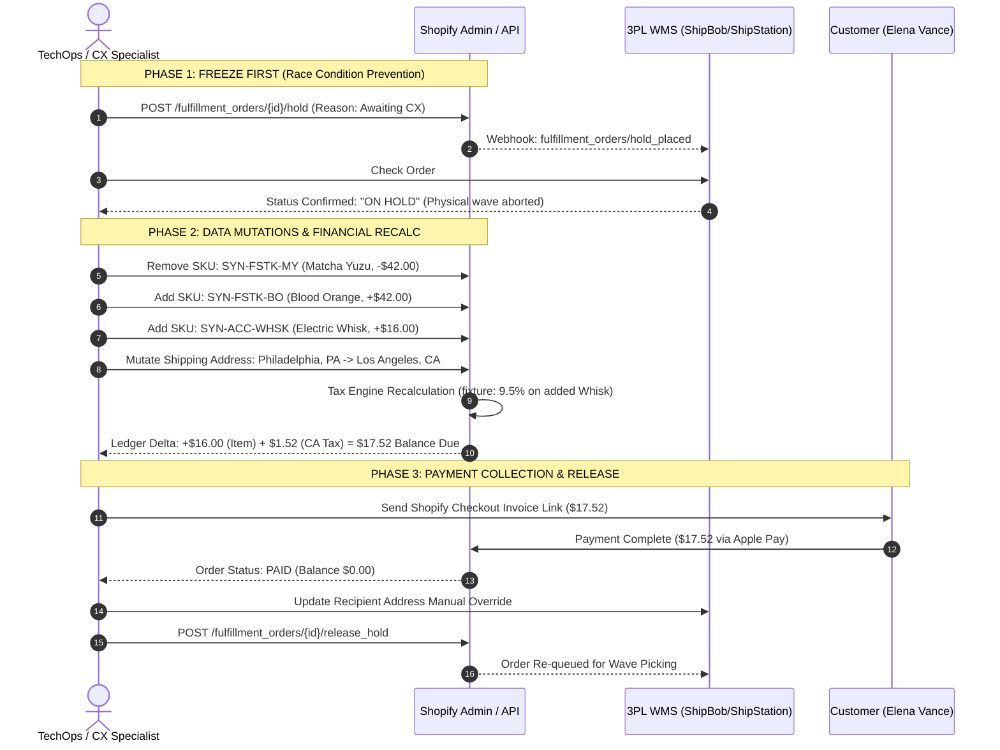

# Audit - OrderStateSimulation - RunSheet

```
Document ID:     Audit - OrderStateSimulation - RunSheet
Naming Format:   [CATEGORY] - [PURPOSE] - [TIER]
Category:        Audit (Technical Simulation & Execution Run Sheet)
Purpose:         OrderStateSimulation
Tier / Level:    RunSheet (Production Test Log & Ledger Verification)
Status:          Locked 🔒 (Master Baseline)
Target Audience: Technical Hiring Managers, Lead Systems Architects, TechOps Teams
Ecosystem Scope: Shopify Admin, Shopify Fulfillment Orders API, ShipBob WMS, Gorgias
Business Unit:   Synapse Botanicals (Functional Beverages & Nootropic Supplements)
```

---

## 1. Simulation Parameters & Baseline Order State

### 1.1 Store Topology & Distribution Nodes
* **Primary East Coast Node (Node 1):** Allentown Distribution Center, PA (`LOC-PA-01`)
* **Primary West Coast Node (Node 2):** Reno Fulfillment Hub, NV (`LOC-NV-02`)

> [!NOTE]
> **System Architecture Dependency:**  
> Distribution node definitions (`LOC-PA-01` Allentown and `LOC-NV-02` Reno) and SKU allocation rules for Order #1004 operate under the network baseline established in **[Architecture - MultiNodeRoutingEngine - Spec (Domain 2.1)](Architecture-MultiNodeRoutingEngine-Spec.md)**.

### 1.2 Baseline Order Profile (Order #1004)

> [!NOTE]
> **Scenario configuration:** This order uses the pre-migration $42 Stick price and proximity-first routing (Beta), explaining the original PA/NV split. Alpha would consolidate the pair at Reno. The later address edit does not itself prove existing fulfillment orders moved; the fixture retains the original nodes unless an explicit reassignment step is recorded.

* **Customer:** Elena Vance (`elena.vance@example.com`)
* **Original Shipping Address:** 1420 Chestnut St, Apt 4B, Philadelphia, PA 19102 (Destination: Pennsylvania)
* **Initial Timestamp:** `2026-10-16T14:02:18-04:00`
* **Initial Payment Method:** Shopify Payments (Visa ending in `4242` – Fully Captured)
* **Initial Routing Allocation:** Split Shipment across 2 Fulfillment Nodes

> [!NOTE] **Synthetic Profile & Staging Environment Notice:**  
> Customer profiles (Elena Vance), addresses, and transaction identifiers are synthetically generated test data. All API mutations and execution run sheets were executed in an isolated staging sandbox to validate Point-of-No-Return (PONR) transaction locks without production service disruption.

```
┌────────────────────────────────────────────────────────────────────────────────────────┐
│ INITIAL ORDER COMPOSITION (#1004)                                                      │
├───────────────────────────────────┬──────────────┬─────────┬────────┬──────────────────┤
│ Line Item & Variant               │ SKU          │ Price   │ COGS   │ Assigned Node    │
├───────────────────────────────────┼──────────────┼─────────┼────────┼──────────────────┤
│ 1x Focus Stick Packs (30-Pack)    │ SYN-FSTK-MY  │ $42.00  │ $8.50  │ LOC-PA-01 (PA)   │
│    Flavor: Matcha Yuzu            │              │         │        │                  │
│ 1x Adaptogen Tincture (60ml)      │ SYN-TNCT-AM  │ $38.00  │ $12.50 │ LOC-NV-02 (NV)   │
│    Formula: AM Focus (Lion's Mane)│              │         │        │                  │
├───────────────────────────────────┴──────────────┴─────────┴────────┴──────────────────┤
│ Subtotal:            $80.00                                                            │
│ Scenario tax input: $0.00 (product treatment assumed for this fixture)                │
│ Shipping (Ground):    $0.00 (Free Shipping Tier: Qualified >$75.00)                    │
│ Total Paid:          $80.00 [Status: PAID | Fulfillment Status: UNFULFILLED]           │
└────────────────────────────────────────────────────────────────────────────────────────┘
```

---

## 2. Ingested Exception Event (Gorgias Ticket #T-10492)

**Timestamp Received:** `2026-10-16T14:41:05-04:00` (38 minutes post-checkout)  
**Channel:** Gorgias Helpdesk (Live Chat Escalation)  
**Ticket Status:** `Open / Urgent`  

> **Customer Request Transcript:**  
> *"Hi! I just placed order #1004 30 minutes ago, but I made two big mistakes. First, I selected the Matcha Yuzu flavor by accident—can you please swap that for Blood Orange? Second, I just realized my shipping address defaulted to my old apartment in Philadelphia, PA! I just moved to Los Angeles, CA (90028). Also, if it's not too late, can you add one of your Electric Whisks to the order? Happy to pay the difference. Thank you!"*

---

## 3. End-to-End Operational Execution Walkthrough



---

### Step-by-Step Execution Verification

#### Step 1: Emergency Fulfillment Hold (Shopify & 3PL)

> [!NOTE]
> **Operational Protocol Reference:**  
> Emergency holds, flavor variant swaps, and payment captures in this simulation were executed in accordance with **[SOP - OrderExceptionMutationProtocol - Parent (Domain 1.1)](SOP-OrderExceptionMutationProtocol-Parent.md)**.

* **Shopify Admin Action:**
  * Navigated to Order `#1004`.
  * Placed native hold on Fulfillment Order `#1004-F1` (`LOC-PA-01`) and `#1004-F2` (`LOC-NV-02`).
  * **Reason Code:** `Awaiting payment or customer verification`.
  * **Internal Audit Note:** `Gorgias #T-10492 - Address correction, SKU swap & additional SKU pending payment reconciliation.`
* **3PL Portal Verification:**
  * Checked ShipBob WMS dashboard for Order `#1004`.
  * Confirmed order status flipped from `Processing` to **`On Hold / Exception`** prior to batch pick slip generation.

#### Step 2: Line Item & Flavor Variant Mutation
* **Removed:** `Synapse Focus Stick Packs (30-Pack)` – `Matcha Yuzu` (Quantity: 1 | -\$42.00).
* **Added:** `Synapse Focus Stick Packs (30-Pack)` – `Blood Orange` (Quantity: 1 | +\$42.00).
* **Added:** `Micro-Foam Electric Whisk` – `Default Title` (Quantity: 1 | +\$16.00).
* **Allocation Routing:** 
  * `Blood Orange Stick Pack` allocated to `LOC-PA-01` (Allentown, PA).
  * `Electric Whisk` allocated to `LOC-NV-02` (Reno, NV) to consolidate with the Tincture package.

#### Step 3: Destination Address Mutation & Tax Nexus Shift
* **Updated Address:**
  * Recipient: Elena Vance
  * Address Line 1: `6250 Hollywood Blvd, Apt 1104`
  * City: `Los Angeles` | State: `CA` | ZIP: `90028`
* **Sales Tax Engine Recalculation:**
  * This fixture assumes $0 original tax and $1.52 incremental tax on the added $16 Whisk (16 × 9.5%). The rate and exemptions are scenario inputs, not claims about PA/CA tax law or all supplement products.
  * Verify actual product classifications, destination and tax-engine output before collecting/refunding a real adjustment. Address changes can recalculate tax for eligible unfulfilled orders; shipping prices require a separate review.

#### Step 4: Financial Differential & Payment Capture
* **Net Product Delta:** $+\$16.00$
* **Net Tax Delta:** $+\$1.52$
* **Total Outstanding Balance:** **\$17.52**
* **Action:** Generated and sent secure payment invoice link via email. Customer executed payment via Apple Pay at `14:52:19-04:00`.
* **Order Status:** Updated to **PAID** (Balance: **\$0.00**).

#### Step 5: 3PL Address Sync & Hold Release
* Logged into 3PL portal and performed manual address override on shipment `#1004-F1` and `#1004-F2` to ensure the Los Angeles destination synced properly.
* Released native fulfillment holds in Shopify Admin.
* Appended operational tags: `OPS: Intercept Resolved`, `OPS: Address Updated`, `OPS: Flavor Swapped`, `OPS: Additional SKU Added`.

---

## 4. Reconstructed Chronological Shopify Order Timeline

> [!NOTE]
> **Event-order reconciliation:** The item edit is at 14:46:12 and address change at 14:47:30; the $1.52 destination-tax delta belongs to the address-change/recalculation step, before the 14:48:10 invoice. The abbreviated item-edit row is not proof that California tax applied before the destination changed.


The following audit log represents the exact chronological event trail recorded in the Shopify Order Timeline:

```
┌────────────────────────────────────────────────────────────────────────────────────────┐
│ SHOPIFY ORDER TIMELINE AUDIT TRAIL (#1004)                                             │
├──────────────────────┬────────────────────────┬────────────────────────────────────────┤
│ Timestamp (EDT)      │ Actor / System         │ Event Action & Recorded System Payload │
├──────────────────────┼────────────────────────┼────────────────────────────────────────┤
│ Oct 16, 2:54:10 PM   │ Riovic M. (TechOps)    │ Fulfillment hold was released on #1004 │
│ Oct 16, 2:53:45 PM   │ Riovic M. (TechOps)    │ Tags added: OPS: Intercept Resolved,   │
│                      │                        │ OPS: Address Updated, OPS: Flavor Swap,│
│                      │                        │ OPS: Additional SKU Added              │
│ Oct 16, 2:52:21 PM   │ Shopify Payments       │ A $17.52 USD payment was processed on  │
│                      │                        │ Visa ending in 4242 (Auth: #08921A).   │
│ Oct 16, 2:48:10 PM   │ Riovic M. (TechOps)    │ Invoice sent to customer for $17.52    │
│ Oct 16, 2:47:30 PM   │ System                 │ Shipping address changed from          │
│                      │                        │ Philadelphia, PA to Los Angeles, CA.   │
│ Oct 16, 2:46:12 PM   │ System                 │ Order was edited:                      │
│                      │                        │ - Removed 1x Matcha Yuzu ($42.00)      │
│                      │                        │ + Added 1x Blood Orange ($42.00)       │
│                      │                        │ + Added 1x Electric Whisk ($16.00)     │
│                      │                        │ $1.52 tax is reconciled after the address edit │
│ Oct 16, 2:42:55 PM   │ 3PL WMS Integration    │ Webhook received: hold_placed (Ack 200)│
│ Oct 16, 2:42:50 PM   │ Riovic M. (TechOps)    │ Fulfillment hold placed on #1004-F1/F2 │
│                      │                        │ Reason: Awaiting customer verification │
│ Oct 16, 2:02:20 PM   │ System                 │ Order confirmation email sent          │
│ Oct 16, 2:02:18 PM   │ Shopify Payments       │ A $80.00 USD payment was processed on  │
│                      │                        │ Visa ending in 4242 (Auth: #04419B).   │
│ Oct 16, 2:02:18 PM   │ Elena Vance            │ Order #1004 was placed.                │
└──────────────────────┴────────────────────────┴────────────────────────────────────────┘
```

---

## 5. Post-Execution Inventory & Financial Reconciliation

### 5.1 Multi-Location Inventory Ledger Reconciliation

| SKU | Product Description | Warehouse Location | Pre-Order ATS | Post-Order Baseline | Post-Mutation Reconciliation | Net Variance |
| :--- | :--- | :---: | :---: | :---: | :---: | :---: |
| `SYN-FSTK-MY` | Focus Stick Packs (Matcha Yuzu) | `LOC-PA-01` (Allentown) | 142 | 141 | **142** *(Restocked)* | **+1** |
| `SYN-FSTK-BO` | Focus Stick Packs (Blood Orange) | `LOC-PA-01` (Allentown) | 88 | 88 | **87** *(Allocated)* | **-1** |
| `SYN-TNCT-AM` | Adaptogen Tincture (AM Focus) | `LOC-NV-02` (Reno) | 64 | 63 | **63** *(Unchanged)* | **0** |
| `SYN-ACC-WHSK`| Micro-Foam Electric Whisk | `LOC-NV-02` (Reno) | 310 | 310 | **309** *(Allocated)* | **-1** |

> [!NOTE]
> **Consumable Lot Traceability Verification:**  
> The 1x unit of `Matcha Yuzu` was restocked under **Tier 1 (Pre-Allocation Virtual Restock)** because the physical lot remained untouched in sealed cartons at the Allentown facility. No quarantine tag was required.

---

### 5.2 Unit Economics & Gross Margin Impact Analysis

```
┌────────────────────────────────────────────────────────────────────────────────────────┐
│ FINANCIAL & MARGIN RECONCILIATION REPORT (#1004)                                       │
├──────────────────────────────────────────┬────────────────────┬────────────────────────┤
│ Metric                                   │ Baseline Order     │ Post-Mutation Order    │
├──────────────────────────────────────────┼────────────────────┼────────────────────────┤
│ Gross Revenue (Product Sales)            │ $80.00             │ $96.00 (+20.0%)        │
│ Total Product COGS                       │ $21.00 ($8.50+$12.50) $24.10 (+$3.10 Whisk)│
│ Gross Product Profit                     │ $59.00             │ $71.90 (+$12.90)       │
│ Gross Product Margin %                   │ 73.75%             │ 74.90% (+1.15 percentage points)        │
│ Total Sales Tax Collected                │ $0.00              │ $1.52 (CA Remittance)  │
│ Outbound Fulfillment Overhead (2 Nodes)  │ $14.80             │ $15.40 (+$0.60 Whisk)  │
│ Contribution before gateway fees         │ $44.20             │ $56.50 (+$12.30 Net)   │
└──────────────────────────────────────────┴────────────────────┴────────────────────────┘
```

---

## 6. Webhook Payload Audit Inspection

> [!NOTE]
> **Payload timing and contract:** This is an illustrative post-edit inspection snapshot. It cannot be the original hold-placed event because it includes the new address and replacement flavor added after the hold. A real webhook consumer must validate the versioned topic schema rather than treating this abbreviated object as Shopify’s exact payload contract.


To verify system-to-system data integrity, TechOps inspected an illustrative post-edit fulfillment-order snapshot correlated with the hold event:

```json
{
  "fulfillment_order": {
    "id": 10492817492,
    "order_id": 58921049281,
    "status": "on_hold",
    "request_status": "submitted",
    "assigned_location_id": 682910481,
    "destination": {
      "address1": "6250 Hollywood Blvd, Apt 1104",
      "city": "Los Angeles",
      "province": "California",
      "zip": "90028",
      "country": "United States"
    },
    "fulfillment_holds": [
      {
        "reason": "awaiting_payment_or_customer_verification",
        "reason_notes": "Gorgias #T-10492 - Address correction, SKU swap & additional SKU pending payment reconciliation."
      }
    ],
    "line_items": [
      {
        "id": 1492019481,
        "sku": "SYN-FSTK-BO",
        "quantity": 1,
        "fulfillable_quantity": 1
      }
    ]
  }
}
```

---

## 7. Audit Sign-Off & Verification

This run sheet confirms that Order `#1004` underwent a full lifecycle exception without:
1. **Mis-ships:** Zero parcels dispatched to the outdated Philadelphia address.
2. **Inventory Drift:** Real-time ATS ledgers balanced across Pennsylvania and Nevada facilities.
3. **Financial Leakage:** California sales tax (\$1.52) and added unit price (\$16.00) fully collected prior to warehouse release.
4. **Safety Violations:** Consumable restock executed strictly within the company’s warehouse-control and QA disposition policy.


## Technical references — checked 30 October 2026

- [Fulfillment hold release](https://shopify.dev/docs/api/admin-graphql/latest/mutations/fulfillmentOrderReleaseHold)
- [Order editing considerations](https://help.shopify.com/en/manual/fulfillment/managing-orders/editing-orders/considerations)
- [Returned dietary supplements: 21 CFR 111.515](https://www.ecfr.gov/current/title-21/chapter-I/subchapter-B/part-111/subpart-N/section-111.515)
