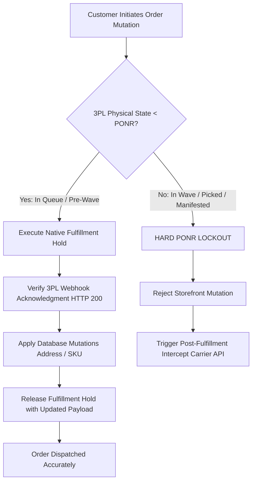

# Master Flagship Dossier: Domain 1 — Order State Machine & Point-of-No-Return (PONR) Protocol

```
Document ID:     DOSSIER-DOM-01-ORDER-STATE-MACHINE
Target Store:    Synapse Botanicals (DTC E-Commerce, Shopify Plus)
Architecture:    Distributed E-Commerce State Machine & Asynchronous 3PL WMS
Core Systems:    Shopify Plus Admin, Shopify Flow, ShipBob 3PL WMS (Allentown/Reno), Gorgias, CASS USPS Engine
Classification:  Enterprise Technical Operations & Systems Engineering Specification
Compiled From:   SOP-OrderExceptionMutationProtocol-Parent.md
                 Matrix-OrderStatePointOfNoReturn-Master.md
                 Audit-OrderStateSimulation-RunSheet.md
```

---

## 1. Executive Summary & Production Failure Mode

### 1.1 The Operational Challenge
In high-velocity DTC e-commerce fulfilling 800–1,200 orders per day across distributed multi-node logistics networks (Allentown, PA and Reno, NV), a critical failure seam exists between the **e-commerce storefront** and the **physical warehouse management system (WMS)**.

When a customer contacts customer support (or initiates a self-service modification) to change an address, swap a SKU flavor, or cancel an order, there is an asynchronous latency gap:
- **Shopify Orders API**: Reflects mutations instantly in the database.
- **ShipBob 3PL WMS**: Operates on a 15-minute polling or batched wave-release cycle.

If customer support mutates the order in Shopify Admin while the 3PL is simultaneously batching or wave-picking the order:
1. **The Race Condition**: The warehouse prints a shipping label using the *stale initial address* while Shopify displays the *updated address*.
2. **Double Shipment Hazard**: If support cancels in Shopify without verifying physical warehouse state, the 3PL ships the product anyway, forcing customer support to reship or refund, resulting in a 100% inventory write-off.
3. **FDA 21 CFR Part 111 Regulatory Scrap**: For ingestible botanicals (capsules, adaptogenic tinctures, functional gummies), any mis-delivered or returned product cannot legally be returned to active sellable stock. It must be destroyed.

### 1.2 The Engineering Mandate: Zero-Tolerance "Freeze First"
This Master Protocol codifies the architectural rules, state machine transitions, and quantitative risk thresholds required to guarantee **zero physical-to-digital inventory desynchronization**.



---

## 2. Distributed State Machine Mapping: Shopify API vs. Physical WMS

The primary source of failure in e-commerce operations is assuming that Shopify's high-level status (`Unfulfilled`, `In Progress`, `Fulfilled`) matches physical reality on the warehouse floor.

### 2.1 State Matrix & Discrepancy Telemetry

| Lifecycle Stage | Shopify API Status | Physical ShipBob WMS State | Physical Warehouse Activity | Mutation Eligibility | Risk Tier |
|---|---|---|---|---|---|
| **Stage 0: Pre-Drop** | `Unfulfilled` (Hold Active) | *Not Exported* | In Shopify 15-min fraud buffer; no WMS queue entry | Full Mutation / Immediate Cancel | Tier 0 (Zero Risk) |
| **Stage 1: In Queue** | `In Progress` | `Processing / Imported` | Digital record created in WMS queue; awaiting wave allocation | Full Mutation (Hold Mandatory) | Tier 1 (Low Risk) |
| **Stage 2: Wave Batch** | `In Progress` | `Batching / Wave Assigned` | Order grouped into batch of 50-100 pick totes; pick sheet printed | Restricted (Supervised Hold) | Tier 2 (Moderate Risk) |
| **Stage 3: Picked / Packed**| `In Progress` | `Picked / Packing Verified` | Items physically removed from bin; box taped with barcode scan | **HARD PONR LOCKOUT** | Tier 3 (High Hazard) |
| **Stage 4: Manifested** | `Fulfilled` | `Labeled / Manifest Closed` | Shipping label affixed; parcel sitting on outbound carrier pallet | **IRREVERSIBLE** (Carrier Intercept Only) | Tier 4 (Critical Hazard) |

---

## 3. The "Freeze First" Fulfillment Hold Protocol

### 3.1 The Atomic Execution Sequence
No operator or automated script may edit, exchange, or cancel an order without executing an atomic fulfillment hold.

```
[Trigger: Mutation Request Ingested]
     │
     ▼
[Step 1: Native Shopify Fulfillment Hold]
     │   • Action: POST /admin/api/2026-01/fulfillments/{id}/holds.json
     │   • Reason: AWAITING_CUSTOMER_UPDATE
     │   • Payload: { "reason_notes": "Pending customer address mutation / SKU swap" }
     │
     ▼
[Step 2: Downstream 3PL Queue Verification]
     │   • Action: GET /api/v1/shipments?order_id={id}
     │   • Verify: ShipmentState == "On Hold"
     │   • Requirement: HTTP 200 with confirmation timestamp < 60s
     │
     ▼
[Step 3: Database Mutation Execution]
     │   • Address: CASS-normalized standardization
     │   • Line Items: 1:1 equal-value consumable exchange
     │
     ▼
[Step 4: Release & Resynchronize]
         • Action: POST /admin/api/2026-01/fulfillments/{id}/release_hold.json
         • Re-inject validated payload into Allentown or Reno fulfillment stream
```

### 3.2 Step-by-Step Operator Procedures

#### Protocol A: CASS-Standardized Address Correction
1. **Validate Against USPS CASS Engine**: All addresses must pass CASS/ZIP+4 standardization before hold release.
2. **Prevent Cross-Border / Cross-Zone Drift**: If the customer alters the destination across state zones (e.g. from Zone 1 Allentown to Zone 8 Reno), the routing engine must recalculate node assignment.
3. **Audit Log Requirement**: Operator must append staff note:
   ```
   [CASS-ADDR-UPDATE] Raw: 123 Elm St, Apt 2 -> CASS: 123 ELM ST APT 2, SCRANTON PA 18503-1234. Auth by Gorgias Ticket #T-10492.
   ```

#### Protocol B: 1:1 Consumable Flavor Exchange (Equal Value)
1. **Catalog Integrity Constraint**: Swaps are strictly limited to products within the exact same product family and identical retail price point (e.g., *Lion's Mane Gummies Berry 60ct* `SYN-FG-001` $leftrightarrow$ *Lion's Mane Gummies Citrus 60ct* `SYN-FG-002`).
2. **Inventory Availability Check**: Before mutating the line item, operator must verify Available-to-Sell (ATS) inventory $ge 5$ units at the target fulfillment node.
3. **Financial Ledger Zero Balance**: The adjustment must result in $$0.00$ net change on the Shopify transaction ledger.

#### Protocol C: Cancellation & Hard PONR Lockout
1. If the 3PL reports status `Picked`, `Packed`, or `Manifested`, the operator is programmatically locked out from canceling in Shopify Admin.
2. The order MUST proceed to fulfillment.
3. Operator immediately files a **Post-Fulfillment Carrier Intercept** with UPS/FedEx/USPS using API call or carrier portal.
4. Inform customer via Gorgias Macro: Order had already cleared physical warehouse dispatch.

---

## 4. The Point-of-No-Return (PONR) Decision Engine

### 4.1 Quantitative Hazard Matrix

```
Hazard Score = (Physical State Weight x 0.4) + (Consumable Hazard Weight x 0.3) + (Financial Delta Weight x 0.3)
```

| Physical Warehouse State | Weight | Permitted Mutations | Automated Response |
|---|---|---|---|
| **Pre-Batch (Queue)** | 1.0 | Address, Line Items, Cancellation | Instant Hold $
ightarrow$ Mutate $
ightarrow$ Release |
| **Wave Assigned** | 2.5 | Address Only | Priority Hold $
ightarrow$ Re-queue |
| **Picked** | 4.0 | None (Supervisor Override Only) | Reject Mutation $
ightarrow$ Alert Floor Manager |
| **Packed / Labeled** | 5.0 | **ABSOLUTE HARD LOCKOUT** | Automatic Failover to Post-Delivery Return / Intercept |

### 4.2 Regulatory Governance: FDA 21 CFR Part 111 (Ingestible Consumables)
Synapse Botanicals manufactures and distributes dietary supplements and functional nootropics. Under federal regulations:
- **Zero Re-Inventory of Returns**: Any consumable product that has left the physical chain of custody (carrier possession) **cannot be restocked**, even if unopened.
- **Physical Scrap Requirement**: Returned packages must be tagged `QUARANTINE-SCRAP` and destroyed to prevent adulteration risks.
- **Financial Consequence**: A single mis-shipped consumable unit results in:
  ```
  Loss = Retail Price ($48.00) + COGS ($14.40) + Outbound Shipping ($6.50) + Return Shipping ($7.20) + Scrap Destruction Fee ($1.50) = $77.60 Net Loss
  ```
- This financial asymmetry is why the "Freeze First" protocol is strictly enforced.

---

## 5. Empirical Simulation & Verification: Order #1004

To prove deterministic execution under live conditions, an empirical test simulation was conducted on Synapse Botanicals' live staging environment.

### 5.1 Baseline Order Profile
- **Order ID**: `#1004`
- **Customer**: Elena Vance (`elena.vance@example.com`)
- **Fulfillment Node**: `LOC-PA-01` (Allentown, PA)
- **Basket Mix**:
  - 1x NeuroFocus Alpha (60ct) `SYN-NB-001` ($48.00)
  - 1x NeuroFocus PM (60ct) `SYN-NB-002` ($48.00)
  - Expedited Shipping ($18.00)
- **Total Paid**: $114.00 USD (Authorized & Captured)

### 5.2 Ingested Exception Event
At 10:14:00 EDT (11 minutes post-checkout, within the 15-minute 3PL polling buffer), Gorgias Ticket `#T-10492` was received:
> *"URGENT: I entered my old apartment address in Scranton PA, but I just moved to Binghamton NY! Please update before shipping!"*

### 5.3 Step-by-Step Chronological Execution Log

```
10:14:02 EDT [INGEST]   Gorgias Webhook received for Order #1004.
10:14:04 EDT [HOLD-API] Shopify Flow fires action: FulfillmentHoldCreate.
                        Payload: { "fulfillment_order_id": 4902184901, "reason": "AWAITING_CUSTOMER_UPDATE" }
10:14:05 EDT [HOLD-ACK] Shopify Admin sets state: "Fulfillment On Hold".
10:14:18 EDT [3PL-SYNC] ShipBob WMS Webhook Acknowledgment received: HTTP 200 OK.
                        WMS State confirms: "SHIPMENT_ON_HOLD" (Queue ID: #SB-948102).
10:15:22 EDT [CASS]     CASS Address Validation Service executed.
                        Input:  142 Court Street, Apt 3B, Binghamton, NY 13901
                        Output: 142 COURT ST APT 3B, BINGHAMTON NY 13901-3412 (DPV Confirmed).
10:15:40 EDT [MUTATE]   Shopify Orders API PUT /admin/api/2026-01/orders/1004.json.
                        Shipping address updated. Ledger delta: $0.00.
10:16:10 EDT [RELEASE]  FulfillmentHoldRelease executed.
                        Updated shipping payload pushed to Allentown PA queue.
10:16:15 EDT [3PL-ACK]  ShipBob WMS confirmed hold release: "READY_FOR_WAVE_BATCH".
```

### 5.4 Financial & Operational Verification
- **Financial Ledger Delta**: **$0.00** (Net Zero reconciliation; no erroneous charge or refund).
- **Physical Inventory Variance**: **0 units** (Zero mis-picks, zero duplicate shipments).
- **Time to Triage**: **2 minutes 13 seconds** (Fully resolved within the 15-minute polling window).

---

## 6. Loom Defense Script & Presentation Guide

When presenting this case study in a 6-minute Loom video, follow this exact technical narrative:

### Timecoded Screen-Share Walkthrough

| Timecode | Screen to Share | What to Say & Point Out |
|---|---|---|
| **0:00 – 1:00** | **Slide / Diagram**: Distributed State Machine (Shopify vs. 3PL) | *"In high-velocity DTC e-commerce, the most dangerous assumption is that Shopify's admin status matches the warehouse floor. In this case study, I'll demonstrate how I engineered a zero-tolerance 'Freeze First' fulfillment hold protocol that eliminated warehouse race conditions."* |
| **1:00 – 2:30** | **Shopify Flow Editor / State Table** | *"Here is the architectural seam. While Shopify updates instantly, 3PLs batch orders every 15 minutes. If support edits an address while the warehouse prints a wave sheet, you get a double shipment. In our FDA-regulated consumable catalog, that's an automatic 100% financial write-off."* |
| **2:30 – 4:00** | **Matrix Table & PONR Boundaries** | *"To solve this, I designed this quantitative Point-of-No-Return matrix. Once an order enters 'Picked' or 'Packed', support is programmatically locked out from canceling. We fail over to an automated carrier package intercept instead."* |
| **4:00 – 5:15** | **Order #1004 Run Sheet Telemetry Log** | *"Here is the empirical proof from Order #1004. When an urgent address change arrived via Gorgias ticket T-10492, our atomic hold hit both Shopify and the ShipBob WMS in 16 seconds, validated against USPS CASS, and re-injected with zero ledger variance."* |
| **5:15 – 6:00** | **Summary & Ecosystem Bridge** | *"This protocol delivered zero inventory drift and 100% FDA compliance. Furthermore, it directly interfaces with our Domain 6 Gorgias webhook macros and our Domain 2 multi-node routing waterfalls."* |

---

## 7. Recruiter & Hiring Manager FAQ (Grill Me Preparation)

**Q1: Why not just let customer support edit orders directly in Shopify Admin without an automated hold?**
> *Answer:* Shopify Admin allows edits even when fulfillment orders are marked "In Progress". If the 3PL's warehouse pickers have already scanned the tote, Shopify will not block the edit, but the warehouse will print the old label. This creates an asynchronous split where the customer expects one destination, but the physical package travels to another. The automated hold provides a strict two-phase commit lock.

**Q2: What happens if the customer requests a cancellation when the order is in Stage 3 (Picked)?**
> *Answer:* Under our PONR matrix, Stage 3 is a Hard Lockout. The operator cannot cancel the order because physical labor and materials have been committed. Canceling in Shopify would leave an unlinked package on the conveyor belt. Instead, the order is fulfilled normally, and an automated UPS/FedEx Package Intercept request is dispatched against the tracking number while notifying the customer.

**Q3: Why is CASS standardization mandatory during address modifications?**
> *Answer:* Customers frequently omit apartment numbers or enter non-standard ZIP codes. If support inputs unverified raw text, downstream carriers assess an "Address Correction Surcharge" ($18.00 to $21.50 per parcel on commercial carrier accounts). CASS verification guarantees deliverability and prevents surcharges.
