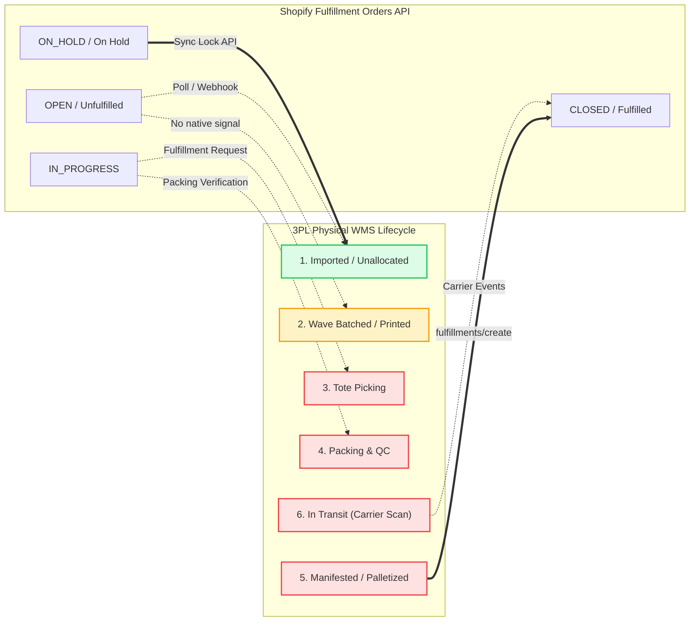
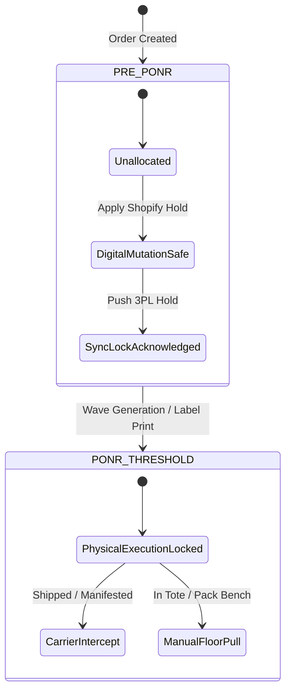
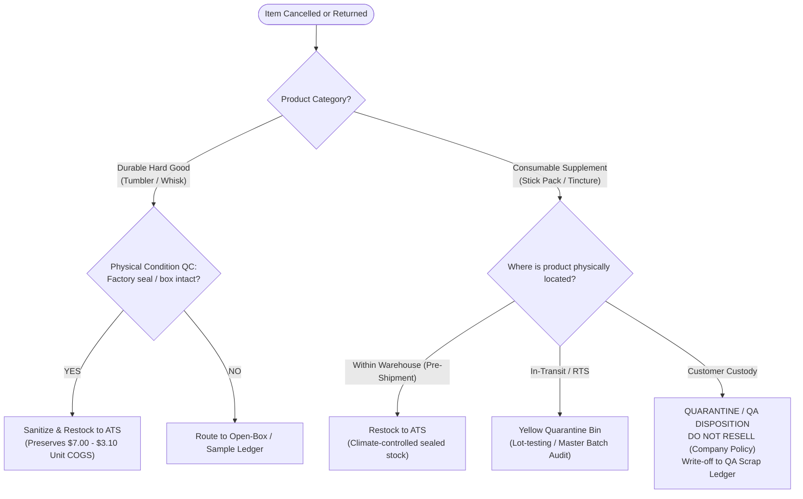

# Matrix - OrderStatePointOfNoReturn - Master

```
Document ID:     Matrix - OrderStatePointOfNoReturn - Master
Naming Format:   [CATEGORY] - [PURPOSE] - [TIER]
Category:        Matrix (Decision Matrix & Risk Governance Framework)
Purpose:         OrderStatePointOfNoReturn
Tier / Level:    Master (Technical Evaluation & Triage Architecture)
Status:          Locked 🔒 (Master Baseline)
Target Audience: TechOps Engineers, Operations Leads, CX Escalation Specialists
Ecosystem Scope: Shopify Fulfillment Orders API, 3PL WMS (ShipStation / ShipBob / Extensiv), Gorgias
Business Unit:   Synapse Botanicals (Functional Beverages & Consumables)
```

---

## 1. Executive Summary & Distributed Architecture Overview

In distributed e-commerce ecosystems, order mutations (address changes, SKU swaps, line cancellations) fail primarily because **Shopify's order status does not reflect the physical state of the warehouse floor**. 

This document serves as the **authoritative risk governance framework** for Synapse Botanicals. It establishes:
1. **The Dual-State Engine:** Bi-directional state mapping between Shopify's native Fulfillment Orders API and 3PL Warehouse Management Systems (WMS).
2. **The Point of No Return (PONR):** Concrete physical thresholds where digital order mutation is blocked and must transition to physical/carrier intercept protocols.
3. **Consumable Regulatory Governance:** Strict lot-quarantine standards under FDA 21 CFR Part 111 preventing biological contamination of active inventory.
4. **Financial & Tax Ledger Matrix:** Financial recalculation rules governing multi-state tax shifts and gateway authorization limits.

---

## 2. Distributed State Mapping: Shopify API vs. 3PL Physical Lifecycle



### 2.1 State Matrix & System Discrepancy Analysis

> [!NOTE]
> **System Architecture Dependency:**  
> Initial fulfillment location assignment (`LOC-PA-01` vs `LOC-NV-02`) prior to 3PL ingestion is dynamically determined by the Shopify Order Routing Engine. See **[Architecture - MultiNodeRoutingEngine - Spec (Domain 2.1)](Architecture-MultiNodeRoutingEngine-Spec.md)**.

| Physical Warehouse Phase (3PL WMS) | Shopify Admin UI Status | Shopify Backend API Status | 3PL Sync Lock Feasible? | Permitted Order Mutations |
| :--- | :--- | :--- | :---: | :--- |
| **Phase 1: Imported / Unallocated** | `Unfulfilled` | `OPEN` | **YES** | • Full Cancellation<br>• Address Mutation<br>• SKU / Variant Swap<br>• Quantity Adjustment |
| **Phase 2: Wave Batched / Label Generated** | `Unfulfilled` | `OPEN` | **CONDITIONAL**<br>*(Manual Floor Pull)* | • Address Override (WMS only)<br>• Line Removal (Requires re-wave)<br>*(Digital Shopify edits locked)* |
| **Phase 3: Tote Picking / In Progress** | `Unfulfilled` | `OPEN` or `IN_PROGRESS` | **NO** | **POINT OF NO RETURN REACHED**<br>• All mutations prohibited in Shopify.<br>• Requires manual floor abort. |
| **Phase 4: Packing, Sealing & QC Scan** | `Unfulfilled` | `IN_PROGRESS` | **NO** | **POINT OF NO RETURN REACHED**<br>• Box physically sealed; label applied.<br>• Digital abort rejected. |
| **Phase 5: Manifested / Pallet Staged** | `Fulfilled` *(Upon scan)* | `CLOSED` | **NO** | • In-transit carrier intercept only. |
| **Phase 6: In-Transit (Carrier Custody)** | `Fulfilled` | `CLOSED` | **NO** | • Carrier Delivery Intercept (RTS). |

---

## 3. The Point-of-No-Return (PONR) Decision Engine

> [!NOTE]
> **Operational cutoff:** For this portfolio, wave assignment or label generation is the standard no-self-service-edit cutoff. Picking/packing are later stages. An authorized floor pull can be an exception only after the warehouse confirms the parcel was stopped and stale labels/allocation were voided. These are business controls, not universal Shopify API status locks.


The **Point of No Return (PONR)** is triggered the exact millisecond a warehouse operator batches an order into a physical pick wave or generates a shipping label. 

Attempting to mutate an order post-PONR in Shopify Admin creates a **silent desynchronization failure**: Shopify displays the updated information, but the warehouse worker picks and ships the original items to the original address.



### 3.1 Failure Mode & Financial Hazard Analysis

| Warehouse State at Mutation Attempt | Failure Mechanism / Technical Trap | Downstream Operational Impact | Hard Financial Cost per Incident (Real Catalog COGS) |
| :--- | :--- | :--- | :--- |
| **Attempting address edit during Phase 2 (Batched)** | Shopify updates database, but 3PL label generation engine has already rendered the carrier 2D barcode with the old address. | Package delivered to wrong address; customer files chargeback / negative review. | **\$81.90**<br>*(Daily Protocol Bundle: COGS \$24.50 + Shipping \$10.45 + Replacement COGS \$24.50 + Re-ship \$10.45 + CX time \$12.00)* |
| **Attempting flavor swap during Phase 3 (Picking)** | Picker pulls original flavor (`Matcha Yuzu`) from bin; order is sealed before Shopify's webhook update registers. | Customer receives incorrect product; retains wrong consumable; demands reshipment. | **$19.45 incremental replacement outlay**<br>*(Replacement COGS $8.50 + replacement label/handling $10.95; original-order costs belong in the baseline, not a retail-price write-off)* |
| **Attempting cancellation during Phase 4 (Packing)** | Customer refund is issued in Shopify; package is loaded onto carrier trailer anyway. | Total loss of inventory; customer receives full refund + free product. | **$54.00 gross cash-outflow components**<br>*(Refund $42.00 + COGS $8.50 + handling $3.50. Net profitability must also include the original $42 receipt; do not count retail price as inventory COGS.)* |

---

## 4. Consumable Safety & Regulatory Governance (FDA 21 CFR Part 111)

Synapse Botanicals operates a hybrid product catalog:
1. **Consumables (Dietary Supplements / Ingestibles):** `Focus Stick Packs (30-Pack)` and `Adaptogen Tinctures (60ml)`.
2. **Durable Accessories (Hard Goods):** `Precision Insulated Tumbler (500ml)` and `Micro-Foam Electric Whisk`.

Because products belong to distinct regulatory classes, **inventory restock logic cannot follow a single generic rule**.

### 4.1 Consumable vs. Durable Disposition Matrix



### 4.2 Regulatory Disposition Classification

> [!NOTE]
> **Policy versus regulation:** The no-resale policy is intentionally strict. 21 CFR 111.515 provides destruction/disposal unless quality-control disposition approves salvage for redistribution or reprocessing. It does not impose a universal third-party-laboratory or cleanroom requirement for every return. Establish product classification before applying the supplement rule.


> [!NOTE]
> **Inventory Feedback Loop:**  
> When units are returned to sellable stock under Tier 1, they immediately restore Available-to-Sell (ATS) levels within the formula defined in **[Architecture - MultiNodeRoutingEngine - Spec (Domain 2.1)](Architecture-MultiNodeRoutingEngine-Spec.md)**, instantly restoring candidate eligibility for that warehouse node.

| Product Line | Physical Custody State | Permissible Shopify Action | Target Inventory Ledger | Regulatory Mandate |
| :--- | :--- | :--- | :--- | :--- |
| **Focus Stick Packs / Adaptogen Tinctures** | Unfulfilled / Pre-Allocation (Warehouse) | Check **`Restock inventory`** | Active `Available-to-Sell` (ATS) | Release the reservation after physical stock and lot/condition checks; warehouse control alone does not certify regulatory compliance. |
| **Focus Stick Packs / Adaptogen Tinctures** | In-Transit Carrier Intercept (RTS) | **DO NOT RESTOCK** upon return scan | `Quarantine - Inspection` | Physical tamper audit + lot number verification against Batch Record. |
| **Focus Stick Packs / Adaptogen Tinctures** | Customer Custody / Delivered | **UNCHECK `Restock inventory`** | `Scrap - Bio-Quarantine Write-Off` | Quarantine and documented quality-control disposition; the company policy prohibits resale of customer-returned consumables. |
| **Precision Insulated Tumbler / Electric Whisk** | Customer Return / Intercept | Check **`Restock inventory`** (Post-QC) | Active `Available-to-Sell` (ATS) | Non-ingestible. Wipe down, inspect exterior finish, re-inventory. |

---

## 5. Financial & Tax Ledger Mutation Matrix

> [!NOTE]
> **Tax fixture:** The state tax percentages below illustrate ledger mechanics, not a jurisdiction-wide rate or product exemption. Classification, destination, effective date and merchant obligations determine tax. The order audit uses a separate $1.52 whisk-tax fixture; its rate should not be treated as the same scenario as the 9.25% example here.


Order adjustments directly alter the transaction ledger, tax obligations, and payment gateway authorizations.

```
┌────────────────────────────────────────────────────────────────────────┐
│                      FINANCIAL RECONCILIATION ENGINE                   │
├───────────────────────────────────┬────────────────────────────────────┤
│           SCENARIO A              │             SCENARIO B             │
│        EQUAL VALUE SWAP           │          NET BALANCE DUE           │
│  Matcha Yuzu ➔ Blood Orange       │   Stick Pack ➔ Starter Bundle      │
│  Original: $42.00  New: $42.00    │   Original: $42.00  New: $82.00    │
│  COGS: $8.50 ➔ $8.50              │   Net Balance Due: +$40.00         │
│  Action: Instant Update ($0 Delta)│   Action: Lock Hold & Send Invoice │
├───────────────────────────────────┼────────────────────────────────────┤
│           SCENARIO C              │             SCENARIO D             │
│        NET REFUND DUE             │        MULTI-STATE TAX SHIFT       │
│   Starter Bundle ➔ Tincture       │     PA Shipping ➔ CA Shipping      │
│   Original: $82.00  New: $38.00   │     Stick Pack ($42.00):           │
│   Net Refund Due: -$44.00         │     PA Tax (0%) ➔ CA Tax (9.25%)   │
│   Action: Gateway Partial Refund  │     Tax Delta: +$3.89              │
└───────────────────────────────────┴────────────────────────────────────┘
```

### 5.1 Financial Delta & Gateway Rules

| Condition | Ledger Impact | Gateway Action Required | Fulfillment Lock Rule |
| :--- | :--- | :--- | :--- |
| **Net Zero Delta**<br>*(Equal price variant swap)* | Subtotal remains identical. Tax unchanged. | None. Order timeline records item mutation. | Hold can be released immediately upon 3PL confirmation. |
| **Net Positive Delta**<br>*(Item added or upgraded)* | Customer balance increases. Additional sales tax calculated based on destination. | Generate Shopify checkout invoice link. | **LOCK MANDATORY:** Hold remains active until invoice status displays `PAID`. |
| **Net Negative Delta**<br>*(Item removed or downgraded)* | Line item subtotal decreases. Tax recalculated. | Issue automated partial refund via original payment method (Shopify Payments / PayPal). | Hold can be released once gateway confirmation displays `Authorized / Refund Captured`. |
| **Inter-State Tax Shift**<br>*(Address updated across state lines)* | Sales tax recalculation triggered. (e.g., Shipping from PA to CA triggers district tax). | If customer owes additional tax, send micro-invoice or absorb via TechOps courtesy credit. | Address must match tax nexus table prior to release. |

### 5.2 Payment Gateway Reconciliation

Reconcile original tender allocations and gateway capabilities before refunding. A gift-card-first rule may be company policy; it is not a universal platform refund hierarchy. Void an uncaptured authorization when supported; refund captured funds. Authorization is not confirmation that a refund settled. Preserve refund transaction IDs and remaining balances.

## 6. High-Speed Operational Triage Protocol (30-Second Triage)

When a customer exception ticket arrives in Gorgias, Tier 2 CX and TechOps specialists must execute this 3-step triage loop within 30 seconds:

```mermaid
flowchart TD
    Start([Ticket Ingest: "Modify Order #1004"]) --> Step1["Step 1: Check Shopify Fulfillment Status"]
    
    Step1 --> S_Check{"Is order Unfulfilled?"}
    S_Check -- NO: Fulfilled --> Deny["TERMINATE: Inform customer parcel is dispatched.<br/>Offer return/exchange portal link."]
    S_Check -- YES: Unfulfilled --> Step2["Step 2: Place Instant Fulfillment Hold in Shopify"]
    
    Step2 --> Step3["Step 3: Open WMS (ShipStation / ShipBob)"]
    Step3 --> W_Check{"Is WMS Status 'Imported / Unallocated'?"}
    
    W_Check -- YES --> ExecuteSafe["EXECUTE MUTATION PROTOCOL (SOP-OPS-001)<br/>1. Edit data in Shopify<br/>2. Reconcile ledger<br/>3. Manual override in WMS<br/>4. Release Hold"]
    
    W_Check -- NO: Picked or Packed --> LockPONR["TRIGGER PONR ESCALATION<br/>1. Reject digital edit<br/>2. Slotted for Carrier RTS upon scan<br/>3. Advise customer of locked dispatch"]
```

---

## 7. Audit Compliance & Discrepancy Reconciliation

TechOps conducts weekly reconciliations between Shopify mutation events and 3PL billing logs to identify systemic race conditions:

### 7.1 Key Audit Metrics (Weekly SLA)
* **Pre-Sync Hold Rate:** $100\%$ of modified orders must show a `Fulfillment hold placed` timestamp preceding any `Order edited` event in the Shopify Timeline.
* **Carrier Intercept Success Rate:** $>85\%$ of Tier 3 intercept requests successfully returned to sender without delivery attempt.
* **Consumable Re-entry Compliance:** $0\%$ of customer returns routed back to Available-to-Sell (ATS) inventory. Any violation results in an immediate internal CAPA (Corrective and Preventive Action) audit.


## Technical references — checked 30 October 2026

- [Returned dietary supplements: 21 CFR 111.515](https://www.ecfr.gov/current/title-21/chapter-I/subchapter-B/part-111/subpart-N/section-111.515)
- [Order editing considerations](https://help.shopify.com/en/manual/fulfillment/managing-orders/editing-orders/considerations)
- [Fulfillment hold release](https://shopify.dev/docs/api/admin-graphql/latest/mutations/fulfillmentOrderReleaseHold)
