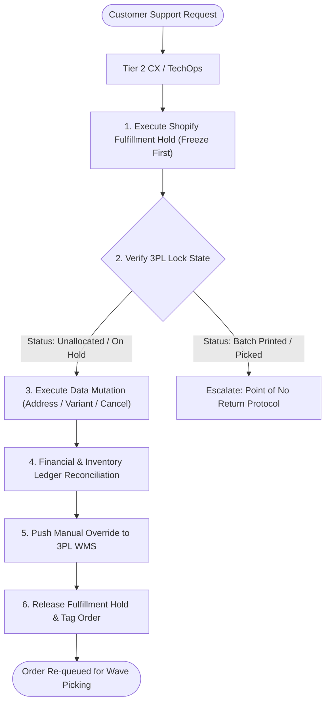
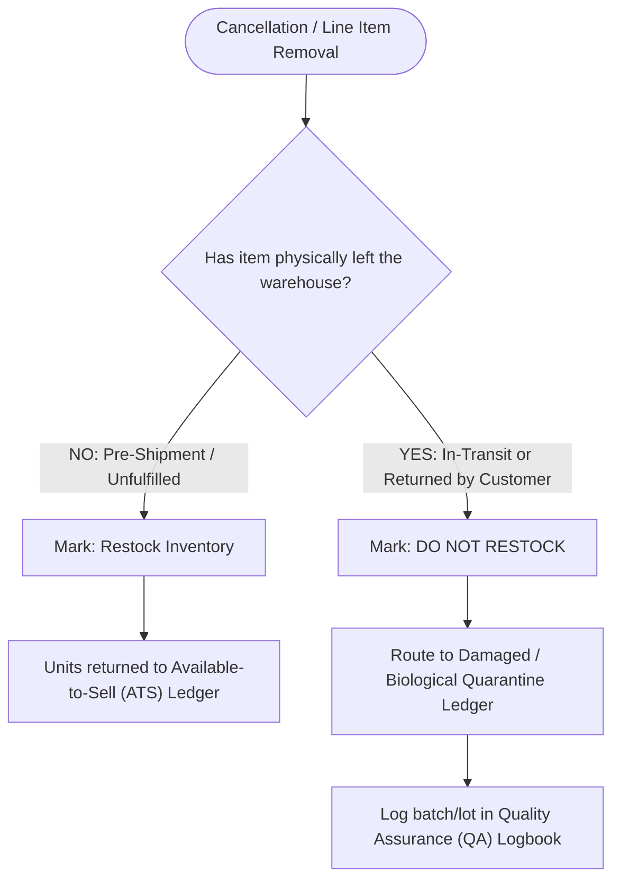

# SOP - OrderExceptionMutationProtocol - Parent

```
Document ID:     SOP - OrderExceptionMutationProtocol - Parent
Naming Format:   [CATEGORY] - [PURPOSE] - [TIER]
Category:        SOP (Standard Operating Procedure)
Purpose:         OrderExceptionMutationProtocol
Tier / Level:    Parent (Master Specification)
Status:          Locked 🔒 (Master Baseline)
Target Audience: Tier 2 Customer Experience (CX), Fulfillment Coordinators, Warehouse Operations
Ecosystem Scope: Shopify Admin, Shopify Fulfillment Orders API, 3PL WMS (ShipBob WMS), Gorgias
Business Unit:   Synapse Botanicals (Functional Beverages & Nootropic Supplements)
```

---

## 1. Purpose, Scope & System Governance

### 1.1 Purpose
This Standard Operating Procedure (SOP) defines the mandatory, step-by-step protocol for intercepting, modifying, and canceling active customer orders across the Synapse Botanicals e-commerce ecosystem. Adherence to this protocol prevents:
* **Downstream Mis-Ships:** Orders shipping to outdated addresses due to 3PL webhook caching.
* **Inventory Drift:** Inaccurate Available-to-Sell (ATS) counts across multi-node distribution centers (Allentown, PA and Reno, NV).
* **Financial Ledger Leakage:** Uncollected balance deltas and improper tax recalculation.
* **Health & Safety Non-Compliance:** Unsanitary re-entry of consumable botanical products into active inventory ledgers.

### 1.2 System Architecture & Scope
This procedure applies to all domestic direct-to-consumer (DTC) orders placed via Shopify and fulfilled via distributed third-party logistics (3PL) nodes.

> [!NOTE]
> **System Architecture Dependency:**  
> Multi-node inventory topology, SKU exclusivity rules (e.g., Adaptogen Tinctures exclusive to Reno, NV), and automated fulfillment routing directives are established in **[Architecture - MultiNodeRoutingEngine - Spec (Domain 2.1)](Architecture-MultiNodeRoutingEngine-Spec.md)**.



### 1.3 Role & Permission Requirements
To execute this SOP, operators must hold the following minimum permissions:
* **Shopify Admin:** `Orders` (Full access, including edit and cancel), `Customers` (View/Edit), `Gift cards/Discounts` (Read), `Fulfillments` (Hold and release).
* **3PL / WMS Portal (ShipBob WMS):** `Orders: Edit`, `Shipments: Void/Hold`.
* **Helpdesk (Gorgias / Zendesk):** `Agent / Lead` with macro execution permissions.

---

## 2. The Core Rule: "Freeze First" Fulfillment Hold Protocol

> [!WARNING]
> **THE ZERO-TOLERANCE "FREEZE FIRST" MANDATE**  
> Under no circumstances should an operator edit an address, swap a SKU, or initiate a refund on an open Shopify order without **first placing a native Fulfillment Hold**. Modifying an order while in an `Open / Unfulfilled` state creates a fatal race condition: the 3PL's automated wave-generation script may batch, print, and pack the original order before your changes register.

### 2.1 Step-by-Step Native Hold Execution
1. Open the target order in **Shopify Admin** (`https://admin.shopify.com/store/synapse-botanicals/orders/[ORDER_ID]`).
2. Verify the order status is currently `Unfulfilled` or `Partially Fulfilled`.
3. Locate the **Fulfillment Card** representing the line items to be modified.
4. Click the **three horizontal dots (...)** in the upper-right corner of the fulfillment card and select **Hold fulfillment**.

```
┌────────────────────────────────────────────────────────────────────────┐
│  Fulfillment #1004-F1                                 [ ... ] ▾        │
│  Allentown Fulfillment Center (PA)                    Fulfill item     │
│  Status: Unfulfilled                                 ───────────────── │
│                                                      ► Hold fulfillment│
│                                                        Change location │
└────────────────────────────────────────────────────────────────────────┘
```

5. In the **Hold fulfillment** modal, choose the standardized reason code:
   * Select: **`Awaiting payment or customer verification`** (Default for address corrections and variant swaps).
   * Enter internal note: `CX Intercept: [Ticket #] - Pending address/SKU change by [Operator Initials]`.
6. Click **Hold fulfillment**.

### 2.2 Downstream 3PL Queue Verification

> [!NOTE]
> **Hold scope:** Apply the necessary hold to each relevant fulfillment order and record its hold ID/owner. Shopify acknowledgment alone does not prove that an already imported warehouse job stopped. Require WMS business-state confirmation before editing; re-check before release, and release only this operation’s holds.

Before proceeding with edits, verify that the hold registered in the warehouse system:
1. Copy the **Shopify Order ID / Name** (e.g., `#1004`).
2. Log into the warehouse portal (e.g., ShipBob WMS).
3. Search for the order in the search bar.
4. Confirm the order status displays **`On Hold`** or **`Exception`**. If the order still displays `Processing` or `Ready to Pick`, manually toggle the **Hold** button inside the 3PL portal before moving to Section 3 or 4.

---

## 3. SOP - OrderExceptionMutationProtocol - Protocol A: Shipping Address & Delivery Mutation

Address corrections are the #1 source of warehouse mis-ships because Shopify does not automatically push address edits to 3PL records that have already been imported via webhook.

### 3.1 Eligibility Criteria
An address mutation is strictly permissible **only** if:
1. A Shopify Fulfillment Hold is actively applied.
2. The 3PL status has **not** reached `Batch Printed`, `Picked`, or `Packed`.

### 3.2 Shopify Admin Address Mutation
1. Within the order detail page, scroll to the **Customer** section in the right-hand sidebar.
2. Next to **Shipping address**, click **Edit**.
3. Update the address fields precisely:
   * **Recipient Name:** Verify first and last name.
   * **Address Line 1 & Line 2:** Ensure apartment/suite numbers are placed on Line 2.
   * **City, State/Province, ZIP/Postal Code:** Cross-reference against the USPS Postal Lookup or standard carrier verification modal.
4. Check the box: **`Update customer profile with this address`** (Only if requested by the customer for future recurring subscription orders).
5. Click **Save**.

### 3.3 The Downstream 3PL Manual Override (Crucial Step)

> [!CAUTION]
> **THE 3PL CACHING TRAP**  
> Some warehouse integrations import on create and do not automatically apply later address changes to existing shipment records. Verify the configured connector behavior. If you skip this manual overwrite, the package will ship to the customer's old address.

1. Navigate to the order record inside the **3PL / WMS Portal**.
2. Locate the **Recipient / Ship To** address block.
3. Click **Edit / Override Address**.
4. Paste the updated address fields matching the verified Shopify record.
5. Re-run address validation inside the 3PL portal to confirm carrier compliance (e.g., USPS/FedEx address hygiene check).
6. Click **Save Changes** in the 3PL.

---

## 4. SOP - OrderExceptionMutationProtocol - Protocol B: SKU & Variant Swaps (Flavor / Quantity Edits)

### 4.1 Live Edit vs. Re-Draft Decision Rule

Use the following decision matrix to determine whether to perform a live edit or void the order and issue a new draft:

| Condition | Authorized Action | Protocol |
| :--- | :--- | :--- |
| **Direct Variant Swap (Equal Price)**<br>*(e.g., Matcha Yuzu Stick Pack $\rightarrow$ Blood Orange Stick Pack, both \$42.00)* | **Live Order Edit** | Follow Section 4.2 |
| **Quantity Modification (Inventory Available)**<br>*(e.g., 1x Focus Tincture $\rightarrow$ 2x Focus Tincture)* | **Live Order Edit** | Follow Section 4.2 & 4.3 |
| **Price Differential (Customer Owes Balance)**<br>*(e.g., Stick Pack \$42.00 $\rightarrow$ Daily Protocol Starter Bundle \$82.00)* | **Live Order Edit** + Invoice Link | Follow Section 4.3 (Scenario 2) |
| **Subscription / Recharge Order Mutation** | **Recharge App Update** | Edit via Recharge Portal; do not live-edit Shopify subscription parent |
| **Complex Multi-Item Overhaul / Expired Gateway Auth** | **Cancel & Re-Draft** | Void order, issue draft with credit |

### 4.2 Executing the Variant Swap in Shopify Admin
1. Ensure the order is on **Fulfillment Hold** (Section 2).
2. At the top of the order page, click **Edit**.
3. Click **Add product**. Search for the target SKU (e.g., `Synapse Blood Orange Stick Pack (30-Pack)`).
4. Select the item and specify the desired quantity.
5. Scroll down to the original item being replaced (e.g., `Synapse Matcha Yuzu Stick Pack (30-Pack)`).
6. Click the **Trash / Remove line item** icon next to the old product.
7. Enter an internal note in the edit modal: `Swap Matcha Yuzu for Blood Orange per customer request - Ticket #12498`.
8. Check warehouse allocation: Ensure the fulfillment location card matches the intended warehouse node (Allentown vs Reno).

```
┌────────────────────────────────────────────────────────────────────────┐
│  Order Edit Preview (#1004)                                            │
│                                                                        │
│  [-] REMOVE: Synapse Matcha Yuzu Stick Pack (30-Pack)     -$42.00      │
│  [+] ADD:    Synapse Blood Orange Stick Pack (30-Pack)    +$42.00      │
│                                                                        │
│  Item Subtotal:                   $42.00                               │
│  Tax Differential:                 $0.00                               │
│  Net Balance Due:                  $0.00                               │
└────────────────────────────────────────────────────────────────────────┘
```

### 4.3 Financial Delta & Ledger Reconciliation

> [!NOTE]
> **Price and edit scope:** The $42 examples use the pre-migration price; post-migration Stick Packs are $44. Equal list price alone does not guarantee a zero balance: check carried discounts, taxes and shipping. Shopify order edits do not automatically re-quote shipping; inspect weight/service changes separately.


#### Scenario 1: Net Differential = \$0.00
* Review the summary banner. Since the price and tax calculation match 1:1, click **Update order**.
* The transaction history records the item swap without financial adjustment.

#### Scenario 2: Customer Owes Balance (Net Positive Delta)
1. If the replacement item costs more, Shopify displays a **Balance due** banner.
2. Click **Update order**.
3. Under the payment card, click **Send invoice**.
4. Customize the message: *"We have updated your order with your requested items. Please complete the remaining balance of \$XX.XX via this secure link so we can release your order to the warehouse."*
5. **KEEP THE FULFILLMENT HOLD ACTIVE.** Do not release the hold until Shopify's timeline registers the balance payment as `Paid`.

#### Scenario 3: Customer is Due a Refund (Net Negative Delta)
1. If the replacement item costs less, Shopify prompts with **Amount to refund**.
2. Click **Update order and refund**.
3. Select the original payment gateway (Shopify Payments, PayPal, etc.).
4. **DO NOT** select "Store Credit" unless explicitly agreed to in writing by the customer.
5. Inspect the order timeline to verify the gateway response code displays `Success / Authorization Captured`.

---

## 5. SOP - OrderExceptionMutationProtocol - Protocol C: Split-Shipments & Consumable Restocking Governance

Synapse Botanicals manufactures ingestible botanical wellness formulations. Strict operational separation must be maintained between digital order adjustments and physical product restocking.



### 5.1 Canceling a Single Node in a Split-Shipment

> [!NOTE]
> **Underlying System Rule:**  
> Split fulfillments occur dynamically when an order contains both East-Coast exclusive items and West-Coast exclusive items under Shopify’s *Minimize Split Shipments* rule. For the underlying algorithmic routing trade-offs, refer to **[Architecture - MultiNodeRoutingEngine - Spec (Domain 2.1)](Architecture-MultiNodeRoutingEngine-Spec.md)**.

When an order is split between two warehouses (e.g., Allentown, PA fulfilling Stick Packs; Reno, NV fulfilling Tinctures) and the customer wishes to cancel only one part:
1. Identify the specific fulfillment card for the warehouse node to cancel.
2. At the top of the order page, click **Edit**.
3. Remove the line items belonging exclusively to the target warehouse.
4. Review the refund breakdown:
   * **Product Price:** Full line item amount refunded.
   * **Shipping:** If the other package is still shipping, **do not refund shipping fees** unless shipping was paid per item.
5. In the restock dialog:
   * Because the package has **not shipped**, check the box: **`Restock inventory at [Warehouse Location]`**.
6. Click **Update order and refund**.
7. The remaining fulfillment card for the other warehouse remains intact and ready for processing.

### 5.2 Consumable Restocking Governance (FDA Compliance Rule)

> [!IMPORTANT]
> **INGESTIBLE GOODS SANITATION MANDATE (FDA 21 CFR Part 111)**  
> Synapse Botanicals products are consumable supplements. Company policy is to quarantine returned consumables and prohibit resale of customer-returned ingestibles. Under 21 CFR 111.515, quality-control material review determines whether destruction/disposal, approved salvage or reprocessing is appropriate; no universal third-party-laboratory requirement is asserted.

* **Pre-Fulfillment Cancel (Within Warehouse):**
  * Check **`Restock Inventory`**. The product has remained in a temperature-controlled, sealed environment.
* **Returned Parcel / Post-Delivery Cancel / Damaged in Transit:**
  * **UNCHECK `Restock Inventory`** in Shopify.
  * Tag the order: `QA: Biological Quarantine`.
  * The warehouse receiver must physically place the returned items in the yellow **Quarantine Bin** for disposal or lot-testing. Entering returned consumable products back into sellable inventory is a direct violation of company policy.

---

## 6. SOP - OrderExceptionMutationProtocol - Protocol D: Hold Release & Fulfillment Re-Queueing

Once all address corrections, variant swaps, and financial reconciliations are completed, the order must be safely re-released to the fulfillment queue.

### 6.1 Pre-Release "Ready-to-Ship" Gate
Before clicking release, verify all four checkpoints:
* [ ] **Address Validated:** Recipient street, suite, and ZIP codes match carrier standards in both Shopify and the 3PL portal.
* [ ] **Ledger Balanced:** `Total balance` on the order displays **\$0.00** (no uncollected invoices).
* [ ] **Inventory Location Confirmed:** The fulfillment card lists the warehouse location with verified on-hand inventory.
* [ ] **Internal Documentation Complete:** Zendesk/Gorgias ticket ID is noted in the Order Timeline.

### 6.2 Step-by-Step Hold Release
1. Navigate to the held fulfillment card in Shopify Admin.
2. Click the **three horizontal dots (...)** and select **Release fulfillment hold**.
3. Confirm the status changes from `On Hold` back to `Unfulfilled`.
4. Open the order in the **3PL Portal**:
   * Navigate to the order record.
   * Click **Release Hold / Re-queue**.
   * Confirm the 3PL order status updates to **`Ready to Pick / Awaiting Allocation`**.

### 6.3 Standardized Tagging & Ticket Closure
1. In the right sidebar of the Shopify order page, append the appropriate operational tags:
   * `OPS: Intercept Resolved`
   * `OPS: Address Updated` (if address was modified)
   * `OPS: SKU Swapped` (if variant was swapped)
2. In Gorgias / Zendesk, apply macro: **`Fulfillment - Intercept Completed`**.
3. Send customer confirmation email detailing the approved changes.

---

## 7. Exception & Escalation Matrix ("The Point of No Return")

> [!NOTE]
> **System Governance Reference:**  
> For full cost-of-failure hazard modeling and physical warehouse cutoff definitions across WMS lifecycle stages, refer to **[Matrix - OrderStatePointOfNoReturn - Master (Domain 1.2)](Matrix-OrderStatePointOfNoReturn-Master.md)**.

When an edit request arrives late, operators must determine whether an in-flight order can still be saved or if carrier intercept procedures must be initiated.

| 3PL / WMS Physical State | Live Modification Permitted? | Action Protocol | Financial & Customer Resolution |
| :--- | :--- | :--- | :--- |
| **Imported / Unallocated** | **YES** | Follow Section 2 $\rightarrow$ 3 $\rightarrow$ 4 | Zero penalty; standard edit process. |
| **Wave Generated / Batched** | **CONDITIONAL** | 1. Place Shopify Hold.<br>2. Contact warehouse floor to pull order from physical wave.<br>3. Once confirmed voided, execute edits. | \$0 loss if pulled before label generation. |
| **Printed / Picked** | **NO** *(Point of No Return)* | 1. **Do not edit in Shopify.**<br>2. Allow order to complete.<br>3. Initiate Carrier Intercept upon carrier scan. | Inform customer order was locked in packing; initiate redirect or reshipment. |
| **Packed / Manifested** | **NO** *(Point of No Return)* | Package is palletized. Initiate carrier intercept via carrier portal. | Bill customer redirection fee or file return-to-sender request. |
| **In Transit (Carrier Scan)** | **NO** | Open carrier tracking portal (UPS / FedEx / USPS) and request **Return to Sender (RTS)**. | Create replacement order as Draft once RTS scan confirms return trajectory. |

### 7.1 Carrier Intercept Quick-Reference Protocol
* **UPS:** Log into *UPS Quantum View Manage* $\rightarrow$ Enter Tracking # $\rightarrow$ Select `Delivery Intercept` $\rightarrow$ Choose `Return to Sender`.
* **FedEx:** Log into *FedEx Ship Manager* $\rightarrow$ Select `Redirect to Hold at Location` or `Return to Shipper`.
* **USPS:** Access *USPS Package Intercept Portal* (Priority Mail / Priority Mail Express only; First-Class packages cannot be intercepted).

---

## 8. Quality Assurance & Audit Trail Verification

Every operator action is permanently recorded in the Shopify Order Timeline and system webhook logs. Routine audits are conducted weekly by TechOps.

### 8.1 The Order Timeline Audit Trail
To confirm your actions were properly registered:
1. Scroll to the bottom of the order page to the **Timeline** widget.
2. Verify that the following chronological entries appear:
   * `Fulfillment hold was placed by [Your Name] with reason: Awaiting payment or customer verification`
   * `[Item A] was removed and [Item B] was added`
   * `Order edit was completed. Net refund / charge of $XX.XX was captured`
   * `Fulfillment hold was released by [Your Name]`

```
┌────────────────────────────────────────────────────────────────────────┐
│  Timeline                                                              │
│                                                                        │
│  ○ Today, 2:14 PM   Fulfillment hold was released by Riovic M.         │
│  ○ Today, 2:13 PM   Fulfillment order #1004-F1 updated with new SKU    │
│  ○ Today, 2:11 PM   Shipping address updated by Riovic M.              │
│  ○ Today, 2:09 PM   Fulfillment hold placed by Riovic M. (Awaiting CX) │
└────────────────────────────────────────────────────────────────────────┘
```

### 8.2 Webhook Health & Verification
If downstream sync fails:
1. Navigate to **Shopify Admin $\rightarrow$ Settings $\rightarrow$ Notifications $\rightarrow$ Webhooks**.
2. Locate the active endpoints for `ShipBob WMS Integration`.
3. Check the **Recent Deliveries** status for the `orders/updated` and `fulfillment_orders/hold_placed` topics.
4. If the status displays `Failed (422 / 500)`, submit an escalation ticket to `#techops-incident` with the `X-Shopify-Order-Id` header.


## Technical references — checked 30 October 2026

- [Fulfillment hold release](https://shopify.dev/docs/api/admin-graphql/latest/mutations/fulfillmentOrderReleaseHold)
- [Order editing considerations](https://help.shopify.com/en/manual/fulfillment/managing-orders/editing-orders/considerations)
- [Returned dietary supplements: 21 CFR 111.515](https://www.ecfr.gov/current/title-21/chapter-I/subchapter-B/part-111/subpart-N/section-111.515)
