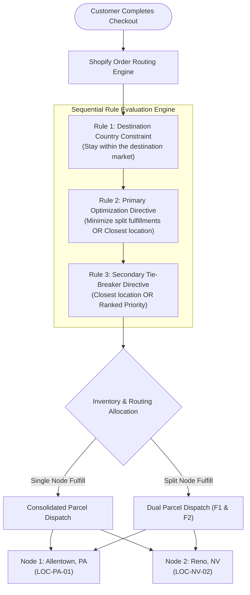
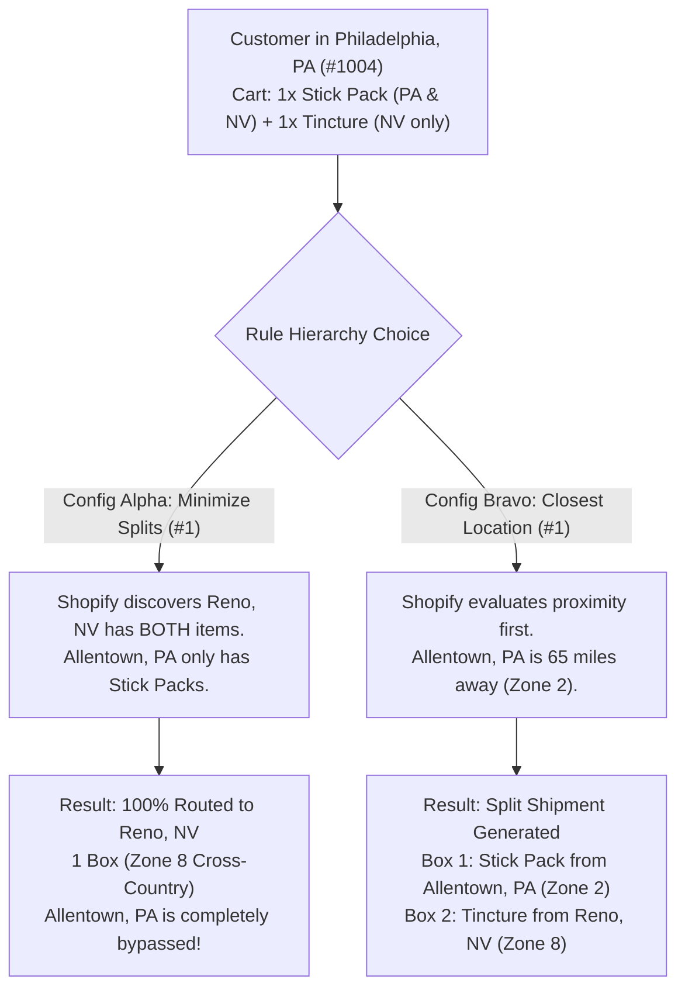
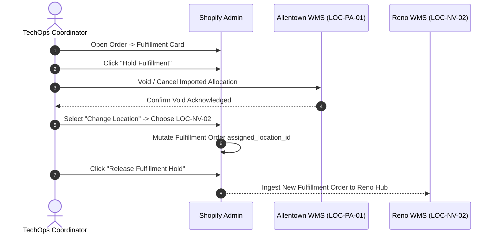

# Architecture - MultiNodeRoutingEngine - Spec

```
Document ID:     Architecture - MultiNodeRoutingEngine - Spec
Naming Format:   [CATEGORY] - [PURPOSE] - [TIER]
Category:        Architecture (Systems Engineering & Routing Specification)
Purpose:         MultiNodeRoutingEngine
Tier / Level:    Spec (Production Configuration & Rule Governance)
Status:          Locked 🔒 (Master Baseline)
Target Audience: TechOps Engineers, Logistics Leads, Systems Architects
Ecosystem Scope: Shopify Native Order Routing Engine, Shopify Inventory API, ShipBob WMS
Business Unit:   Synapse Botanicals (Multi-Node DTC Fulfillment)
```

---

## 1. Executive Summary & Network Topology

Synapse Botanicals operates a distributed direct-to-consumer (DTC) fulfillment network across the contiguous United States. Orders are fulfilled dynamically using **Shopify’s Native Order Routing Engine** (`Settings` $\rightarrow$ `Shipping and delivery` $\rightarrow$ `Order routing`).

This specification establishes:
1. **Network Node Architecture:** Distribution roles and SKU stocking profiles for East Coast and West Coast nodes.
2. **Algorithmic Evaluation Hierarchy:** The strict execution order of Shopify’s routing rule stack.
3. **The Cross-Country Routing Trap:** Technical analysis of how rule priority alters parcel dispatch decisions.
4. **Safety Stock Buffer Thresholds:** Mathematical buffers preventing stockouts and unintentional split shipments.
5. **Operational Location Reassignment Protocols:** Procedures for manually overriding fulfillment nodes.

> [!NOTE] **Routing Architecture & Empirical Simulation Reference:**  
> The multi-node stocking profiles (`LOC-PA-01` Allentown, `LOC-NV-02` Reno) and routing algorithms specified in this document are benchmarked against simulated order cohorts in **[CaseStudy - MultiLocationRoutingOptimization - Analysis (Domain 2.3)](CaseStudy-MultiLocationRoutingOptimization-Analysis.md)** using real UPS Ground freight rate cards.



---

## 2. Fulfillment Node Profiles & SKU Stocking Topology

To optimize delivery speed and reduce carrier shipping zones, inventory is partitioned across two strategic distribution centers:

### 2.1 Node Profiles

| Node Identifier | Facility Name | Geographic Focus | Transit Zone Coverage | Primary Facility Role |
| :--- | :--- | :--- | :---: | :--- |
| **`LOC-PA-01`** | Allentown Distribution Center, PA | East Coast, Midwest, Mid-Atlantic | Zones 1–4 East | High-velocity consumable hub (Stick Packs & Starter Bundles) |
| **`LOC-NV-02`** | Reno Fulfillment Hub, NV | West Coast, Pacific NW, Southwest | Zones 1–4 West | Specialty tincture hub + hardware accessory stock + West consumable hub |

### 2.2 SKU Stocking & Availability Matrix

> [!NOTE]
> **Kitted inventory:** Bundles are stocked as pre-kitted units at both nodes in this routing topology. Reno-only loose tincture inventory does not force a pre-kitted bundle to Reno. Component-picked bundle scenarios must declare their alternate allocation/pick basis explicitly.


Not all SKUs are dual-stocked across both warehouses due to manufacturing batch sizes and storage requirements:

| Product Title | SKU Identifier | Allentown, PA (`LOC-PA-01`) | Reno, NV (`LOC-NV-02`) | Stocking Strategy |
| :--- | :--- | :---: | :---: | :--- |
| **Focus Stick Packs (Matcha Yuzu)** | `SYN-FSTK-MY` | **Primary (High ATS)** | **Secondary (Buffer)** | Dual-Stocked (Universal velocity) |
| **Focus Stick Packs (Blood Orange)** | `SYN-FSTK-BO` | **Primary (High ATS)** | **Secondary (Buffer)** | Dual-Stocked (Universal velocity) |
| **Focus Stick Packs (Wild Blueberry)**| `SYN-FSTK-WB` | **Primary (High ATS)** | **Secondary (Buffer)** | Dual-Stocked (Universal velocity) |
| **Focus Stick Packs (Crisp Green Apple)** | `SYN-FSTK-GA` | **Primary (High ATS)** | **Secondary (Buffer)** | Dual-Stocked (Universal velocity) |
| **Adaptogen Tincture (AM Focus)** | `SYN-TNCT-AM` | — *(Not Stocked)* | **Exclusive Hub (100%)** | Single-Node Specialized Hub |
| **Adaptogen Tincture (PM Restore)**| `SYN-TNCT-PM` | — *(Not Stocked)* | **Exclusive Hub (100%)** | Single-Node Specialized Hub |
| **The Daily Protocol Starter Bundle**| `SYN-BNDL-MAO / SYN-BNDL-BAB`| **Primary (High ATS)** | **Secondary (Buffer)** | Dual-Stocked Kitted Unit |
| **Precision Insulated Tumbler** | `SYN-TMBL-MO / BW / SG`| **Primary Stock** | **Secondary Stock** | Dual-Stocked Hardware |
| **Micro-Foam Electric Whisk** | `SYN-ACC-WHSK`| — *(Not Stocked)* | **Exclusive Hub (100%)** | Single-Node Accessory Stock |

---

## 3. Algorithmic Routing Rule Hierarchy

Shopify evaluates order routing rules **sequentially from top to bottom**. Each rule acts as a filter or a sort function on the list of eligible fulfillment locations.

### 3.1 Production Rule Stack Configuration

1. Minimize split fulfillments.
2. Stay within the destination market.
3. Ship from the closest location.

Use ranked locations or location-metafield rules only as explicitly configured additional preferences.

### 3.2 Detailed Execution Mechanics

#### Rule 1: Market preference

The native market rule prioritizes locations in the destination market; it is not a hard sovereign-border filter. Any hard domestic-only constraint requires a separate documented configuration.

> [!NOTE]
> **Tags and custom routing:** `flow-route:*` tags are metadata. They change allocation only when a named custom rule, middleware consumer or operator reads them and performs a supported action. Order-created tagging can occur after initial routing, so do not assume it precedes assignment.

#### Rule 2: Minimize split fulfillments (Primary Optimization)
* **Mechanics:** Evaluates all possible combinations of candidate locations that can fulfill the entire line item set:
  * **Option A (Single Location Candidate):** If any single warehouse contains $100\%$ of the ordered items in Available-to-Sell (ATS) stock, Shopify **discards all multi-location combinations**.
  * **Option B (Multi-Location Fallback):** If no single warehouse has all items, the engine calculates the minimum number of locations required (e.g., 2 locations instead of 3).

#### Rule 3: Ship from closest location (Distance Sort & Tie-Breaker)
* **Mechanics:** Calculates straight-line geodesic distance between the customer's delivery ZIP code and the geocoded address of eligible candidate locations.
* **Tie-Breaker:** When two or more single-location candidates can fulfill the entire order, the engine selects the facility closest to the recipient.

---

## 4. The "Hidden Gap" Exposed: Split-Averse vs. Proximity Routing Trap

The most common operational failure in multi-warehouse e-commerce is the **Cross-Country Routing Trap**. When operators do not understand how Rule 2 interacts with Rule 3, they mistakenly believe the warehouse integration is defective.



### 4.1 Comparative Scenario Analysis

**Test Order Parameters:**
* **Customer Location:** Philadelphia, PA (`19102`)
* **Basket Items:**
  * 1x `Focus Stick Packs (30-Pack)` – Dual-stocked at `LOC-PA-01` and `LOC-NV-02`
  * 1x `Adaptogen Tincture (60ml)` – Stocked **exclusively** at `LOC-NV-02`

| System Metric | Configuration Alpha (Split-Averse: Production) | Configuration Bravo (Proximity-Averse: Split Allowed) |
| :--- | :--- | :--- |
| **Rule Order** | 1. Minimize split fulfillments<br>2. Closest location | 1. Ship from closest location<br>2. Minimize split fulfillments |
| **Assigned Warehouse(s)** | **`LOC-NV-02` (Reno, NV) exclusively** | **`LOC-PA-01` (PA) & `LOC-NV-02` (NV) [SPLIT]** |
| **Packages Dispatched** | **1 Package** (Both items consolidated) | **2 Packages** (Dual split packages) |
| **Carrier Zone(s)** | Zone 8 (Cross-country: Reno $\rightarrow$ Philly) | Package 1: Zone 2 (Allentown $\rightarrow$ Philly)<br>Package 2: Zone 8 (Reno $\rightarrow$ Philly) |
| **Direct Fulfillment Cost** | **$10.85** in the isolated 0.94 lb routing fixture | **$18.00** ($7.65 PA + $10.35 NV); $7.15 higher |

| **Transit Time (SLA)** | 4–5 Business Days (Ground) | Stick Pack: 1–2 Days \| Tincture: 4–5 Days |
| **Customer Experience** | 1 Box, 1 Tracking Number | 2 Boxes arriving on different days |
| **Operator Perception** | *"Why did PA get skipped? Is PA broken?"* | *"Why did this split? The split costs more in this fixture!"* |

> [!IMPORTANT]
> **THE PRODUCTION DIRECTIVE**  
> Synapse Botanicals maintains **Configuration Alpha** as the production baseline. Ingestible botanical drink mixes and tinctures are routinely consumed together as a morning ritual. Consolidating into a single package saves **$7.15 in modeled direct fulfillment cost for the routing fixture pair** and eliminates customer confusion caused by staggered delivery dates.

> [!NOTE]
> **Empirical Validation Reference:**  
> For an end-to-end audit trail of how this exact split-routing scenario was processed, intercepted, and reconciled with live customer exceptions, review **[Audit - OrderStateSimulation - RunSheet (Domain 1.3)](Audit-OrderStateSimulation-RunSheet.md)**.

---

## 5. Inventory Buffers & Safety Stock Governance

To prevent stockouts from high-velocity sales spikes and avoid race conditions between Shopify and 3PL WMS synchronization cycles, safety stock buffers must be established.

### 5.1 Buffer Mathematics & Available-to-Sell (ATS) Logic
Model Shopify inventory states separately from any external WMS buffer:

$$\text{Available} = \text{On Hand} - \text{Committed} - \text{Unavailable}$$

Safety stock is part of Unavailable when represented there. If a separate WMS-only buffer is used, document its mapping; do not subtract it again from Shopify Available.

```
┌────────────────────────────────────────────────────────────────────────────────────────┐
│ INVENTORY SAFETY BUFFER SPECIFICATION                                                  │
├──────────────────────────────┬──────────────┬─────────────┬─────────────┬──────────────┤
│ Product Category             │ Velocity Tier│ PA Buffer   │ NV Buffer   │ Rationale    │
├──────────────────────────────┼──────────────┼─────────────┼─────────────┼──────────────┤
│ Focus Stick Packs (All SKUs) │ High (Tier 1)│ 15 Units    │ 10 Units    │ Rapid spikes │
│ Adaptogen Tinctures          │ Med  (Tier 2)│ —           │ 10 Units    │ Single-hub   │
│ Starter Protocol Bundles     │ Med  (Tier 2)│ 10 Units    │ 5 Units     │ High AOV kit │
│ Tumblers & Whisks            │ Low  (Tier 3)│ 5 Units     │ 5 Units     │ Stable drain │
└──────────────────────────────┴──────────────┴─────────────┴─────────────┴──────────────┘
```

### 5.2 Dynamic Out-of-Stock Fallback Cascade
When a distribution node’s ATS reaches $\le 0$ (due to on-hand inventory hitting the safety buffer):
1. **Automated De-allocation:** The native routing engine automatically disqualifies that location from candidate pools for that SKU.
2. **Future assignment:** Eligible new orders can use the secondary node. Existing fulfillment orders require a supported move/reassignment and source-WMS cancellation acknowledgment; stock changes alone do not guarantee automatic transfer.
3. **Low-Stock Notification Trigger:** If total network ATS falls below 25 units, Shopify Flow generates an automated Slack notification to `#supply-chain-alerts`.

---

## 6. Operational Location Reassignment Protocol (Manual Overrides)

When physical warehouse constraints (e.g., weather delays, carrier trailer shortages, physical inventory audits) require an operational override, TechOps coordinators must execute a manual location reassignment.



### 6.1 Step-by-Step Location Override Procedure

> [!NOTE]
> **System Governance & Safety Dependency:**  
> Location reassignments must strictly follow the native hold protocol in **[SOP - OrderExceptionMutationProtocol - Parent (Domain 1.1)](SOP-OrderExceptionMutationProtocol-Parent.md)**, and are strictly prohibited once an order crosses the Point of No Return defined in **[Matrix - OrderStatePointOfNoReturn - Master (Domain 1.2)](Matrix-OrderStatePointOfNoReturn-Master.md)**.

1. **Place Fulfillment Hold:** Never change locations on an active, unheld fulfillment order. Apply hold code: `Inventory issue`.
2. **Void Original 3PL Record:** Access the source warehouse portal (e.g., ShipBob Allentown). Search Order ID $\rightarrow$ Click **Cancel / Void Order**. Confirm the shipment is not in a wave pick.
3. **Execute Location Mutation in Shopify Admin:**
   * Navigate to the target fulfillment card.
   * Click the **three horizontal dots (...)** $\rightarrow$ Select **Change location**.
   * In the location dropdown, select the target facility (e.g., `Reno Fulfillment Hub`).
   * Verify line items and quantities transfer completely.
   * Click **Save**.
4. **Release Hold:** Release the Shopify fulfillment hold. Confirm the order transmits to the destination 3PL queue through the configured fulfillment integration; a hold release is not a scheduling event.
5. **Tag Order:** Append tracking tag: `OPS: Rerouted [Old_Loc] to [New_Loc]`.

---

## 7. Change Management & Verification Checklist

Modifications to the Shopify Order Routing rule stack can affect subsequent eligible order assignments. Any proposed changes to the rule order must undergo the following release gate:

* [ ] **Off-Peak Execution:** Routing rule adjustments must be deployed Tuesday–Thursday between 10:00 PM and 11:30 PM EST.
* [ ] **Pre-Flight Test Suite:** Run 4 synthetic draft orders representing:
  1. East Coast Single-Node basket (PA only)
  2. West Coast Single-Node basket (NV only)
  3. East Coast Mixed basket (PA & NV SKUs)
  4. Out-of-Stock Fallback basket (PA inventory depleted)
* [ ] **3PL Ingestion Validation:** Confirm test order fulfillment orders are ingested into the correct warehouse WMS tenant within 180 seconds.
* [ ] **Post-Deploy Audit:** Review the first 25 live production orders following deployment to ensure fulfillment card locations match the expected model.


## Technical references — checked 30 October 2026

- [Shopify routing rules](https://help.shopify.com/en/manual/fulfillment/setup/order-routing/understanding-order-routing)
- [Shopify inventory states](https://help.shopify.com/en/manual/inventory-and-locations/fundamentals/inventory-states)
