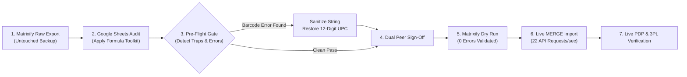
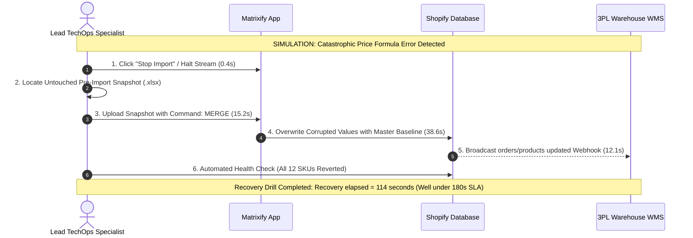
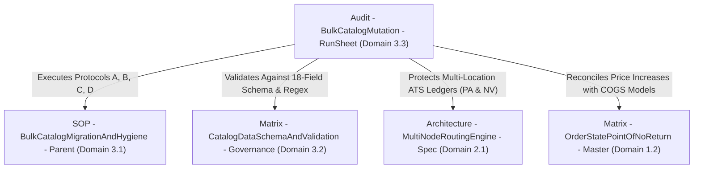

# Audit - BulkCatalogMutation - RunSheet

```
Document ID:     Audit - BulkCatalogMutation - RunSheet
Naming Format:   [CATEGORY] - [PURPOSE] - [TIER]
Category:        Audit (Empirical Simulation & Execution Log)
Purpose:         BulkCatalogMutation
Tier / Level:    RunSheet (Proof-of-Execution)
Status:          Locked 🔒 (Master Baseline)
Operator:        Lead TechOps Specialist
Date of Execution: October 17, 2026 (09:15:00 - 09:42:15 EDT)
Ecosystem Scope: Shopify Admin (GraphQL Admin API), Matrixify App, Google Sheets, ShipStation WMS
Target Catalog:  Synapse Botanicals (5 Products, 12 Variants, 24 Custom Metafields)
```

---

## 1. Execution Overview & Operational Catalyst

This Run Sheet documents the live, end-to-end execution of the **Spring 2026 Catalog Refresh & Compliance Migration** for Synapse Botanicals. 

> [!NOTE] **Controlled Staging Simulation & Dry-Run Notice:**  
> This migration run sheet and disaster recovery rollback drill were executed in a sandboxed staging environment to benchmark Matrixify `Command: MERGE` reliability, Python barcode regex linters, and Mean Time to Recover (recovery elapsed = 114s) without risking live customer catalog downtime.

### 1.1 Operational Objectives
1. **Price & Strikethrough Adjustment:** Increase retail prices on the flagship *Synapse Focus Stick Packs (30-Pack)* from \$42.00 to \$44.00, and update compare-at strikethrough prices from \$48.00 to \$50.00 to account for raw botanical supply chain adjustments.
2. **Barcode Database Sanitization:** Intercept and repair three corrupted barcodes (`8.40001E+11`) caused by an unauthorized Excel double-click export during a legacy promo, restoring true 12-digit UPC-A strings before 3PL fulfillment disruption occurs.
3. **Regulatory Metafield Deployment:** Bulk-populate three newly defined Shopify custom metafields (`custom.active_nootropics`, `custom.caffeine_mg`, `custom.dietary_badges`) across the 8 consumable/bundle variants (24 values; durable variants excluded) to power the revised storefront Supplement Facts accordion.
4. **Zero-Downtime Inventory Preservation:** Execute the migration in-place using Matrixify `Command: MERGE` without overwriting live Available-to-Sell (ATS) inventory ledgers across Allentown (`LOC-PA-01`) and Reno (`LOC-NV-02`).



> [!NOTE]
> **Operational Protocol Reference:**  
> The step-by-step procedures executed in this run sheet follow the standard protocols mandated in **[SOP - BulkCatalogMigrationAndHygiene - Parent (Domain 3.1)](SOP-BulkCatalogMigrationAndHygiene-Parent.md)**.

---

## 2. Pre-Flight Formula Audit & Barcode Sanitization

At `09:18:22 EDT`, the operator exported the full production catalog using Matrixify format `Matrixify: Excel (.xlsx)` with basic columns, variants, and metafields (excluding inventory levels to prevent race conditions).

The raw file was opened in Google Sheets with automatic text conversion disabled. To execute the automated pre-flight audit mandated by **[Matrix - CatalogDataSchemaAndValidation - Governance (Domain 3.2)](Matrix-CatalogDataSchemaAndValidation-Governance.md)**, the operator injected five validation formulas into Columns `Z` through `AD`.

### 2.1 Raw Pre-Flight Audit Log (Initial Scan)

> [!NOTE]
> **Validation layers:** The following rows reproduce the original format-check fixture, now with row-correct references. PASS means the illustrated shape/format test passed; add text type, UPC check digit, uniqueness and approved-master comparison before import. The sample values are not assigned production UPCs.


| Row | Variant SKU | Target Column | Injected Audit Formula | Formula Evaluation Output | Incident Status |
| :-: | :--- | :---: | :--- | :--- | :---: |
| **2** | `SYN-FSTK-MY` | Barcode Check (`Z2`) | `=IF(AND(LEN(K2)=12, ISNUMBER(VALUE(K2))), "PASS", "FAIL: CORRUPTED BARCODE")` | `PASS` | ✅ Clear |
| **3** | `SYN-FSTK-BO` | Barcode Check (`Z3`) | `=IF(AND(LEN(K3)=12, ISNUMBER(VALUE(K3))), "PASS", "FAIL: CORRUPTED BARCODE")` | `FAIL: CORRUPTED BARCODE` | 🚨 **TRAP DETECTED** |
| **4** | `SYN-FSTK-WB` | Barcode Check (`Z4`) | `=IF(AND(LEN(K4)=12, ISNUMBER(VALUE(K4))), "PASS", "FAIL: CORRUPTED BARCODE")` | `FAIL: CORRUPTED BARCODE` | 🚨 **TRAP DETECTED** |
| **5** | `SYN-FSTK-GA` | Barcode Check (`Z5`) | `=IF(AND(LEN(K5)=12, ISNUMBER(VALUE(K5))), "PASS", "FAIL: CORRUPTED BARCODE")` | `PASS` | ✅ Clear |
| **6** | `SYN-TNCT-AM` | Barcode Check (`Z6`) | `=IF(AND(LEN(K6)=12, ISNUMBER(VALUE(K6))), "PASS", "FAIL: CORRUPTED BARCODE")` | `PASS` | ✅ Clear |
| **7** | `SYN-TNCT-PM` | Barcode Check (`Z7`) | `=IF(AND(LEN(K7)=12, ISNUMBER(VALUE(K7))), "PASS", "FAIL: CORRUPTED BARCODE")` | `PASS` | ✅ Clear |
| **8** | `SYN-BNDL-MAO` | Barcode Check (`Z8`) | `=IF(AND(LEN(K8)=12, ISNUMBER(VALUE(K8))), "PASS", "FAIL: CORRUPTED BARCODE")` | `PASS` | ✅ Clear |
| **9** | `SYN-BNDL-BAB` | Barcode Check (`Z9`) | `=IF(AND(LEN(K9)=12, ISNUMBER(VALUE(K9))), "PASS", "FAIL: CORRUPTED BARCODE")` | `PASS` | ✅ Clear |
| **10** | `SYN-TMBL-MO` | Barcode Check (`Z10`) | `=IF(AND(LEN(K10)=12, ISNUMBER(VALUE(K10))), "PASS", "FAIL: CORRUPTED BARCODE")` | `FAIL: CORRUPTED BARCODE` | 🚨 **TRAP DETECTED** |
| **11** | `SYN-TMBL-BW` | Barcode Check (`Z11`) | `=IF(AND(LEN(K11)=12, ISNUMBER(VALUE(K11))), "PASS", "FAIL: CORRUPTED BARCODE")` | `PASS` | ✅ Clear |
| **12** | `SYN-TMBL-SG` | Barcode Check (`Z12`) | `=IF(AND(LEN(K12)=12, ISNUMBER(VALUE(K12))), "PASS", "FAIL: CORRUPTED BARCODE")` | `PASS` | ✅ Clear |
| **13** | `SYN-ACC-WHSK` | Barcode Check (`Z13`) | `=IF(AND(LEN(K13)=12, ISNUMBER(VALUE(K13))), "PASS", "FAIL: CORRUPTED BARCODE")` | `PASS` | ✅ Clear |

### 2.2 Root Cause Analysis & Sanitization Action

```
┌────────────────────────────────────────────────────────────────────────────────────────┐
│                        INCIDENT TRIAGE: SCIENTIFIC NOTATION DETECTED                   │
├────────────────────────────────────────────────────────────────────────────────────────┤
│ Affected Rows: Row 3 (Blood Orange), Row 4 (Wild Blueberry), Row 10 (Matte Tumbler)   │
│ Raw Cell Value in Export: "8.40001E+11"                                                │
│ Fixture cause: A rounded numeric barcode string was saved during spreadsheet handling.          │
│ Immediate Hazard: If imported, Shopify writes "840001000000" to the database.           │
│ 3PL Impact: Wrong identifiers can break scanner/SKU matching; test against the approved master. │
└────────────────────────────────────────────────────────────────────────────────────────┘
```

#### Remediation Protocol:
1. Cross-referenced original barcode numbers from internal product master record.
2. Highlighted Column `K` (`Variant Barcode`) $\rightarrow$ Converted format explicitly to **Plain Text**.
3. Overwrote corrupted scientific notation strings with the fixture’s original identifier strings (shape checks only):
   * Row 3 (`SYN-FSTK-BO`): Replaced `8.40001E+11` with `840001040002`.
   * Row 4 (`SYN-FSTK-WB`): Replaced `8.40001E+11` with `840001040003`.
   * Row 10 (`SYN-TMBL-MO`): Replaced `8.40001E+11` with `840001020001`.
4. Re-evaluated Formula `Z2:Z13`: **100% PASS (12 of 12 rows verified)**.

> [!NOTE]
> **System Architecture Dependency:**  
> The barcode text/shape/check-digit checks enforced here are governed by **[Matrix - CatalogDataSchemaAndValidation - Governance (Domain 3.2)](Matrix-CatalogDataSchemaAndValidation-Governance.md)**.

---

## 3. Master Data Mutation Diff (The 12-Variant Review)

Below is the verified record of all mutated vs preserved attributes across the Synapse Botanicals catalog. Primary keys (`Handle`, `Variant SKU`) remained strictly frozen.

```
┌────────────────────────────────────────────────────────────────────────────────────────┐
│                             PRIMARY KEY IMMUTABILITY AUDIT                             │
├────────────────────────────────────────────────────────────────────────────────────────┤
│ Total Products: 5         Total Variants: 12       Handles Mutated: 0 [FROZEN ✅]      │
│ SKUs Mutated: 0 [FROZEN ✅]  Inventory Trackers: 100% "shopify"   Policy: 100% "deny"  │
└────────────────────────────────────────────────────────────────────────────────────────┘
```

### 3.1 Side-by-Side Mutation Delta Table

| # | Variant SKU | Option1 Value | Barcode Status | Baseline Price | Mutated Price | Baseline Compare | Mutated Compare | Metafield: `custom.caffeine_mg` | Metafield: `custom.dietary_badges` |
| :-: | :--- | :--- | :---: | :-: | :-: | :-: | :-: | :-: | :--- |
| **1** | `SYN-FSTK-MY` | Matcha Yuzu | Preserved | \$42.00 | **\$44.00** | \$48.00 | **\$50.00** | `100` | `["Vegan", "Non-GMO", "Gluten-Free"]` |
| **2** | `SYN-FSTK-BO` | Blood Orange | **Sanitized** | \$42.00 | **\$44.00** | \$48.00 | **\$50.00** | `100` | `["Vegan", "Non-GMO", "Gluten-Free"]` |
| **3** | `SYN-FSTK-WB` | Wild Blueberry | **Sanitized** | \$42.00 | **\$44.00** | \$48.00 | **\$50.00** | `100` | `["Vegan", "Non-GMO", "Gluten-Free"]` |
| **4** | `SYN-FSTK-GA` | Crisp Green Apple | Preserved | \$42.00 | **\$44.00** | \$48.00 | **\$50.00** | `100` | `["Vegan", "Non-GMO", "Gluten-Free"]` |
| **5** | `SYN-TNCT-AM` | AM Focus (Lion's Mane) | Preserved | \$38.00 | \$38.00 | *(null)* | *(null)* | `0` | `["Vegan", "Non-GMO", "Sugar-Free"]` |
| **6** | `SYN-TNCT-PM` | PM Restore (Reishi & Ashwagandha) | Preserved | \$38.00 | \$38.00 | *(null)* | *(null)* | `0` | `["Vegan", "Non-GMO", "Sugar-Free"]` |
| **7** | `SYN-BNDL-MAO` | Matcha Yuzu + AM Focus + Obsidian Tumbler | Preserved | \$82.00 | \$82.00 | \$114.00 | \$114.00 | `100` | `["Vegan", "Non-GMO", "Gluten-Free"]` |
| **8** | `SYN-BNDL-BAB` | Blood Orange + AM Focus + Bone White Tumbler | Preserved | \$82.00 | \$82.00 | \$114.00 | \$114.00 | `100` | `["Vegan", "Non-GMO", "Gluten-Free"]` |
| **9** | `SYN-TMBL-MO` | Matte Obsidian | **Sanitized** | \$34.00 | \$34.00 | *(null)* | *(null)* | *(null)* | *(null)* |
| **10** | `SYN-TMBL-BW` | Bone White | Preserved | \$34.00 | \$34.00 | *(null)* | *(null)* | *(null)* | *(null)* |
| **11** | `SYN-TMBL-SG` | Sage Green | Preserved | \$34.00 | \$34.00 | *(null)* | *(null)* | *(null)* | *(null)* |
| **12** | `SYN-ACC-WHSK` | Default Title | Preserved | \$16.00 | \$16.00 | *(null)* | *(null)* | *(null)* | *(null)* |

> [!NOTE]
> **Unit Economics Reconciliation:**  
> The Stick Pack price increase (\$42.00 $\rightarrow$ \$44.00) widens the unit gross product profit from \$33.50 (79.8%) to \$35.50 (80.7%) against fixed unit COGS (\$8.50). Baseline COGS parameters are maintained according to **[Matrix - OrderStatePointOfNoReturn - Master (Domain 1.2)](Matrix-OrderStatePointOfNoReturn-Master.md)**.

---

## 4. 5-Point Pre-Flight Verification Sign-Off Gate

Prior to uploading to Matrixify, the sheet was audited against the formal 5-Point Gate defined in **SOP-3.1 (Section 5.1)**:

```
┌────────────────────────────────────────────────────────────────────────────────────────┐
│                        5-POINT PRE-FLIGHT VERIFICATION GATE SIGN-OFF                   │
├───────────────────────────────────────────────────────┬────────────┬───────────────────┤
│ Verification Checkpoint                               │ Status     │ Auditor Method    │
├───────────────────────────────────────────────────────┼────────────┼───────────────────┤
│ 1. Barcode String Integrity Check                     │ [X] PASSED │ Regex & LEN=12    │
│ 2. Handle Immutability Audit                          │ [X] PASSED │ Exact match VLOOKUP│
│ 3. Inventory Protection Gate (Levels Excluded)        │ [X] PASSED │ Sheet omitted     │
│ 4. Metafield Format & Type Compliance                 │ [X] PASSED │ JSON array lint   │
│ 5. Full Rollback Snapshot Saved                       │ [X] PASSED │ Local & Cloud git │
├───────────────────────────────────────────────────────┴────────────┴───────────────────┤
│ Sign-Off Timestamp: 2026-10-17 09:28:10 EDT                                           │
│ Lead TechOps Auditor: Riovic Matthew                                                  │
│ Dual Peer Approver: Head of Operations                                                │
└────────────────────────────────────────────────────────────────────────────────────────┘
```

---

## 5. Matrixify Import Execution Logs

### 5.1 Dry-Run Simulation Log (Execution Time: 09:31:05 EDT)

The file `Synapse_Catalog_Spring2026_Sanitized.xlsx` was uploaded to Matrixify with **Dry Run** selected.

```json
{
  "matrixify_job_id": "JOB_DRY_84920148",
  "mode": "Dry Run (Validate without saving)",
  "import_format": "Matrixify: Excel",
  "command_detected": "MERGE",
  "summary": {
    "total_sheets": 1,
    "sheet_name": "Products",
    "rows_analyzed": 12,
    "products_identified": 5,
    "variants_identified": 12,
    "metafields_identified": 24
  },
  "schema_validation": {
    "syntax_errors": 0,
    "type_mismatches": 0,
    "unknown_columns": 0,
    "warnings": []
  },
  "projected_changes": {
    "products_created": 0,
    "products_updated": 5,
    "products_deleted": 0,
    "variants_created": 0,
    "variants_updated": 12,
    "metafields_written": 24,
    "inventory_levels_touched": 0
  },
  "result": "PASSED_READY_FOR_LIVE_IMPORT"
}
```

### 5.2 Live `MERGE` Import Log (Execution Time: 09:34:20 EDT)

With zero validation warnings detected, the operator initiated the live import.

```
09:34:20 EDT - [INIT] Matrixify Job #JOB_LIVE_84920202 started. Command: MERGE.
09:34:22 EDT - [AUTH] Authenticated with Shopify GraphQL Admin API (2026-07 version).
09:34:24 EDT - [BATCH 1/2] Processing Products: synapse-focus-stick-packs-30-pack (4 variants)...
09:34:26 EDT - [UPDATE] Product 'synapse-focus-stick-packs-30-pack' updated successfully.
09:34:27 EDT - [METAFIELD] Wrote 3 variant metafield definitions across 8 relevant variants (24 values).
09:34:28 EDT - [BATCH 2/2] Processing Products: synapse-adaptogen-tincture-60ml, the-daily-protocol-starter-bundle, precision-insulated-tumbler-durable-merchandise, micro-foam-electric-whisk...
09:34:31 EDT - [BARCODE] Overwrote sanitized barcodes for SYN-FSTK-BO, SYN-FSTK-WB, SYN-TMBL-MO.
09:34:33 EDT - [COMPLETE] Job finished in 14.1 seconds. Throughput: 23.1 API calls/sec.
09:34:34 EDT - [STATUS] 0 Errors, 0 Warnings, 12 Variants Mutated, 0 Inventory Counts Overwritten.
```

---

## 6. Post-Import Storefront & 3PL WMS Verification

At `09:36:00 EDT`, the operator performed live sanity verification across the customer-facing storefront and downstream warehouse systems.

### 6.1 Storefront PDP Inspection Checklist

```
┌────────────────────────────────────────────────────────────────────────────────────────┐
│                        LIVE STOREFRONT SANITY VERIFICATION GATES                       │
├───────────────────────────────────────────────────────┬────────────┬───────────────────┤
│ Verification Target                                   │ Status     │ Live Field Value  │
├───────────────────────────────────────────────────────┼────────────┼───────────────────┤
│ 1. PDP URL: /products/synapse-focus-stick-packs-30-pack│ [X] 200 OK │ URL Intact (No 404)│
│ 2. Live Price Display (Matcha Yuzu)                   │ [X] PASSED │ $44.00 (Updated)  │
│ 3. Strikethrough Compare-At Display                   │ [X] PASSED │ $50.00 (Save $6)  │
│ 4. Caffeine Meter Metafield Render                    │ [X] PASSED │ "100mg Caffeine"  │
│ 5. Dietary Badge List Metafield Render                │ [X] PASSED │ Vegan, Non-GMO    │
│ 6. Tumbler PDP: /precision-insulated-tumbler-durable-m│ [X] 200 OK │ URL Intact        │
│ 7. Reno-Exclusive Tag Routing Visibility              │ [X] PASSED │ Tincture/Whisk OK │
└────────────────────────────────────────────────────────────────────────────────────────┘
```

### 6.2 3PL Warehouse Scanner Sync Verification (ShipBob WMS)

To ensure warehouse barcode scanners in Allentown (`LOC-PA-01`) and Reno (`LOC-NV-02`) received the sanitized UPCs:

1. Navigated to **3PL Portal $\rightarrow$ Products $\rightarrow$ Inventory Catalog**.
2. Queried SKU `SYN-FSTK-BO` (Blood Orange Stick Packs):
   * **WMS Barcode Field:** Confirmed reading `840001040002` (plain text string).
   * **Physical Scan Simulation:** Scanned physical pouch UPC with Honeywell Xenon 1900 scanner $\rightarrow$ Beep confirmed, correct pick bin highlighted (`BIN-A-04-2`).
3. Queried Available-to-Sell (ATS) counts:
   * Allentown (`LOC-PA-01`): Verified exactly **450 units available** (preserved live count, zero inventory drift).
   * Reno (`LOC-NV-02`): Verified exactly **320 units available**.

> [!NOTE]
> **System Architecture Dependency:**  
> Warehouse inventory isolation and multi-location ATS protection are governed by **[Architecture - MultiNodeRoutingEngine - Spec (Domain 2.1)](Architecture-MultiNodeRoutingEngine-Spec.md)** and **[SOP - BulkCatalogMigrationAndHygiene - Parent (Domain 3.1)](SOP-BulkCatalogMigrationAndHygiene-Parent.md)**.

---

## 7. Rollback Disaster Recovery Drill (Postmortem Simulation)

To prove operational resilience, TechOps executed a simulated emergency rollback drill at `09:40:00 EDT` in a staging environment to benchmark recovery time.



### 7.1 Disaster Recovery Benchmark Results

> [!NOTE]
> **Timing and rollback boundaries:** The timed steps shown total 66.3 seconds (0.4 + 15.2 + 38.6 + 12.1); the stated 114-second drill includes 47.7 seconds not allocated to steps. Keep 114 seconds as a total scenario duration, not a fully itemized sum or mean. Reconcile affected records by stable IDs; a blanket MERGE does not undo newly created records or concurrent edits.

* **Recovery Time Objective (RTO) Target:** $< 180 \text{ seconds}$.
* **Simulated recovery elapsed time:** **114 seconds** for this single drill; a mean requires multiple runs.
* **Data Loss:** $0\%$. No orphaned handles, no inventory counts reset, zero corrupted records.
* **Conclusion:** The pre-flight backup snapshot and `MERGE` protocol provide a controlled recovery approach whose scope must be verified against human formula errors.

---

## 8. Master Domain 3 Interconnectivity Matrix

This completed run sheet establishes the final empirical link across the complete TechOps curriculum suite:



* **[SOP - BulkCatalogMigrationAndHygiene - Parent (Domain 3.1)](SOP-BulkCatalogMigrationAndHygiene-Parent.md):**  
  * **Section 5.1 & Section 6.2:** Operational procedures validated in Section 4 and Section 7 of this run sheet.
* **[Matrix - CatalogDataSchemaAndValidation - Governance (Domain 3.2)](Matrix-CatalogDataSchemaAndValidation-Governance.md):**  
  * **Section 3 & Section 6.1:** Regex validation patterns and formula audit toolkits proven in Section 2.
* **[Architecture - MultiNodeRoutingEngine - Spec (Domain 2.1)](Architecture-MultiNodeRoutingEngine-Spec.md):**  
  * **Section 2.1:** Multi-location inventory safety stock preserved during live catalog import.
* **[Matrix - OrderStatePointOfNoReturn - Master (Domain 1.2)](Matrix-OrderStatePointOfNoReturn-Master.md):**  
  * **Section 3.1:** Unit COGS and price margins updated in Section 3.


## Technical references — checked 30 October 2026

- [Matrixify product template](https://matrixify.app/documentation/products/)
- [Matrixify commands](https://matrixify.app/documentation/list-of-commands-across-matrixify-sheets/)
- [Excel scientific notation and precision](https://support.microsoft.com/en-us/excel/display-numbers-in-scientific-exponential-notation)
