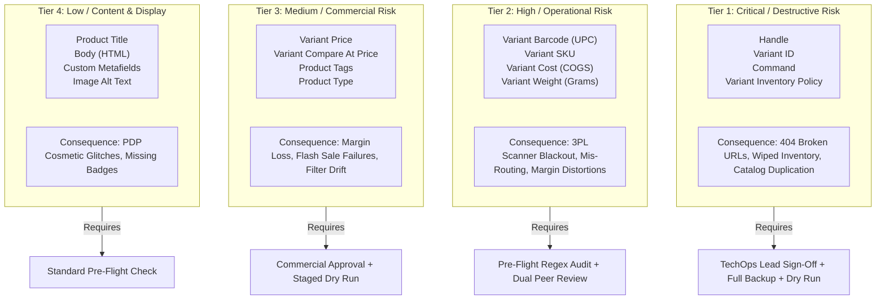
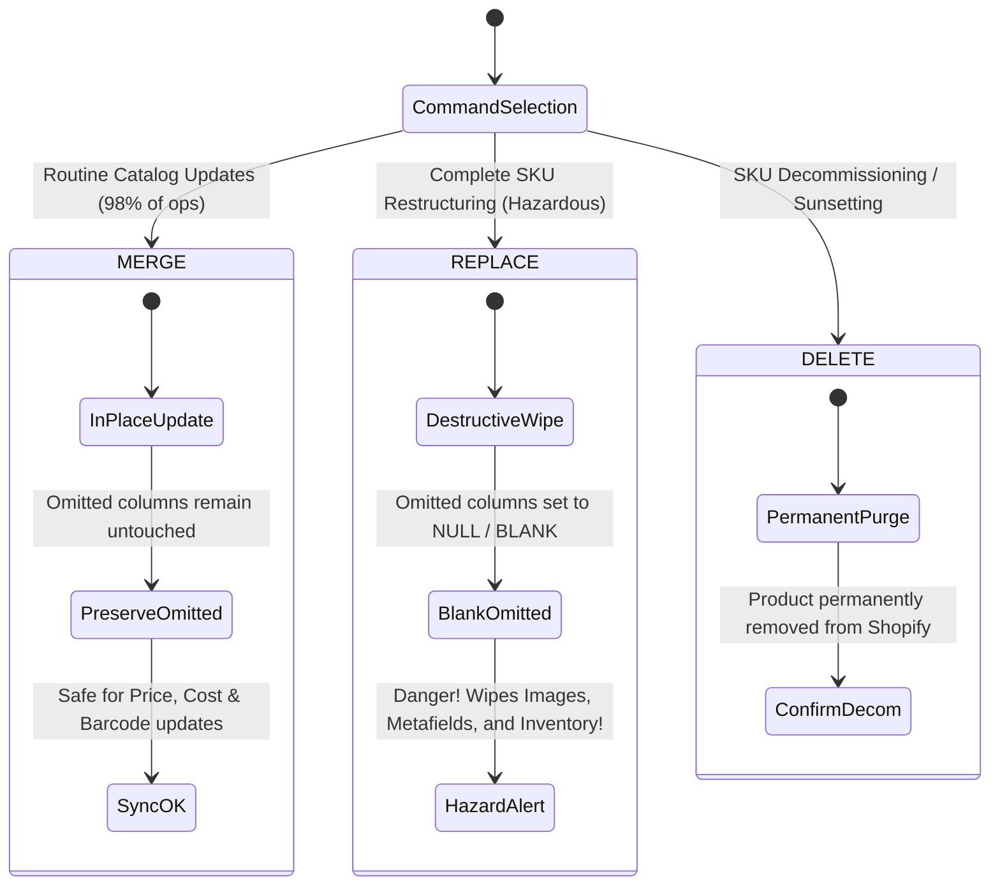
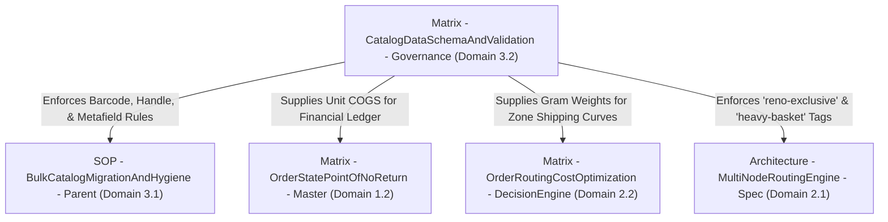

# Matrix - CatalogDataSchemaAndValidation - Governance

```
Document ID:     Matrix - CatalogDataSchemaAndValidation - Governance
Naming Format:   [CATEGORY] - [PURPOSE] - [TIER]
Category:        Matrix (Technical Decision & Validation Engine)
Purpose:         CatalogDataSchemaAndValidation
Tier / Level:    Governance (Master Technical Ruleset)
Status:          Locked 🔒 (Master Baseline)
Target Audience: Lead TechOps Specialists, Data Engineers, E-Commerce Catalog Managers
Ecosystem Scope: Shopify Admin / GraphQL Admin API, Matrixify (Excelify), Google Sheets, 3PL WMS
Business Unit:   Synapse Botanicals (Product Catalog & Inventory Operations)
```

---

## 1. Governance Charter & Architectural Purpose

This Governance Matrix establishes the field-level data dictionary, mutation risk classifications, and automated validation gates for all bulk catalog operations across the Synapse Botanicals Shopify ecosystem.

Bulk catalog imports represent one of the highest-leverage and highest-hazard operational workflows in e-commerce. A single unvalidated column header, auto-formatted spreadsheet cell, or misconfigured import command can silently:
1. **Truncate Barcodes (UPC-A):** Transforming 12-digit barcodes into scientific notation or dropping leading zeros, paralyzing 3PL handheld barcode scanners in Allentown (`LOC-PA-01`) and Reno (`LOC-NV-02`).
2. **Break Storefront SEO & Marketing Campaigns:** Mutating product `Handle` slugs, instantly generating 404 errors across Google search results, affiliate links, and paid Meta/TikTok ads.
3. **Trigger Catastrophic Field Wipes:** Executing a destructive `REPLACE` import instead of a non-destructive `MERGE`, wiping active inventory levels, image galleries, and custom metafields.
4. **Distort Operational Margins:** Corrupting `Variant Cost` (COGS) fields, undermining financial triage models and unit economics.

> [!NOTE]
> **System Architecture Dependency:**  
> This governance ruleset enforces the technical constraints required by **[SOP - BulkCatalogMigrationAndHygiene - Parent (Domain 3.1)](SOP-BulkCatalogMigrationAndHygiene-Parent.md)** and directly supplies the baseline weight and cost parameters modeled in **[Matrix - OrderRoutingCostOptimization - DecisionEngine (Domain 2.2)](Matrix-OrderRoutingCostOptimization-DecisionEngine.md)**.

---

## 2. Field Mutation Risk Taxonomy (The 4 Hazard Tiers)

Every column in the Synapse Botanicals catalog schema is assigned to an explicit Hazard Tier. Operational permissions, review gates, and dry-run requirements scale directly with the tier level.



### 2.1 Hazard Tier Specifications

| Hazard Tier | Classification | Permissible Matrixify Commands | Mandatory Governance Gate | Operational Impact if Corrupted |
| :---: | :--- | :--- | :--- | :--- |
| **Tier 1** | **Critical / Destructive** | `MERGE` (Only with frozen Primary Keys). `REPLACE` strictly prohibited without CTO authorization. | TechOps Lead Sign-Off + Full Pre-Import Snapshot + Dry Run Validation | Broken customer links (404), duplicated product entities, unrecoverable inventory policy reset from `deny` to `continue`. |
| **Tier 2** | **High / Operational** | `MERGE` | Pre-Flight Formula Audit + Regex Barcode Verification + 3PL Sync Check | Handheld scanners at Allentown/Reno 3PL nodes reject incoming goods; mis-allocation of warehouse bins; routing engine failure. |
| **Tier 3** | **Medium / Commercial** | `MERGE` | Commercial Merchandiser Sign-Off + Automated Margin Spread Validation | Negative gross margin sales (if price < COGS); broken collection automated rules based on tags; lost strikethrough savings display. |
| **Tier 4** | **Low / Content & Display** | `MERGE` | Standard Pre-Flight Syntax Check (HTML & JSON Linting) | Visual PDP formatting errors; missing dietary certification badges; supplement facts panel render failure. |

---

## 3. Master Field-Level Schema & Validation Matrix

This master matrix specifies the technical constraints, expected data types, validation formulas, and system dependencies for every product and variant column in the catalog.

| # | Shopify Field Name | Matrixify Column Header Syntax | Target Data Type | Nullability | Hazard Tier | Validation Rule / Regex Pattern | Downstream System Dependency & Impact |
| :-: | :--- | :--- | :--- | :-: | :-: | :--- | :--- |
| **1** | `Handle` | `Handle` | String (kebab-case) | **NOT NULL** | **Tier 1** | `^[a-z0-9]+(?:-[a-z0-9]+)*$` | Mutable URL slug and possible import matching field; stable Product ID identifies the record. Preserve for routine imports; deliberate changes require matching IDs and redirect verification. |
| **2** | `Title` | `Title` | String (Plain text) | **NOT NULL** | **Tier 4** | `^.{3,120}$` | Storefront H1 header, Google SEO title tag, and customer invoice descriptor. |
| **3** | `Body (HTML)` | `Body (HTML)` | HTML String | NULLABLE | **Tier 4** | Valid closed HTML tags; no inline CSS overrides or external script tags. | Renders product overview, accordion tabs, and clinical trial citations on PDP. |
| **4** | `Vendor` | `Vendor` | Enum String | **NOT NULL** | **Tier 3** | Strictly `Synapse Botanicals` | Brand filtering, sales reporting, and automated collections. |
| **5** | `Type` | `Type` | Enum String | **NOT NULL** | **Tier 3** | `^(Supplements\|Drinkware\|Accessories\|Bundles)$` | Smart collection conditions and Google Merchant Center product taxonomy. |
| **6** | `Tags` | `Tags` | Comma-delimited String | NULLABLE | **Tier 3** | Must contain required operational tags (`consumable` or `durable`). Kitted bundles must include `bundle`. | Evaluated by Shopify Flow automations and multi-location routing engines (e.g., `heavy-basket`, `reno-exclusive`). |
| **7** | `Status` | `Status` | Enum String | **NOT NULL** | **Tier 1** | `^(Active\|Draft\|Archived)$` | Storefront visibility. Setting to `Draft` hides the product from live checkout immediately. |
| **8** | `Option1 Name` | `Option1 Name` | String | NULLABLE | **Tier 2** | `^(Flavor\|Formula\|Color\|Title)$` | Variant dimension header. Must match existing option architecture to prevent variant schema splits. |
| **9** | `Option1 Value` | `Option1 Value` | String | NULLABLE | **Tier 2** | Must match approved variant names (e.g., `Matcha Yuzu`, `AM Focus`, `Matte Obsidian`). | Storefront selector buttons and 3PL pick ticket line descriptions. |
| **10** | `Variant SKU` | `Variant SKU` | Alphanumeric String | **NOT NULL** | **Tier 2** | `^SYN-[A-Z0-9]{3,4}-[A-Z0-9]{2,4}$` | Universal Inventory Key. Aligned with ShipStation, ShipBob, and ERP ledgers. |
| **11** | `Variant Barcode` | `Variant Barcode` | 12-Digit Numeric String | **NOT NULL** | **Tier 2** | `^[0-9]{12}$` *(shape only; additionally validate UPC-A check digit and master-data match)* | Physical warehouse barcode scanners. Keep as text to preserve identifier formatting, especially leading zeros; display notation alone does not prove corruption. |
| **12** | `Variant Price` | `Variant Price` | Decimal (2 places) | **NOT NULL** | **Tier 3** | `^\d+\.\d{2}$` and `Variant Price > 0.00` | Customer checkout price. Must exceed `Variant Cost` to maintain positive gross margin. |
| **13** | `Variant Compare At Price` | `Variant Compare At Price` | Decimal (2 places) | NULLABLE | **Tier 3** | `^$\|^(\d+\.\d{2})$` and `Compare At Price >= Price` | Storefront strikethrough price. Triggers "Sale" badges and psychological value perception. |
| **14** | `Cost per item` | `Variant Cost` | Decimal (2 places) | **NOT NULL** | **Tier 2** | `^\d+\.\d{2}$` and `Variant Cost > 0.00` | Feeds financial margin calculations and unit economic loss models in **[Matrix - OrderStatePointOfNoReturn - Master](Matrix-OrderStatePointOfNoReturn-Master.md)**. |
| **15** | `Variant Grams` | `Variant Grams` | Integer | **NOT NULL** | **Tier 2** | `^[1-9]\d*$` | Carrier rate quote calculation and split-shipment weight thresholds in **[Matrix - OrderRoutingCostOptimization - DecisionEngine](Matrix-OrderRoutingCostOptimization-DecisionEngine.md)**. |
| **16** | `Variant Weight Unit` | `Variant Weight Unit` | Enum String | **NOT NULL** | **Tier 2** | Strictly `g` (or `lb`) | Prevents 453x calculation errors caused by unit mismatches between grams and pounds. |
| **17** | `Variant Inventory Tracker` | `Variant Inventory Tracker` | Enum String | **NOT NULL** | **Tier 1** | Strictly `shopify` | Connects variant to multi-location inventory ledgers. Setting to blank stops inventory tracking entirely. |
| **18** | `Variant Inventory Policy` | `Variant Inventory Policy` | Enum String | **NOT NULL** | **Tier 1** | Strictly `deny` *(Unless approved for backorder)* | Prevents overselling when physical warehouse stock reaches 0. |

> [!NOTE]
> **System Architecture Dependency:**  
> Specific fields in this schema directly feed upstream and downstream logistics engines:
> * **`Variant Barcode` & `Handle`:** Governed by the scanner protection and immutability protocols in **[SOP - BulkCatalogMigrationAndHygiene - Parent (Domain 3.1)](SOP-BulkCatalogMigrationAndHygiene-Parent.md)**.
> * **`Variant Cost` (COGS):** Feeds the financial write-off thresholds during 3PL mis-shipment incidents in **[Matrix - OrderStatePointOfNoReturn - Master (Domain 1.2)](Matrix-OrderStatePointOfNoReturn-Master.md)**.
> * **`Variant Grams`:** Supplies shipping weights to carrier rate brackets in **[Matrix - OrderRoutingCostOptimization - DecisionEngine (Domain 2.2)](Matrix-OrderRoutingCostOptimization-DecisionEngine.md)**.
> * **`Tags` (`reno-exclusive`):** Triggers hard node restrictions in **[Architecture - MultiNodeRoutingEngine - Spec (Domain 2.1)](Architecture-MultiNodeRoutingEngine-Spec.md)**.

---

## 4. Metafield Validation & Storefront Type Mapping

> [!NOTE]
> **Metafield owner:** These serving/flavor attributes are variant-scoped, so Products-sheet headers use Variant Metafield:. Product-scoped attributes use Metafield:. The owner, definition type and theme access path must agree. Metafields containing compliance or dosage data need higher review than cosmetic copy.


Synapse Botanicals utilizes custom Shopify Metafields to power regulatory supplement panels, dosage meters, and dietary badges. Because Shopify metafield definitions enforce strict type checking, invalid formats trigger fatal `422 Unprocessable Entity` API errors during Matrixify imports.

### 4.1 Production Metafield Schema & Format Rules

```mermaid
flowchart LR
    CSVField["Matrixify Metafield Header"] --> TypeCheck{Shopify Type Validation}
    TypeCheck -- "Single-Line Text" --> TxtVal["Clean String (No Line Breaks)"]
    TypeCheck -- "Integer" --> IntVal["Whole Numbers Only (No Decimals)"]
    TypeCheck -- "List of Strings" --> JsonVal["Valid JSON Array: [\"Item1\", \"Item2\"]"]
    TypeCheck -- "Boolean" --> BoolVal["Strict Literal: true / false"]
    
    TxtVal --> PDP[PDP Supplement Panel]
    IntVal --> Meter[Caffeine Dose Meter]
    JsonVal --> Badges[Dietary Certification Badges]
    BoolVal --> Cert[USDA Organic Stamp]
```

| Matrixify Column Header Syntax | Shopify Metafield Type | Nullable | Production Value Example | Validation Rule & Common Failure Modes |
| :--- | :--- | :---: | :--- | :--- |
| `Variant Metafield: custom.active_nootropics [string]` | `single_line_text_field` | No | `Lion's Mane (500mg), L-Theanine (200mg)` | **Rule:** Plain text string under 255 characters.  <br/>**Trap:** Do not insert line breaks (`\n` or `\r`), which will cause an API schema rejection. |
| `Variant Metafield: custom.caffeine_mg [number_integer]` | `number_integer` | No | `100` *(or `0` for Decaf/Tincture)* | **Rule:** Whole integer $\ge 0$.  <br/>**Trap:** Inserting `100mg` (with units) or `99.5` (decimal) will trigger a type mismatch error. |
| `Variant Metafield: custom.dietary_badges [list.single_line_text_field]` | `list.single_line_text_field` | Yes | `["Vegan", "Non-GMO", "Gluten-Free", "Sugar-Free"]` | **Rule:** Valid JSON string array. Enclosed in `[` `]`, items wrapped in double quotes `"` and separated by commas.  <br/>**Trap:** Writing `Vegan, Non-GMO` (comma-separated string) fails immediately. |
| `Variant Metafield: custom.serving_count [number_integer]` | `number_integer` | No | `30` | **Rule:** Positive integer $> 0$. Displays total standard servings per package. |
| `Variant Metafield: custom.usda_organic [boolean]` | `boolean` | No | `true` | **Rule:** Strictly literal lowercase `true` or `false`. Do not enter `1`/`0` or `Yes`/`No`. |
| `Variant Metafield: custom.storage_instructions [single_line_text_field]` | `single_line_text_field` | Yes | `Store in a cool, dry place. Avoid direct sunlight.` | **Rule:** Standard storage advisory string displayed below the ingredients accordion. |

> [!NOTE]
> **Operational Protocol Reference:**  
> The import formatting and JSON list validation procedures for these metafields are operationalized in **[SOP - BulkCatalogMigrationAndHygiene - Parent (Domain 3.1)](SOP-BulkCatalogMigrationAndHygiene-Parent.md)**.

---

## 5. Matrixify Command Lifecycle & Execution Engine

Matrixify supports explicit operational commands that govern how rows are processed. Using the wrong command can silently delete catalog history or overwrite unedited fields.



### 5.1 Comparative Command Decision Matrix

| Matrixify Command | Target Action | Behavior on Omitted Columns | Risk Classification | Approved Use Cases | Prohibited Scenarios |
| :---: | :--- | :--- | :---: | :--- | :--- |
| **`MERGE`** *(Default)* | Upserts matched products/variants; a missing match can create a new record. For existing-only changes use UPDATE with stable IDs and Variant Command: UPDATE. | **Safe:** Omitted columns are completely ignored and preserve their current live values in Shopify. | **Tier 3 (Standard)** | Routine price updates, COGS adjustments, barcode sanitization, and adding new metafields. | Never use if the intention is to completely clear or delete an obsolete attribute (use explicit empty string or DELETE). |
| **`REPLACE`** | Overwrites the entire product object with the exact payload provided in the spreadsheet. | **Destructive:** Any column omitted in the CSV is **permanently wiped / cleared** in Shopify. | **Tier 1 (Critical)** | Complete catalog re-architecting, bulk replacing all variant image galleries. | **STRICTLY PROHIBITED** for routine price or inventory updates. Overwriting will wipe inventory policies, tags, and custom metafields. |
| **`DELETE`** | Permanently purges the matching product or variant entity from the Shopify database. | **Irreversible:** Deletes the database record, customer reviews connection, and sales history link. | **Tier 1 (Critical)** | Permanent decommissioning of discontinued SKUs (after 301 URL redirect is deployed). | Prohibited for temporarily out-of-stock items (use `Status = Draft` or zero inventory instead). |

> [!NOTE]
> **Operational Protocol Reference:**  
> The step-by-step pre-import verification gates, dry-run procedures, and disaster recovery rollback steps for `MERGE` imports are defined in **[SOP - BulkCatalogMigrationAndHygiene - Parent (Domain 3.1)](SOP-BulkCatalogMigrationAndHygiene-Parent.md)**.

---

## 6. Pre-Flight Formula Library (Google Sheets Audit Toolkit)

Prior to uploading any catalog sheet to Matrixify, the catalog manager must paste these formulas into auxiliary audit columns (Columns `Z` through `AD`) to automate pre-flight validation.

```
┌────────────────────────────────────────────────────────────────────────────────────────┐
│                        PRE-FLIGHT SPREADSHEET AUDIT FLOW                               │
├────────────────────────────────────────────────────────────────────────────────────────┤
│  Raw Export ──> Apply Audit Formulas ──> Filter for [FAIL] ──> Correct ──> Ready      │
└────────────────────────────────────────────────────────────────────────────────────────┘
```

### 6.1 Ready-to-Use Spreadsheet Audit Formulas

#### Audit Formula 1: Barcode String & Length Integrity (UPC-A Check)
Checks text type and 12-digit shape. A separate check-digit and approved-master comparison are still required.
```excel
=IF(AND(ISTEXT(K2),REGEXMATCH(K2,"^[0-9]{12}$")),"PASS: SHAPE ONLY","FAIL: BARCODE FORMAT")
```

*Expected Result:* Returns `PASS: SHAPE ONLY` for `840001040001`; this example fails the UPC-A check digit and is a synthetic identifier, not a validated assigned UPC. Returns `FAIL: CORRUPTED BARCODE` for `8.40001E+11` or `84000104000`.

#### Audit Formula 2: Price vs. Compare-At Strikethrough Relationship
Ensures that promotional compare-at prices are strictly greater than or equal to the live selling price, preventing negative discount calculations.
```excel
=IF(ISBLANK(M2), "PASS: NO COMPARE AT", IF(AND(ISNUMBER(M2), ISNUMBER(L2), M2>=L2), "PASS", "FAIL: COMPARE_AT_LESS_THAN_PRICE"))
```
*Expected Result:* Returns `PASS` when Price is `42.00` and Compare-At is `48.00`. Returns `FAIL` if Compare-At is accidentally entered as `38.00`.

#### Audit Formula 3: Margin & COGS Health Check
Validates that unit COGS (`Variant Cost`) does not exceed the live selling price (`Variant Price`), preventing commercial margin leakage.
```excel
=IF(AND(ISNUMBER(L2), ISNUMBER(N2), L2>N2), "PASS (Margin: " & TEXT((L2-N2)/L2, "0.0%") & ")", "FAIL: ZERO OR NEGATIVE MARGIN")
```
*Expected Result:* Returns `PASS (Margin: 79.8%)` for Stick Packs ($42.00 price vs $8.50 cost). Returns `FAIL` if costs exceed price.

#### Audit Formula 4: SKU Taxonomy Regex Verification
Ensures every SKU conforms to the Synapse Botanicals standard naming pattern: `SYN-[PRODUCT_CODE]-[VARIANT_CODE]`.
```excel
=IF(REGEXMATCH(J2, "^SYN-[A-Z0-9]{3,4}-[A-Z0-9]{2,4}$"), "PASS", "FAIL: INVALID SKU CONVENTION")
```
*Expected Result:* Returns `PASS` for `SYN-FSTK-MY`. Returns `FAIL: INVALID SKU CONVENTION` for lowercase letters, missing hyphens, or spaces (`syn_fstk_my`).

#### Audit Formula 5: Parse List Metafields

Regex alone is not a general JSON parser. Use the following after export and verify the configured Shopify definition and permitted values:

```python
import json, re
def valid_badges(value):
    try:
        parsed = json.loads(value)
    except (ValueError, TypeError):
        return False
    return isinstance(parsed, list) and all(isinstance(x, str) for x in parsed)

def valid_upca(value):
    if not isinstance(value, str) or not re.fullmatch(r"[0-9]{12}", value):
        return False
    weighted = 3 * sum(map(int, value[:11:2])) + sum(map(int, value[1:11:2]))
    return (10 - weighted % 10) % 10 == int(value[-1])
```

> [!NOTE]
> **Barcode fixture scope:** Shape, check digit, uniqueness and approved assignment are separate checks. Example identifiers in this portfolio are fixtures. Do not turn a failed sample into a supposedly assigned UPC by changing its check digit.

## 7. Master Production Catalog Reference (Synapse Botanicals)

> [!NOTE]
> **Catalog version:** This table is the pre-migration $42 Stick / $48 compare-at baseline. The catalog audit moves these four variants to $44 / $50. Other prices remain $38 Tincture, $82 Bundle, $34 Tumbler and $16 Whisk. The routing pound-weight and $98 bundle stress fixtures are separate scenario inputs, not direct exports from this table.


This reference table establishes the verified baseline data for Synapse Botanicals' active product catalog. All bulk audit runs and migrations must reconcile with these exact parameters.

| Product Title | Handle | Variant SKU | Option1 Value | Barcode (UPC-A) | Retail Price | Compare Price | Unit COGS | Weight (Grams) | Inventory Node | Tags |
| :--- | :--- | :--- | :--- | :---: | :---: | :---: | :---: | :---: | :---: | :--- |
| **Synapse Focus Stick Packs (30-Pack)** | `synapse-focus-stick-packs-30-pack` | `SYN-FSTK-MY` | Matcha Yuzu | `840001040001` | \$42.00 | \$48.00 | \$8.50 | 340 g | Allentown / Reno | `consumable, sub-eligible, focus, beverage-mix` |
| | `synapse-focus-stick-packs-30-pack` | `SYN-FSTK-BO` | Blood Orange | `840001040002` | \$42.00 | \$48.00 | \$8.50 | 340 g | Allentown / Reno | `consumable, sub-eligible, focus, beverage-mix` |
| | `synapse-focus-stick-packs-30-pack` | `SYN-FSTK-WB` | Wild Blueberry | `840001040003` | \$42.00 | \$48.00 | \$8.50 | 340 g | Allentown / Reno | `consumable, sub-eligible, focus, beverage-mix` |
| | `synapse-focus-stick-packs-30-pack` | `SYN-FSTK-GA` | Crisp Green Apple | `840001040004` | \$42.00 | \$48.00 | \$8.50 | 340 g | Allentown / Reno | `consumable, sub-eligible, focus, beverage-mix` |
| **Synapse Adaptogen Tincture (60ml)** | `synapse-adaptogen-tincture-60ml` | `SYN-TNCT-AM` | AM Focus (Lion's Mane) | `840001030001` | \$38.00 | *(null)* | \$12.50 | 180 g | Reno Exclusive | `consumable, tincture, adaptogen, sub-eligible, reno-exclusive` |
| | `synapse-adaptogen-tincture-60ml` | `SYN-TNCT-PM` | PM Restore (Reishi & Ashwagandha) | `840001030002` | \$38.00 | *(null)* | \$12.50 | 180 g | Reno Exclusive | `consumable, tincture, adaptogen, sub-eligible, reno-exclusive` |
| **The Daily Protocol Starter Bundle** | `the-daily-protocol-starter-bundle` | `SYN-BNDL-MAO` | Matcha Yuzu + AM Focus + Obsidian Tumbler | `840001050001` | \$82.00 | \$114.00 | \$24.50 | 920 g | Allentown / Reno | `bundle, starter-kit, kitted, heavy-basket` |
| | `the-daily-protocol-starter-bundle` | `SYN-BNDL-BAB` | Blood Orange + AM Focus + Bone White Tumbler | `840001050002` | \$82.00 | \$114.00 | \$24.50 | 920 g | Allentown / Reno | `bundle, starter-kit, kitted, heavy-basket` |
| **Precision Insulated Tumbler (500ml)** | `precision-insulated-tumbler-durable-merchandise` | `SYN-TMBL-MO` | Matte Obsidian | `840001020001` | \$34.00 | *(null)* | \$7.00 | 450 g | Allentown / Reno | `durable, drinkware, accessories, non-consumable` |
| | `precision-insulated-tumbler-durable-merchandise` | `SYN-TMBL-BW` | Bone White | `840001020002` | \$34.00 | *(null)* | \$7.00 | 450 g | Allentown / Reno | `durable, drinkware, accessories, non-consumable` |
| | `precision-insulated-tumbler-durable-merchandise` | `SYN-TMBL-SG` | Sage Green | `840001020003` | \$34.00 | *(null)* | \$7.00 | 450 g | Allentown / Reno | `durable, drinkware, accessories, non-consumable` |
| **Micro-Foam Electric Whisk** | `micro-foam-electric-whisk` | `SYN-ACC-WHSK` | Default Title | `840001010001` | \$16.00 | *(null)* | \$3.10 | 120 g | Reno Exclusive | `accessory, durable, hardware, reno-exclusive` |

> [!NOTE]
> **Cross-Domain Baseline Parameters:**  
> These verified unit costs (\$8.50 Stick Packs, \$12.50 Tinctures, \$24.50 Bundle) establish the baseline financial exposure modeled in **[Matrix - OrderStatePointOfNoReturn - Master (Domain 1.2)](Matrix-OrderStatePointOfNoReturn-Master.md)**, while catalog weights (340g Stick Packs, 920g Bundle) govern split-shipment breakeven curves in **[Matrix - OrderRoutingCostOptimization - DecisionEngine (Domain 2.2)](Matrix-OrderRoutingCostOptimization-DecisionEngine.md)**.

---

## 8. Cross-Domain Interconnectivity & Traceability

This governance framework maintains strict bi-directional relationships across all operational and financial architecture modules:



* **[SOP - BulkCatalogMigrationAndHygiene - Parent (Domain 3.1)](SOP-BulkCatalogMigrationAndHygiene-Parent.md):**  
  * **Section 2.1 & 2.2:** Governs the operational execution of the 12-digit barcode protection and immutable handle safeguards defined in Section 2 and Section 3 of this document.
  * **Section 4.1:** Consumes the exact metafield syntax and formatting rules established in Section 4.
* **[Matrix - OrderRoutingCostOptimization - DecisionEngine (Domain 2.2)](Matrix-OrderRoutingCostOptimization-DecisionEngine.md):**  
  * **Section 1.2:** Consumes the `Variant Grams` weight catalog fields specified in Section 3 (e.g., 340g Stick Packs, 920g Bundle) to compute carrier rate brackets across USPS Ground Advantage and Priority Mail.
* **[Architecture - MultiNodeRoutingEngine - Spec (Domain 2.1)](Architecture-MultiNodeRoutingEngine-Spec.md):**  
  * **Section 3.2:** Relies on catalog tag governance (`reno-exclusive` for Tinctures and Whisks) to execute Rule 1 location restrictions before evaluating proximity logic.
* **[Matrix - OrderStatePointOfNoReturn - Master (Domain 1.2)](Matrix-OrderStatePointOfNoReturn-Master.md):**  
  * **Section 3.1:** Directly consumes the `Variant Cost` (COGS) figures defined in Section 7 to determine the financial write-off hazard threshold during warehouse mis-shipment incidents.
* **[Audit - BulkCatalogMutation - RunSheet (Domain 3.3)](Audit-BulkCatalogMutation-RunSheet.md):**  
  * **Section 2 & Section 5:** Empirically proves the execution of these schema rules, regex validation formulas, and dry-run import gates on live catalog data.


## Technical references — checked 30 October 2026

- [Matrixify product template](https://matrixify.app/documentation/products/)
- [Matrixify commands](https://matrixify.app/documentation/list-of-commands-across-matrixify-sheets/)
- [Excel scientific notation and precision](https://support.microsoft.com/en-us/excel/display-numbers-in-scientific-exponential-notation)
