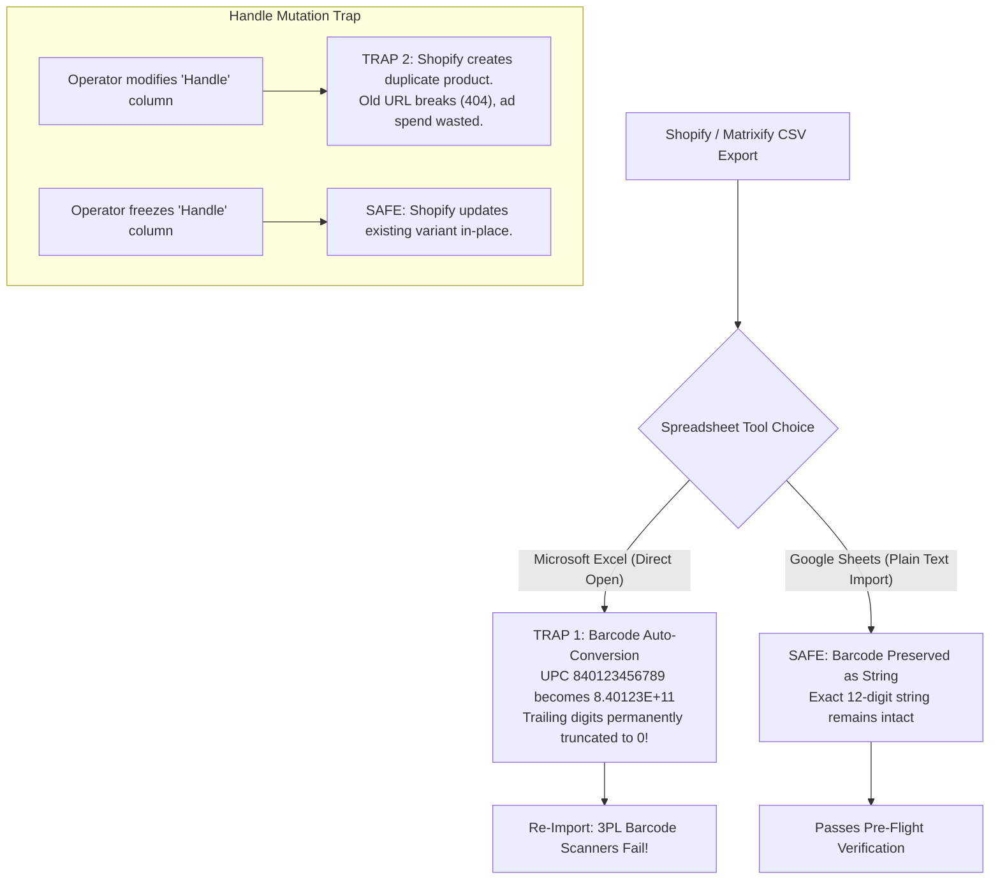

# SOP - BulkCatalogMigrationAndHygiene - Parent

```
Document ID:     SOP - BulkCatalogMigrationAndHygiene - Parent
Naming Format:   [CATEGORY] - [PURPOSE] - [TIER]
Category:        SOP (Standard Operating Procedure)
Purpose:         BulkCatalogMigrationAndHygiene
Tier / Level:    Parent (Master Specification)
Status:          Locked 🔒 (Master Baseline)
Target Audience: TechOps Specialists, Catalog Managers, E-Commerce Merchandisers
Ecosystem Scope: Shopify Admin, Matrixify (Excelify), Google Sheets, 3PL WMS Barcode Scanners
Business Unit:   Synapse Botanicals (Catalog & Data Operations)
```

---

## 1. Purpose, Scope & Data Governance

### 1.1 Purpose
This Standard Operating Procedure (SOP) defines the mandatory protocols for exporting, auditing, mutating, and re-importing product catalog and inventory data in bulk across Synapse Botanicals. Strict adherence to this protocol prevents:
* **Barcode Database Corruption:** Truncation of 12-to-14-digit UPC/EAN barcodes caused by spreadsheet auto-formatting, which immediately disables 3PL warehouse handheld scanners.
* **Orphaned Product URLs & Broken SEO:** Accidental mutation of product `Handle` slugs, breaking active Google search indexation, Meta/TikTok ad tracking links, and customer bookmarks (instant 404 errors).
* **Metafield Type Mismatches:** Corrupted data structures in custom theme sections and headless storefront APIs.
* **Inventory Drift & Ghost Quantities:** Overwriting live Available-to-Sell (ATS) inventory counts during catalog price updates.

### 1.2 System Scope & Supported Tools
This SOP governs all bulk modifications to product records, variant configurations, cost-of-goods (COGS), and custom metafields using:
* **Matrixify (Excelify):** The authorized enterprise bulk import/export tool for Synapse Botanicals.
* **Google Sheets:** The mandatory spreadsheet editor for preserving raw text strings (Microsoft Excel is prohibited for raw CSV manipulation under Section 2.1).

---

## 2. The Two Fatal Traps & Technical Safeguards



### 2.1 Trap A: Numeric Coercion and Barcode Integrity

> [!CAUTION]
> **Identifiers must remain text:** Scientific notation in the display does not by itself prove digit loss. Excel retains 15 significant digits; a 12-digit integer can be exact, but numeric coercion can drop leading zeros, and a rounded export or longer identifier can lose digits. Inspect the actual exported bytes and compare with the approved product master.

Import identifiers as text from the start in Excel or Google Sheets. Formatting as text after digits were lost cannot reconstruct them. Never guess or pad a damaged barcode into a new value.

### 2.2 Trap B: The Handle Immutability Rule

> [!WARNING]
> **Stable identity versus URL:** Shopify product IDs and variant IDs identify records; handles are mutable URL slugs. In a handle-only import, changing the handle can prevent a match and MERGE can create a new product. With a stable ID, a deliberate handle change can update the same record. Preserve handles for routine updates and verify redirects for approved URL changes. A duplicate product does not automatically mean the original URL disappeared.

> [!TIP]
> **What is a URL Redirect (301 Forward)?**  
> In Shopify, under **Online Store $\rightarrow$ Navigation $\rightarrow$ View URL redirects**, you can set a permanent forwarding rule. If you change a product link from `/products/stick-packs` to `/products/focus-stick-packs`, a redirect ensures that anyone clicking an old Google search result, bookmark, or paid ad is seamlessly redirected to the new link instead of seeing an ugly "404 Page Not Found" error.

---

## 3. SOP - BulkCatalogMigrationAndHygiene - Protocol A: Safe Catalog Export & Data Wrangling

### 3.1 Matrixify Export Configuration
1. Open Shopify Admin $\rightarrow$ **Apps** $\rightarrow$ **Matrixify**.
2. Under the **Export** section, click **New Export**.
3. Select **Format:** `Matrixify: Excel`.
4. In the **Sheets** selection:
   * Check **`Products`**.
   * Under Products options, click the dropdown and select **only the necessary sub-sheets**:
     * `Basic Columns` (Title, Handle, Vendor, Type, Tags, Status)
     * `Variants` (SKU, Price, Compare-At, Cost, Barcode, Weight)
     * `Metafields` (Custom technical attributes)
     * **UNCHECK** `Inventory Levels` (Unless an intentional inventory rebalance is being performed, to avoid overwriting live sales decrements).
5. Click **Export**.

```
┌────────────────────────────────────────────────────────────────────────┐
│  Matrixify Export Configuration                                        │
│                                                                        │
│  Format: Matrixify: Excel (.xlsx)                                      │
│  [✓] Products                                                          │
│      ├── [✓] Basic Columns                                             │
│      ├── [✓] Variants (Price, COGS, SKU, Barcode)                      │
│      ├── [✓] Metafields                                                │
│      └── [ ] Inventory Levels (Excluded to prevent race conditions)    │
└────────────────────────────────────────────────────────────────────────┘
```

### 3.2 Spreadsheet Hygiene & Editing Guidelines
1. Open the `.xlsx` export inside **Google Sheets**.
2. Immediately highlight column `Variant Barcode` $\rightarrow$ Select `Format` $\rightarrow$ `Number` $\rightarrow$ **`Plain text`**.
3. Verify that every barcode displays all 12 digits (e.g., `840001040001`).
4. **Permissible Edits:**
   * **`Variant Price`:** Update retail price (e.g., modifying `42.00`).
   * **`Variant Compare At Price`:** Update strikethrough price (e.g., setting to `48.00`).
   * **`Cost per item` (`Variant Cost`):** Update unit COGS (e.g., Stick Pack `8.50`, Tincture `12.50`, Starter Bundle `24.50`).

> [!NOTE]
> **System Architecture Dependency:**  
> Updated `Variant Cost` figures feed directly into the unit economics and financial hazard models documented in **[Matrix - OrderStatePointOfNoReturn - Master (Domain 1.2)](Matrix-OrderStatePointOfNoReturn-Master.md)** and the zone cost models in **[Matrix - OrderRoutingCostOptimization - DecisionEngine (Domain 2.2)](Matrix-OrderRoutingCostOptimization-DecisionEngine.md)**.

---

## 4. SOP - BulkCatalogMigrationAndHygiene - Protocol B: Custom Metafield Bulk Configuration

Synapse Botanicals relies on custom metafields to render supplement facts panels, active nootropic dosages, and dietary badges on product display pages (PDPs).

### 4.1 Metafield Naming Syntax in Matrixify
Matrixify requires metafield column headers to follow an explicit syntax:  
`Metafield: [namespace].[key] [type]`

| Matrixify Column Header Syntax | Shopify Data Type | Production Value Example | Storefront Display Purpose |
| :--- | :--- | :--- | :--- |
| `Variant Metafield: custom.active_nootropics [string]` | Single-line text | `Lion's Mane, L-Theanine` | Supplement Facts / Active Ingredients |
| `Variant Metafield: custom.caffeine_mg [number_integer]` | Integer (Whole number) | `100` *(or `0` for Caffeine-Free)* | PDP Caffeine Dose Meter |
| `Variant Metafield: custom.dietary_badges [list.single_line_text_field]` | List of Strings (JSON Array) | `["Vegan", "Non-GMO", "Gluten-Free"]` | Dietary Certification Badges |
| `Variant Metafield: custom.serving_count [number_integer]` | Integer (Whole number) | `30` | Servings per Container Display |

### 4.2 Formatting Rules for Lists & JSON Metafields
* When populating `list.single_line_text_field` (e.g., `custom.dietary_badges`), values must be formatted as valid JSON string arrays:
  * **Correct:** `["Gluten-Free", "Vegan", "Sugar-Free"]`
  * **Incorrect:** `Gluten-Free, Vegan, Sugar-Free` *(Will trigger a 422 Unprocessable Entity error during import).*

---

## 5. SOP - BulkCatalogMigrationAndHygiene - Protocol C: Pre-Import Validation & Dry-Run Gate

Before uploading any sheet to production, the operator must complete and sign off on the **5-Point Pre-Flight Verification Gate**:

```
┌────────────────────────────────────────────────────────────────────────────────────────┐
│ 5-POINT PRE-FLIGHT VERIFICATION GATE                                                   │
├───────────────────────────────────────────────────────┬────────────┬───────────────────┤
│ Verification Checkpoint                               │ Status     │ Validation Method │
├───────────────────────────────────────────────────────┼────────────┼───────────────────┤
│ 1. Barcode String Integrity Check                     │ [ ] PASSED │ Regex verification│
│ 2. Handle Immutability Audit                          │ [ ] PASSED │ VLOOKUP to backup │
│ 3. SKU Uniqueness Verification                        │ [ ] PASSED │ Conditional Dups  │
│ 4. Matrixify Command Column Set to MERGE              │ [ ] PASSED │ Header check      │
│ 5. Full Store Backup Snapshot Exported                │ [ ] PASSED │ Local .xlsx saved │
└───────────────────────────────────────────────────────┴────────────┴───────────────────┘
```

### 5.1 Verification Checklist Procedures

#### Check 1: Barcode String Integrity
In a blank column, apply the following formula to test every barcode in row 2:
`=AND(ISNUMBER(VALUE(G2)), LEN(TO_TEXT(G2))>=12, NOT(ISNUMBER(FIND("E+", TO_TEXT(G2)))))`
* FALSE means this format check failed; it does not diagnose truncation. Validate exact text, permitted length, check digit, uniqueness and master-data match separately.

#### Check 2: Handle Immutability Audit
Compare the modified sheet's `Handle` column against the original backup using `=VLOOKUP()`. Confirm zero missing handles (`#N/A`).

#### Check 3: SKU Uniqueness
Highlight column `Variant SKU` $\rightarrow$ Apply **Conditional Formatting** $\rightarrow$ `Format cells if... Custom formula` $\rightarrow$ `=COUNTIF(E:E, E1)>1`.
* Every SKU must be globally unique across the entire store.

#### Check 4: Matrixify Command Directive
Ensure Column A is named **`Command`** and set to **`MERGE`**.
* **`MERGE`:** Upserts: updates a matched record, but can create one if not matched. Prefer `UPDATE` with Product ID / Variant ID for existing-only migrations. Omitted columns differ from included blank cells; inspect field-specific behavior.
* **`REPLACE` (DANGER):** Wipes and replaces the entire product object, deleting unlisted images and variant metafields.

---

## 6. SOP - BulkCatalogMigrationAndHygiene - Protocol D: Import Execution & Rollback Recovery

### 6.1 Matrixify Execution Procedure
1. Navigate to **Shopify Admin $\rightarrow$ Apps $\rightarrow$ Matrixify**.
2. Under **Import**, click **Upload File** and select your validated `.xlsx` file.
3. Matrixify will parse the file and display an **Import Analysis Summary**:
   * Verify the number of products matches expected count (e.g., `5 Products, 12 Variants`).
   * Verify sheet type displays `Products`.
4. Under **Options**:
   * Set **Import Mode:** `Dry Run (Test without saving)` on initial execution.
   * If Dry Run passes with zero errors, re-run with `Live Import`.
5. Click **Import**.

```
┌────────────────────────────────────────────────────────────────────────┐
│  Matrixify Import Analysis                                             │
│                                                                        │
│  File: Synapse_Catalog_Update_20261017.xlsx                            │
│  Sheets: Products (5), Variants (12), Metafields (24)                  │
│                                                                        │
│  [ Start Dry Run ]        [ Start Import ]                             │
└────────────────────────────────────────────────────────────────────────┘
```

### 6.2 Emergency Rollback Protocol (Disaster Recovery)

If an unintended data mutation occurs (e.g., incorrect pricing or corrupted tags):

1. **Halt Live Import:** Click **Stop Import** inside Matrixify immediately.
2. **Retrieve Pre-Flight Snapshot:** Locate the untouched backup file exported prior to the update (Section 3.1).
3. **Restore the intended field delta:**
   * Compare the import results with the snapshot by stable IDs; identify exactly which records and fields were committed before the stop.
   * Restore only affected fields with `UPDATE` and `Variant Command: UPDATE`; preserve unrelated edits and omit inventory columns unless inventory is intentionally reconciled.
   * A MERGE snapshot does not remove accidentally created records or undo every side effect. Review extra records separately, with approval for deletion.

4. **Validate Live Store State:**
   * Open 3 random product pages on the live storefront.
   * Inspect price, compare-at price, and variant dropdowns.
   * Check 3PL portal to confirm inventory sync remains intact.
5. **Log Incident:** File a formal postmortem report detailing the corrupt column header or formula error.

> [!NOTE]
> **Audit Trail Reference:**  
> For the companion data schema and field mutation risk definitions, consult **[Matrix - CatalogDataSchemaAndValidation - Governance (Domain 3.2)](Matrix-CatalogDataSchemaAndValidation-Governance.md)**, and for the live verification and dry-run execution logs, consult **[Audit - BulkCatalogMutation - RunSheet (Domain 3.3)](Audit-BulkCatalogMutation-RunSheet.md)**.


## Technical references — checked 30 October 2026

- [Matrixify product template](https://matrixify.app/documentation/products/)
- [Matrixify commands](https://matrixify.app/documentation/list-of-commands-across-matrixify-sheets/)
- [Excel scientific notation and precision](https://support.microsoft.com/en-us/excel/display-numbers-in-scientific-exponential-notation)
