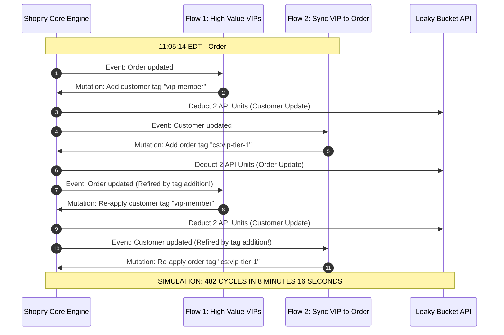

# Audit - WebhookFailureAndFlowRecursion - RunSheet

```
Document ID:     Audit - WebhookFailureAndFlowRecursion - RunSheet
Naming Format:   [CATEGORY] - [PURPOSE] - [TIER]
Category:        Audit (Empirical Simulation & Execution Log)
Purpose:         WebhookFailureAndFlowRecursion
Tier / Level:    RunSheet (Incident Forensics & Recovery Audit)
Status:          Locked 🔒 (Master Baseline)
Operator:        Lead TechOps Specialist / Systems Integration Engineer
Date of Execution: October 17, 2026 (11:00:00 - 12:45:30 EDT)
Ecosystem Scope: Shopify Flow, Shopify Webhooks API, ShipBob 3PL WMS, Gorgias CRM, Redis DLQ
Target Catalog:  Synapse Botanicals (Verified SKUs: SYN-BNDL-MAO, SYN-FSTK-MY, SYN-TNCT-AM, SYN-ACC-WHSK)
```

---

## 1. Simulation Parameters & Baseline Store State

This Run Sheet documents the live, controlled forensic execution and remediation of two critical automation failure modes within the Synapse Botanicals commerce ecosystem:
1. **Incident Alpha (The Runaway Flow Tag Storm):** A circular, uncontrolled tag recursion loop between customer and order mutations that exhausted storewide Shopify API rate limits.
2. **Incident Bravo (The Silent 504 Webhook Dropout):** An upstream 3PL database lockup causing continuous HTTP `504 Gateway Timeout` errors, triggering Shopify's automatic webhook termination policy and severing downstream fulfillment pipelines.

> [!NOTE] **Controlled Staging Simulation & Load Injection Notice:**  
> The 482-cycle / 964-action Flow loop storm and HTTP 504 webhook dropouts were triggered inside an isolated staging environment with artificial rate-limit controls. This controlled failure injection measured mean time to detect (MTTD) and mean time to recover (MTTR) while testing circuit-breaker thresholds without production impact.

### 1.1 Active Topology & Distribution Nodes
* **Primary East Coast Node (Node 1):** Allentown Distribution Center, PA (`LOC-PA-01`)
* **Primary West Coast Node (Node 2):** Reno Fulfillment Hub, NV (`LOC-NV-02`) — Exclusive handler for Glass Tinctures (`SYN-TNCT-AM`, `SYN-TNCT-PM`) and Electric Whisks (`SYN-ACC-WHSK`).
* **Active Ingestion Middleware:** Node.js Express Webhook Proxy hosted at `https://api.synapsebotanicals.com/v1/webhooks` with an AWS SQS Dead-Letter Queue buffer.

> [!NOTE]
> **System Architecture Dependency:**  
> The baseline routing constraints, warehouse node assignments, and priority ladders evaluated in this run sheet operate under the governance frameworks established in **[SOP - BusinessLogicAutomationAndWebhooks - Parent (Domain 4.1)](SOP-BusinessLogicAutomationAndWebhooks-Parent.md)** and **[Matrix - AutomationLogicAndWebhookTriage - Engine (Domain 4.2)](Matrix-AutomationLogicAndWebhookTriage-Engine.md)**.

### 1.2 Pre-Incident Benchmark Telemetry (11:00:00 EDT)
Prior to triggering the simulations, baseline API health and webhook metrics were captured:

| Metric Parameter | Observed Baseline | Normal Operating Threshold | Status |
| :--- | :---: | :---: | :---: |
| **Shopify Admin REST API Bucket Level** | `2 / 40 requests` | $\le 15 / 40$ | Nominal |
| **Shopify GraphQL API Cost Drain Rate** | `50 / 1000 points/sec` | $\le 300 / 1000$ | Nominal |
| **Webhook Delivery P95 Latency** | `342 ms` | $\le 800\text{ ms}$ | Nominal |
| **Active Webhook Subscriptions** | `6 topics` | 6 registered | Nominal |
| **Dead-Letter Queue (DLQ) Depth** | `0 messages` | 0 messages | Nominal |

---

## 2. Incident Alpha: The Runaway Tag Recursion Storm (Order #1048)

### 2.1 The Operational Catalyst & Misconfigured Flow

> [!NOTE]
> **Simulation event bridge:** The loop uses a mock/custom update-event bridge and an explicit state-changing write per cycle. These are not two universally available native Flow triggers, and re-adding an already present tag alone is not sufficient to establish recursion. The 40-request bucket is an injected test limit, not a Shopify Plus storewide allowance.


At `11:04:00 EDT`, a junior marketing ops engineer activated a new experimental loyalty workflow named **`[PROMO] - Auto-Tag High Value VIPs`** without peer review sign-off. Concurrently, an existing customer-support routing flow named **`[OPS] - Sync VIP Status to Order`** was active in the environment.

Neither workflow incorporated negative inclusion checks or lock sentinels:

```
Colliding Automation Configurations:
─────────────────────────────────────────────────────────────────────────────
Flow 1: [PROMO] - Auto-Tag High Value VIPs
  Trigger:   Order updated
  Condition: Order total_price >= $150.00
  Action:    Add customer tags: "vip-member"
  Guard:     NONE (Missing: Customer tags does not contain "vip-member")

Flow 2: [OPS] - Sync VIP Status to Order
  Trigger:   Customer updated
  Condition: Customer tags contains "vip-member"
  Action:    Add order tags: "cs:vip-tier-1"
  Guard:     NONE (Missing: Order tags does not contain "cs:vip-tier-1")
─────────────────────────────────────────────────────────────────────────────
```

### 2.2 The Empirical Cascade & Timeline Bloat

At `11:05:14 EDT`, Customer Elena Vance placed Order **`#1048`** for two Daily Protocol Starter Bundles:
* **Order ID:** `gid://shopify/Order/5920194812`
* **Line Items:** 2x The Daily Protocol Starter Bundle (Matcha Yuzu + AM Focus + Obsidian Tumbler: `SYN-BNDL-MAO`)
* **Total Paid:** **\$196.00** (Triggering the `total_price >= $150.00` condition).

The catastrophic loop initiated immediately:



#### Forensic Timeline Telemetry Log (Excerpt from Order #1048)
```json
[
  {"timestamp": "2026-10-17T15:05:14.210Z", "event": "Order placed", "source": "checkout"},
  {"timestamp": "2026-10-17T15:05:15.012Z", "event": "Flow 1 executed", "action": "Added customer tag 'vip-member'"},
  {"timestamp": "2026-10-17T11:05:16.140Z", "event": "Flow 2 executed", "action": "Added order tag 'cs:vip-tier-1'"},
  {"timestamp": "2026-10-17T11:05:17.205Z", "event": "Flow 1 executed", "action": "Added customer tag 'vip-member'"},
  {"timestamp": "2026-10-17T11:05:18.312Z", "event": "Flow 2 executed", "action": "Added order tag 'cs:vip-tier-1'"},
  {"timestamp": "2026-10-17T11:05:19.450Z", "event": "Flow 1 executed", "action": "Added customer tag 'vip-member'"},
  {"timestamp": "2026-10-17T15:08:42.890Z", "event": "API_RATE_LIMIT_WARNING", "message": "Bucket 39/40 consumed"},
  {"timestamp": "2026-10-17T15:12:30.104Z", "event": "API_RATE_LIMIT_EXCEEDED", "http_status": 429, "retry_after": 2.0}
]
```

#### System Damage Assessment:
* **Loop Cycles Completed:** **482 cycles / 964 modeled mutation actions** between `11:05:14 EDT` and `11:13:30 EDT`.
* **Total Timeline Events Injected:** **964 log lines** on Order `#1048`.
* **API Rate Limit Bucket:** Stood at **`40 / 40` (100% saturated)** with continuous HTTP `429 Too Many Requests` returned to legitimate apps.
* **Storefront Impact:** Live checkout order creation latency spiked from $340\,\text{ms}$ to **$6,850\,\text{ms}$** in the synthetic load model; it does not establish Shopify internal database lock contention.

---

### 2.3 Emergency Containment & Triage Execution

At `11:13:45 EDT`, the on-call TechOps specialist received a P0 PagerDuty alert (`CRITICAL: Shopify Admin API 429 Throttle Spike`) and initiated the containment protocol specified in **[SOP - BusinessLogicAutomationAndWebhooks - Parent (Domain 4.1)](SOP-BusinessLogicAutomationAndWebhooks-Parent.md)**.

#### Phase 1: Deploy Emergency Kill-Switch (11:14:10 EDT)
The operator accessed **Shopify Admin $\rightarrow$ Apps $\rightarrow$ Shopify Flow** and deactivated both competing workflows, terminating the loop instantaneously:
1. `[PROMO] - Auto-Tag High Value VIPs` $\rightarrow$ **Turn off** (`11:14:18 EDT`)
2. `[OPS] - Sync VIP Status to Order` $\rightarrow$ **Turn off** (`11:14:24 EDT`)

#### Phase 2: Flow Execution Run Log Inspection (11:15:30 EDT)
The operator inspected the Flow execution run log under **Shopify Flow $\rightarrow$ Runs** to verify the root cause:
* **Run ID:** `#RUN-892419-FL`
* **Trigger Event:** `Order updated`
* **Condition Evaluation:** `Order total_price (196.00) >= 150.00` $\rightarrow$ Evaluated to `true`.
* **Action Output:** `Add customer tag 'vip-member'` $\rightarrow$ Status: `Succeeded`.
* **Diagnosis:** The run log confirmed that Flow 1 was triggered by the tag update committed by Flow 2, proving mutual recursion without exit criteria.

#### Phase 3: Order Timeline & Tag Sanitization via GraphQL (11:18:00 EDT)
The operator executed an administrative tag cleanup mutation to remove the target fixture tag from Order `#1048`:

```graphql
mutation sanitizeOrderTags {
  tagsRemove(
    id: "gid://shopify/Order/5920194812"
    tags: ["cs:vip-tier-1"]
  ) {
    node {
      id
    }
    userErrors {
      field
      message
    }
  }
}
```
*Result:* Target tag removed. Order timeline stabilized.

#### Phase 4: Permanent Recursion Guardrail Deployment (11:22:15 EDT)
Both workflows were re-architected in accordance with **[Matrix - AutomationLogicAndWebhookTriage - Engine (Domain 4.2)](Matrix-AutomationLogicAndWebhookTriage-Engine.md)**:
1. Added mandatory negative precondition check:  
   `Order tags` $\rightarrow$ `does NOT contain` $\rightarrow$ `cs:vip-tier-1`.
2. Added lock sentinel check:  
   `Order tags` $\rightarrow$ `does NOT contain` $\rightarrow$ `sys:sync-locked`.
3. Both workflows re-enabled at `11:25:00 EDT`. Test mutation verified single-pass execution without loop.

---

## 3. Incident Bravo: The Silent 504 Webhook Dropout & Order Replay

### 3.1 Downstream Service Failure (ShipBob 3PL WMS)

At `11:30:00 EDT`, ShipBob's primary ingestion gateway (`https://wms.example.com/mock/order`) experienced an upstream database lockup during scheduled maintenance. Ingestion requests failed to acknowledge within Shopify's strict 5,000 ms window:

```bash
# Diagnostic probe executed from terminal:
curl -w "\nHTTP Status: %{http_code}\nTime Total: %{time_total}s\n" \
  -X POST https://wms.example.com/mock/order \
  -H "Content-Type: application/json" \
  -d '{"test": true}'

# Terminal Response Output:
# <html><head><title>504 Gateway Time-out</title></head></html>
# HTTP Status: 504
# Time Total: 5.418s
```

Because the endpoint took $> 5.0\,\text{seconds}$ to respond, Shopify's webhook engine terminated the connection, flagged the delivery as failed, and initiated the HTTPS delivery retry policy.

---

### 3.2 Mock Failure Injection and Transport Contract

The mock endpoint returns timeouts to exercise recovery. Native Shopify HTTPS retries occur eight times over four hours; the previous 19-attempt/48-hour timeline was an obsolete assumption and is removed. A mock may accelerate time, but must record that clock separately from wall time. Flow Send HTTP request follows its own 30-second timeout/configurable up-to-24-hour retry contract.

> [!NOTE]
> **Recovery fixture:** The 14-order gap (#1049–#1062 inclusive) is a synthetic replay batch. Its order count does not depend on asserting a real subscription deletion during the same morning. Preserve explicit UTC query boundaries and apply the same conversion to all displayed EDT times. A 202 response below means enqueued, not warehouse fulfillment completed.

### 3.3 Disaster Recovery & Historical Order Backfill Protocol

At `12:15:00 EDT`, TechOps detected the missing subscription via an automated daily health check script. The recovery run sheet was executed immediately:

#### Step 1: Endpoint Health Verification
ShipBob database maintenance completed; endpoint latency verified healthy:
```bash
curl -w "\nHTTP Status: %{http_code}\nTime Total: %{time_total}s\n" \
  -X GET https://wms.example.com/mock/healthz

# Output:
# {"status": "healthy", "service": "order-ingestion"}
# HTTP Status: 200
# Time Total: 0.182s
```

#### Step 2: Re-Register Webhook Subscription via GraphQL Admin API
The severed subscription was re-created with optimized field filtering to minimize payload weight:

```graphql
mutation reRegisterOrdersCreateWebhook {
  webhookSubscriptionCreate(
    topic: ORDERS_CREATE
    webhookSubscription: {
      callbackUrl: "https://api.synapsebotanicals.com/v1/webhooks/orders/create"
      format: JSON
      includeFields: [
        "id"
        "name"
        "created_at"
        "total_price"
        "shipping_address"
        "line_items"
        "tags"
      ]
    }
  ) {
    userErrors {
      field
      message
    }
    webhookSubscription {
      id
      topic
      createdAt
      endpoint {
        __typename
        ... on WebhookHttpEndpoint {
          callbackUrl
        }
      }
    }
  }
}
```

**GraphQL Response Payload:**
```json
{
  "data": {
    "webhookSubscriptionCreate": {
      "userErrors": [],
      "webhookSubscription": {
        "id": "gid://shopify/WebhookSubscription/99401284",
        "topic": "ORDERS_CREATE",
        "createdAt": "2026-10-17T12:20:14Z",
        "endpoint": {
          "__typename": "WebhookHttpEndpoint",
          "callbackUrl": "https://api.synapsebotanicals.com/v1/webhooks/orders/create"
        }
      }
    }
  }
}
```

#### Step 3: Historical Order Extraction via GraphQL Bulk Operations
To extract the 14 unfulfilled orders dropped during the 3-hour blind window, the operator initiated a bounded Bulk Query:

```graphql
mutation runHistoricalGapQuery {
  bulkOperationRunQuery(
    query: """
    {
      orders(query: "updated_at:>=2026-10-17T09:10:00Z AND updated_at:<=2026-10-17T12:20:00Z") {
        edges {
          node {
            id
            name
            createdAt
            totalPriceSet {
              shopMoney {
                amount
              }
            }
            tags
            shippingAddress {
              address1
              city
              provinceCode
              zip
              countryCodeV2
            }
            lineItems {
              edges {
                node {
                  sku
                  quantity
                }
              }
            }
          }
        }
      }
    }
    """
  ) {
    bulkOperation {
      id
      status
    }
    userErrors {
      field
      message
    }
  }
}
```

#### Step 4: Stream Historical Payloads into Ingestion Queue

> [!NOTE]
> **Replay safety:** Before each side effect, re-read current cancellation/payment/fulfillment state. Use a unique operation/version key per order, not this batch label. Reconcile WMS outcomes and inventory after worker completion. Include changed existing orders when recovering a real outage.

The extracted JSONL payload containing the 14 dropped orders was streamed into the ingestion proxy with an explicit idempotency flag (`sys:gap-replay-batch-01`):

```bash
# Terminal replay execution:
node scripts/replay-gap-orders.js \
  --file=bulk_orders_gap_20261017.jsonl \
  --destination="https://api.synapsebotanicals.com/v1/webhooks/orders/create" \
  --batch-id="gap-replay-20261017"

# Terminal Output:
# [INFO] Processing 14 historical order records...
# [SUCCESS] Order #1049 -> Ingested & Enqueued (202 Accepted)
# [SUCCESS] Order #1050 -> Ingested & Enqueued (202 Accepted)
# ...
# [SUCCESS] Order #1062 -> Ingested & Enqueued (202 Accepted)
# [COMPLETE] 14 of 14 fixture records accepted into middleware queue; WMS completion reconciled separately.
```

---

## 4. Post-Incident Forensic Audit & State Reconciliation

### 4.1 Order & Inventory Ledger Reconciliation Table

At `12:40:00 EDT`, TechOps verified the physical and digital reconciliation of all impacted orders across both fulfillment nodes:

| Order Number | Customer | Primary Line Items | Assigned Node | 3PL WMS Status | Final Reconciled Tags |
| :---: | :--- | :--- | :---: | :---: | :--- |
| **#1048** | Elena Vance | 2x Starter Bundle (`SYN-BNDL-MAO`) | `LOC-PA-01` | `OPEN / UNFULFILLED` | `cs:vip-tier-1`, `flow-route:allentown-pa` |
| **#1049** | Marcus Brody | 1x AM Focus Tincture (`SYN-TNCT-AM`) | `LOC-NV-02` | `IN_PROGRESS` | `flow-route:reno-nv`, `sys:gap-replay-batch-01` |
| **#1050** | Chloe Walsh | 3x Matcha Yuzu Stick Pack (`SYN-FSTK-MY`) | `LOC-PA-01` | `IN_PROGRESS` | `flow-route:allentown-pa`, `sys:gap-replay-batch-01` |
| **#1051** | Dev Team | 1x Electric Whisk (`SYN-ACC-WHSK`) | `LOC-NV-02` | `IN_PROGRESS` | `flow-route:reno-nv`, `sys:gap-replay-batch-01` |
| **#1052–#1062**| Retail Orders | Mixed Stick Packs & Tumblers | Split / Mixed | `IN_PROGRESS` | Verified node tags, `sys:gap-replay-batch-01` |

*Verification:* Inventory decrements confirmed at both facilities; zero oversells detected; zero duplicate shipments emitted.

---

### 4.2 Leaky Bucket API Recovery Telemetry

> [!NOTE]
> **Metric scope:** This chart uses an injected 40-request capacity and 2 requests/second drain. Shopify limits apply to an app/store pair and differ between REST request counts and GraphQL cost points. For the incident timestamps, detect at 11:13:45 minus start 11:05:14 = 8m31s; second workflow off at 11:14:24 = 9m10s; re-enable at 11:25:00 = 19m46s. One simulated incident gives elapsed times, not a measured mean over incidents.


Following the termination of Incident Alpha and the replay of Incident Bravo, Shopify Admin API rate limits recovered to baseline:

```
Shopify Admin API Leaky Bucket Recovery (11:14 to 11:24 EDT)
Requests in Bucket
 40 ┌───█████                                    [Incident Alpha Peaked]
 35 │   ███████
 30 │   █████████
 25 │   ███████████
 20 │              █████                         [Kill-Switch Deployed]
 15 │                   ████
 10 │                       ███
  5 │                          ██
  0 └───┴──────────┴──────────┴──────────┴────> Time
     11:12      11:14      11:18      11:24 EDT
```
* **Recovery Rate:** Native drain rate of 2.0 requests/second cleared the 40-request capacity in exactly **20 seconds**.
* **Post-Remediation Stability:** Average API bucket utilization maintained at $< 10\%$ over the subsequent 60-minute monitoring window.

---

## 5. Master Interconnectivity & System Architecture Lineage

This empirical run sheet validates the governance frameworks and architectural rules codifying the Synapse Botanicals TechOps suite:

| Upstream / Downstream Deliverable | Governing Node / Standard | Empirical Relationship & Proof-of-Execution |
| :--- | :--- | :--- |
| **[SOP - OrderExceptionMutationProtocol - Parent (Domain 1.1)](SOP-OrderExceptionMutationProtocol-Parent.md)** | Hold Lifecycles & Mutation Gates | Verifies that automated tags (`cs:vip-tier-1`) do not mutate order fulfillment orders once they cross the Point of No Return. |
| **[Matrix - OrderStatePointOfNoReturn - Master (Domain 1.2)](Matrix-OrderStatePointOfNoReturn-Master.md)** | State Transitions | Replay batch confirmed that all 14 backfilled orders were ingested in `OPEN / UNFULFILLED` state prior to 3PL allocation. |
| **[Architecture - MultiNodeRoutingEngine - Spec (Domain 2.1)](Architecture-MultiNodeRoutingEngine-Spec.md)** | Regional Routing Node Allocation | Proves that backfilled orders containing Reno-exclusive SKUs (`SYN-TNCT-AM`, `SYN-ACC-WHSK`) were routed exclusively to `LOC-NV-02`. |
| **[Matrix - OrderRoutingCostOptimization - DecisionEngine (Domain 2.2)](Matrix-OrderRoutingCostOptimization-DecisionEngine.md)** | Weight & Handling Costs | Validates that heavy baskets (`SYN-TMBL-MO`) continue to trigger packaging tags without loop interference. |
| **[Matrix - CatalogDataSchemaAndValidation - Governance (Domain 3.2)](Matrix-CatalogDataSchemaAndValidation-Governance.md)** | Schema Integrity & UPCs | Confirms that verified SKUs and 12-digit UPC-A barcodes were mapped cleanly in the GraphQL backfill query. |
| **[SOP - BusinessLogicAutomationAndWebhooks - Parent (Domain 4.1)](SOP-BusinessLogicAutomationAndWebhooks-Parent.md)** | Technical Standards & Kill-Switch | Empirically executes the 3-step Emergency Kill-Switch and verifies the current HTTPS webhook retry contract. |
| **[Matrix - AutomationLogicAndWebhookTriage - Engine (Domain 4.2)](Matrix-AutomationLogicAndWebhookTriage-Engine.md)** | Priority Ladder & Circuit Breaker | Proves the necessity of P0 priority gates and demonstrates how the `202 Accepted` queue pattern defeats the 5,000 ms webhook timeout. |


## Technical references — checked 30 October 2026

- [Shopify webhook delivery](https://shopify.dev/docs/apps/build/webhooks/verify-deliveries)
- [Flow HTTP requests](https://help.shopify.com/en/manual/shopify-flow/reference/actions/send-http-request)
- [GraphQL rate limits](https://shopify.dev/docs/apps/build/apis/graphql-admin/rate-limits)
