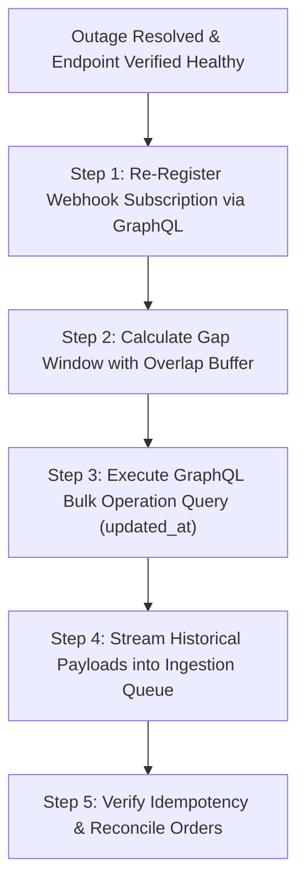
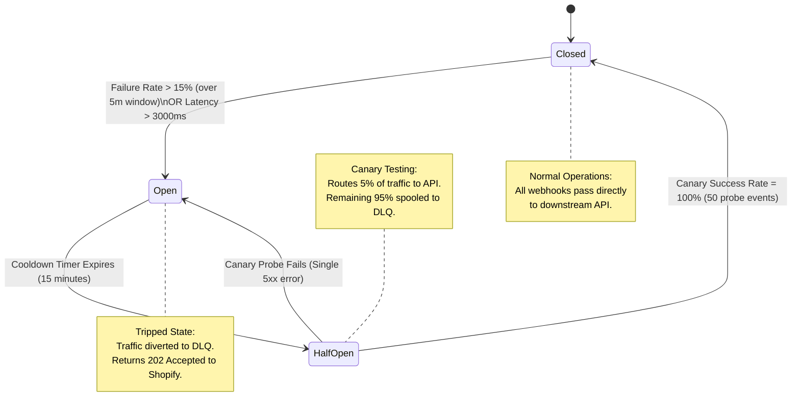

# Matrix - AutomationLogicAndWebhookTriage - Engine

```
Document ID:     Matrix - AutomationLogicAndWebhookTriage - Engine
Naming Format:   [CATEGORY] - [PURPOSE] - [TIER]
Category:        Matrix (Algorithmic Evaluation & Incident Governance)
Purpose:         AutomationLogicAndWebhookTriage
Tier / Level:    Engine (Event Priority & Fail-Safe Architecture)
Status:          Locked 🔒 (Master Baseline)
Target Audience: Lead TechOps Specialists, Automation Engineers, Systems Integrators
Ecosystem Scope: Shopify Flow, Shopify Webhooks API, AWS SQS / Redis DLQ, 3PL WMS (ShipBob WMS), Gorgias
Business Unit:   Synapse Botanicals (Automation & Systems Infrastructure)
```

---

## 1. Executive Summary & Event-Driven Governance Philosophy

### 1.1 Purpose & Architectural Scope
In distributed modern commerce, event-driven architectures execute mission-critical operations: real-time fraud evaluation, dynamic multi-node fulfillment routing, inventory synchronization, and downstream ERP/CRM record propagation. When an automation pipeline fails or executes out of sequence, the resulting failures manifest as duplicate warehouse shipments, corrupted inventory ledgers, dropped customer orders, and customer service escalation cascades.

This document establishes the authoritative technical decision engine governing **Shopify Flow execution priority**, **HTTP webhook response code triage**, **automated retry curves**, **circuit-breaker thresholds**, and **recursion prevention guardrails** for Synapse Botanicals.

### 1.2 The Three Core Triage Axioms
1. **Zero Silent Data Loss:** Every inbound and outbound webhook event must either resolve with an HTTP `200/202` acknowledgment or log a persistent failure payload in an observable Dead-Letter Queue (DLQ).
2. **Deterministic State Isolation:** An automated action must evaluate explicit, mutually exclusive preconditions before modifying order, customer, or inventory states.
3. **Idempotent Ingestion & Replay:** Every webhook consumer and automation handler must track unique event identifiers (`X-Shopify-Webhook-Id` or GraphQL GIDs) to guarantee that duplicate deliveries produce zero side effects.

> [!NOTE]
> **System Architecture Dependency:**  
> This decision engine operationalizes the automation standards specified in **[SOP - BusinessLogicAutomationAndWebhooks - Parent (Domain 4.1)](file:///C:/Users/Riovic%20Matthew/.gemini/antigravity/brain/e77e4d5a-78bd-40a4-88c0-71790432f543/SOP%20-%20BusinessLogicAutomationAndWebhooks%20-%20Parent.md)** – **Section 3.1** and directly enforces the fulfillment lock gates modeled in **[Matrix - OrderStatePointOfNoReturn - Master (Domain 1.2)](file:///C:/Users/Riovic%20Matthew/.gemini/antigravity/brain/e77e4d5a-78bd-40a4-88c0-71790432f543/Matrix%20-%20OrderStatePointOfNoReturn%20-%20Master.md)** – **Section 2.0**.

---

## 2. Shopify Flow Priority Resolution & Race Condition Governance

When an order event occurs, multiple Shopify Flow workflows trigger concurrently. Without deterministic priority arbitration, asynchronous race conditions occur—such as routing an order to a 3PL node before fraud analysis can apply an administrative hold.

### 2.1 The Four-Tier Execution Priority Ladder

Workflows must be designed, tagged, and ordered according to the four-tier priority hierarchy detailed below:

| Priority Tier | Classification | Target Workflows | Maximum Execution Latency | Downstream Dependency |
| :--- | :--- | :--- | :--- | :--- |
| **P0 (Critical)** | Risk & Integrity | Fraud Analysis, Order Hold Injection, Sanctions/Address Scrubbing | $\le 1,500\,\text{ms}$ | **Blocks all P1–P3 execution.** Prevents 3PL fulfillment release. |
| **P1 (High)** | Node Routing | Multi-Location Inventory Allocation (`LOC-PA-01` vs. `LOC-NV-02`), Heavy-Basket Packaging Routing | $\le 3,000\,\text{ms}$ | Unlocks fulfillment order assignment and 3PL routing tags. |
| **P2 (Operational)**| Operations & CRM | B2B Wholesale Tagging, Pre-Order Metadata Stamping, Gorgias VIP Ticket Escalation | $\le 10,000\,\text{ms}$ | Non-blocking. Informs warehouse pack slips and support tiers. |
| **P3 (Background)** | Marketing & Retention| Loyalty Tier Adjustments, Delayed Review Sequences (Wait 14 Days), Klaviyo Lifecycle Sync | Asynchronous / Delayed | Completely decoupled from order fulfillment lifecycle. |

---

### 2.2 Event Trigger vs. Action Conflict Resolution Matrix

| Trigger Event | Concurrently Executing Workflows | Potential Race Condition / Conflict | Structural Idempotency & Guard Pattern | Priority Resolution |
| :--- | :--- | :--- | :--- | :--- |
| `Order created` | • Flow 4.1: Fraud Risk Hold<br>• Flow 4.2: Heavy Basket Tagging (`SYN-TMBL-MO`)<br>• 3PL Ingestion Webhook | The 3PL webhook consumes the order and drops it to the warehouse floor before Flow 4.1 can inject `flow-hold:fraud-review`. | Add a mandatory 5-minute buffer delay in 3PL fulfillment release rules, OR require condition: `Order tags does NOT contain flow-hold:*`. | **P0 Wins:** Fraud hold applies immediately; 3PL webhook ignores held orders. |
| `Order updated` | • Flow 4.3: Address Verification<br>• Customer Profile Auto-Sync<br>• ERP Line-Item Reconciliation | Address edit in Shopify admin fires `Order updated`, triggering an auto-tag workflow that re-fires `Order updated` indefinitely. | Strict Tag Exclusion Guard: Precondition must verify `Order tags does NOT contain sys:sync-locked`. Apply tag on pass. | **Loop Terminated:** Single-pass execution guaranteed via namespace sentinel tag. |
| `Inventory level updated` | • Low Stock Warning (`< 50` units)<br>• Auto-Draft Purchase Order Flow<br>• Bundle Disassembly Automation | Simultaneous decrements across Allentown (`LOC-PA-01`) and Reno (`LOC-NV-02`) trigger multiple concurrent inventory threshold webhooks. | Evaluate `inventory_levels` by discrete Location ID rather than aggregated global variant quantity. Apply 60s throttle. | **Node-Level Isolation:** Inventory events isolate to specific fulfillment node. |
| `Customer created` | • Wholesale Verification<br>• Welcome Series Sync<br>• VIP Loyalty Classification | Customer tagged as `wholesale-pending` by Admin, simultaneously tagged as `retail-welcome` by Klaviyo integration. | Flow condition hierarchy: `If customer email matches B2B domain -> Add Tag 'cs:b2b-prospect' -> Exit Flow immediately`. | **Deterministic Exit:** B2B classification halts retail drip sequences. |

> [!NOTE]
> **System Architecture Dependency (Order Lifecycle):**  
> For complete technical governance on how P0 Fraud Holds interact with warehouse fulfillment order lines and manual customer address mutations, consult **[Matrix - OrderStatePointOfNoReturn - Master (Domain 1.2)](file:///C:/Users/Riovic%20Matthew/.gemini/antigravity/brain/e77e4d5a-78bd-40a4-88c0-71790432f543/Matrix%20-%20OrderStatePointOfNoReturn%20-%20Master.md)** – **Section 2.0**.

---

## 3. HTTP Webhook Triage & Status Code Response Matrix

Shopify webhooks expect an HTTP `2xx` success response within **5 seconds (5,000 ms)**. If a receiving server returns a non-2xx status code or times out, Shopify's delivery pipeline marks the execution as failed and enters an automated retry cycle.

The matrix below defines the deterministic operational protocol for each HTTP status code encountered across the Synapse Botanicals webhook ingestion pipeline:

| HTTP Status Code | Response Classification | Root Cause Pattern at Synapse Botanicals | Shopify Delivery Behavior | Automated Triage Action | Recovery SLA | Preventative Engineering Safeguard |
| :--- | :--- | :--- | :--- | :--- | :--- | :--- |
| **`200 OK`** | Nominal Success | Payload received, HMAC validated, and business logic processed synchronously. | Delivery marked complete. Delivery log closed. | Archive raw payload header in 30-day cold log buffer. | Instantaneous | Maintain handler latency $\le 800\,\text{ms}$. |
| **`202 Accepted`** | Asynchronous Success | Payload received, HMAC verified, and raw JSON spooled into message queue (SQS/PubSub/Redis) for background consumption. | Delivery marked complete. Handshake terminated safely. | Enqueue message to background worker pool; immediately release HTTP connection. | Instantaneous | Recommended architecture for all high-volume endpoints to defeat the 5s timeout. |
| **`400 Bad Request`** | Client Payload Error | Malformed JSON body or invalid HTTP headers generated by intermediate reverse proxy. | Shopify retries according to the 19-attempt backoff curve. | Inspect Cloudflare / edge proxy logs for body truncation or header stripping. | 1 Hour | Bypass edge WAF inspection for trusted Shopify webhook IP ranges. |
| **`401 Unauthorized`** | Authentication Failure | Missing or corrupt API bearer token; failed HMAC-SHA256 signature verification. | Shopify retries according to the 19-attempt backoff curve. | **Trigger P1 PagerDuty Alert:** Rotate API keys in private app settings; re-sync shared secret in middleware. | 15 Minutes | Automated credential rotation script with dual-secret overlapping validation windows. |
| **`403 Forbidden`** | Scope / Permission Loss | App access token lacks required Admin API scopes (e.g., `read_fulfillments` revoked). | Shopify retries according to the 19-attempt backoff curve. | Re-authorize app permissions via Shopify Admin Partner portal. | 30 Minutes | CI/CD permission linting during app deployment pipeline. |
| **`404 Not Found`** | Broken Route / Endpoint | Ingestion URL path changed or deprecated (e.g., `/api/webhooks/orders` returns 404). | Shopify retries according to the 19-attempt backoff curve. | Roll back endpoint routing in deployment ingress; restore route alias in server config. | 15 Minutes | Immutable API routing contracts; deprecation redirects (`307 Temporary Redirect` not supported by Shopify—must return 200). |
| **`422 Unprocessable Entity`** | Business Logic Rejection | Schema mismatch (e.g., Order includes unmapped SKU like legacy placeholder `SYN-STK` instead of `SYN-FSTK-MY`). | Shopify retries according to the 19-attempt backoff curve. | Middleware catches rejection, logs payload to DLQ, and generates Ops ticket with failed SKU GID. | 4 Hours | Catalog validation gate on Shopify Admin preventing publish of unmapped SKUs. |
| **`429 Too Many Requests`** | Rate Limit Breached | Downstream receiving server or 3PL WMS API hit burst limit during a flash sale. | Shopify retries according to the 19-attempt backoff curve. | Shift webhook receiver to asynchronous queue ingestion (`202 Accepted` pattern). | 30 Minutes | Implement token-bucket rate smoothing in edge ingestion layer. |
| **`500 Internal Server Error`** | Uncaught Server Exception | Receiving application crashed (unhandled null exception on missing shipping address field). | Shopify retries according to the 19-attempt backoff curve. | Ingestion layer captures raw stack trace; fallback worker captures event in Redis buffer. | 1 Hour | Defensive payload parsing (`payload.shipping_address?.zip ?? ""` with optional chaining). |
| **`502 Bad Gateway`** | Reverse Proxy Failure | Node.js process crashed or NGINX upstream server failed to respond. | Shopify retries according to the 19-attempt backoff curve. | PM2 / Kubernetes auto-heals pod; check container memory limits and OOM kills. | 15 Minutes | Container memory headroom monitoring with alert threshold at 80% RAM utilization. |
| **`503 Service Unavailable`** | Service Outage | 3PL WMS undergoing scheduled database maintenance or server failure. | Shopify retries according to the 19-attempt backoff curve. | Trip **Circuit Breaker** (Section 5) to buffer webhooks in intermediate queue. | 2 Hours | Multi-region failover and decouple synchronous 3PL dependencies via staging tables. |
| **`504 Gateway Timeout`** | Execution Timeout | Ingestion handler blocked on synchronous database write; execution exceeded **5,000 ms**. | Shopify terminates connection and retries according to backoff curve. | Offload all database transactions and downstream API calls to background queues. | 30 Minutes | Enforce hard 2,000 ms timeout on HTTP handler; force async handoff. |

> [!NOTE]
> **System Architecture Dependency (Webhook Security & Kill-Switch):**  
> For complete instructions on implementing timing-safe HMAC SHA-256 verification and deploying the Emergency Webhook Kill-Switch, refer to **[SOP - BusinessLogicAutomationAndWebhooks - Parent (Domain 4.1)](file:///C:/Users/Riovic%20Matthew/.gemini/antigravity/brain/e77e4d5a-78bd-40a4-88c0-71790432f543/SOP%20-%20BusinessLogicAutomationAndWebhooks%20-%20Parent.md)** – **Section 4.0**.

---

## 4. Retry Boundaries, Gap Recovery & Transport Contracts

Understanding the distinct retry boundaries of Shopify's event and automation layers is vital: failure to resolve an outage before the retry schedule expires results in silent subscription termination or permanent event loss.

### 4.1 Native HTTPS Webhook Delivery Contract (Shopify Core)
* **Connection & Response Timeouts:** Native HTTPS delivery enforces a **1-second connection timeout** and a **5-second total response timeout**.
* **Retry Schedule (8 Attempts over ~4 Hours):** Shopify retries failed webhook deliveries (non-2xx responses or timeouts) utilizing an exponential backoff algorithm with randomized jitter.

```
Native Webhook Delivery Attempt Timeline (~4-Hour Window)
[T+0m]────[T+5m]───[T+15m]───[T+30m]───[T+1.0h]───[T+2.0h]───[T+3.0h]───[T+4.0h] ──> [TERMINATED / EMERGENCY EMAIL]
  │         │        │         │         │          │          │          │
Att 1     Att 2    Att 3     Att 4     Att 5      Att 6      Att 7      Att 8
```

| Attempt Number | Time Offset | Cumulative Window | Interval Category | Escalation & Triage Protocol |
| :---: | :---: | :---: | :---: | :--- |
| **1** | $0\,\text{min}$ | $0\,\text{min}$ | Initial Trigger | Subscribed endpoint returns non-2xx or times out ($>5\text{s}$). Logged as transient network blip. |
| **2** | $+5\,\text{min}$ | $5\,\text{min}$ | Immediate Retry | Secondary automated retry. Endpoint health check pinged. |
| **3** | $+10\,\text{min}$ | $15\,\text{min}$ | Short Backoff | Monitoring bot detects 3 consecutive drops across single endpoint. |
| **4** | $+15\,\text{min}$ | $30\,\text{min}$ | Short Backoff | **Tier 1 Slack Alert:** `#ops-tech-alerts` notified of recurring failure. |
| **5** | $+30\,\text{min}$ | $1.0\,\text{hour}$ | Intermediate Backoff | Automated endpoint health check (HTTP GET `/healthz`) initiated. |
| **6** | $+1.0\,\text{hour}$ | $2.0\,\text{hours}$ | Intermediate Backoff | Engineer on-call verifies receiving server status and database connectivity. |
| **7** | $+1.0\,\text{hour}$ | $3.0\,\text{hours}$ | Extended Backoff | Middleware shifts endpoint into circuit-breaker recovery mode. |
| **8** | $+1.0\,\text{hour}$ | $4.0\,\text{hours}$ | **Terminal Retry** | Final native retry attempt. If failed, subscription marked failed; emergency contact emailed. |

* **Subscription Revocation:** Subscriptions managed via the Admin API can be automatically disabled or deleted after persistent delivery failures over consecutive days. Warning emails are dispatched to the application emergency contact.
* **Operational Rule:** Do not publish a fixed minute-by-minute retry schedule as a platform SLA; design ingestion endpoints to process payloads within 2,000ms and defer heavy processing to asynchronous worker queues.

### 4.2 Shopify Flow "Send HTTP Request" Contract
* **Action Timeout:** Shopify Flow actions provide a **30-second request timeout**.
* **Retry Behavior:** Flow allows configurable retry, fail, or ignore handling, retrying failed external HTTP requests for up to **24 hours**.
* **Worker-to-WMS Queue:** External integration middleware (Express / AWS SQS) governs downstream retries into Reno (`LOC-NV-02`) or Allentown (`LOC-PA-01`) independently from Shopify core.

### 4.3 Missed Event Gap Recovery Procedure



#### Step 1: Re-Register Webhook Subscription via GraphQL Admin API
Execute the following mutation to re-establish the severed subscription immediately:

```graphql
mutation reRegisterWebhookSubscription {
  webhookSubscriptionCreate(
    topic: ORDERS_CREATE
    webhookSubscription: {
      callbackUrl: "https://api.synapsebotanicals.com/v1/webhooks/orders/create"
      format: JSON
      includeFields: ["id", "name", "email", "line_items", "shipping_address", "tags", "total_price"]
    }
  ) {
    userErrors {
      field
      message
    }
    webhookSubscription {
      id
      topic
      endpoint {
        __typename
        ... on WebhookHttpEndpoint {
          callbackUrl
        }
      }
    }
  }
}
```

#### Step 2: Historical Order Backfill Query
To backfill every order dropped during the outage window without triggering duplicate fulfillment requests, execute a bulk query bounded by `updated_at` (ensuring address edits and cancellations on pre-existing orders are captured):

```graphql
mutation backfillDroppedOrders {
  bulkOperationRunQuery(
    query: """
    {
      orders(query: "updated_at:>=2026-10-15T08:00:00Z AND updated_at:<=2026-10-17T08:00:00Z") {
        edges {
          node {
            id
            name
            createdAt
            updatedAt
            displayFulfillmentStatus
            tags
            lineItems {
              edges {
                node {
                  sku
                  quantity
                  variant {
                    id
                    barcode
                  }
                }
              }
            }
          }
        }
      }
    }
    """
  ) {
    bulkOperation {
      id
      status
    }
    userErrors {
      field
      message
    }
  }
}
```

---

## 5. Circuit-Breaker State Machine & Ingestion Throttling Engine

To prevent cascading system collapse when downstream services (e.g., 3PL WMS, Gorgias CRM) degrade, Synapse Botanicals implements an automated **Three-State Circuit Breaker Pattern** at the webhook ingestion proxy.

### 5.1 Three-State Circuit Breaker Model



### 5.2 Threshold Configuration & Metric Gates

| Parameter | Operational Threshold | Metric Definition | Action Triggered Upon Breach |
| :--- | :--- | :--- | :--- |
| **Error Rate Trip Threshold** | $\ge 15.0\%$ | Failed responses (`5xx` or timeouts) divided by total requests over a rolling 5-minute window. | **Trip Circuit to `OPEN`:** Cease forwarding to downstream endpoint. Return HTTP `202 Accepted` to Shopify and spool payloads directly to AWS SQS / Redis Dead-Letter Queue. |
| **Consecutive Failure Threshold** | $10\text{ consecutive requests}$ | Ten sequential non-2xx responses or connection timeouts regardless of volume. | **Immediate Emergency Trip to `OPEN`:** Eliminates risk of connection pool exhaustion. |
| **Latency Degradation Threshold** | $\ge 3,000\,\text{ms}$ average | Rolling P95 latency across downstream endpoint over 3 consecutive minutes. | **Preemptive Throttling:** Downgrade synchronous processing; spool 50% of traffic to queue to alleviate downstream load. |
| **Cooldown Duration** | $15\text{ minutes}$ | Elapsed duration the circuit remains in `OPEN` state before probing health. | **Transition to `HALF-OPEN`:** Releases canary probe batch. |
| **Canary Evaluation Volume** | $50\text{ requests (or 5% traffic)}$| Discrete batch of real incoming events routed to endpoint in `HALF-OPEN` state. | If all 50 succeed $\rightarrow$ Reset to `CLOSED`.<br>If any 1 fails $\rightarrow$ Reset to `OPEN` for 30 minutes. |
| **Maximum DLQ Retention** | $14\text{ days}$ | Time-to-live (TTL) for buffered payloads residing in Dead-Letter Queue. | Automated alert at 7-day mark if queue depth $> 0$. |

---

## 6. Canonical Tag Namespace Schema & Idempotency Guardrails

To prevent runaway Flow recursion storms (such as the 482-cycle tag loop analyzed in Domain 4.3), Synapse Botanicals strictly enforces canonical tag namespaces and concurrency controls:

### 6.1 The Canonical Tag Namespace Standard

```
Standard Tag Format: [DOMAIN_PREFIX]:[ACTION_OR_STATE]-[DESCRIPTOR]
Examples:
• flow-hold:customer-edit      (Active fulfillment hold due to customer address change)
• flow-hold:wms-timeout        (Active fulfillment hold due to downstream 3PL HTTP 504)
• flow-route:allentown-pa      (Fulfillment node assigned to Allentown Distribution Center)
• flow-route:reno-nv           (Fulfillment node assigned to Reno Hub)
• sys:edit-pending             (Transient concurrency lock for post-purchase modification)
• sys:loop-guard               (Recursion prevention gatekeeper tag)
```

### 6.2 Idempotency and Concurrency Guardrails
1. **Negative Precondition Gate:** Every Shopify Flow workflow that adds a tag must first verify that the order *does not already have that tag*. Workflows lacking this negative gate are blocked in code review.
2. **Transient Lock Lifecycle (`sys:edit-pending`):** When an in-flight mutation begins, apply `sys:edit-pending`. Subsequent events check for this tag and abort if present, preventing concurrent race conditions.
3. **TTL Clean-Up Daemon:** Any order bearing `sys:edit-pending` for longer than 300 seconds is flagged by an automated audit script, removing the stale lock and dispatching an alert to Slack (`#techops-alerts`).

---

## 7. Master Interconnectivity & System Architecture Lineage

The technical matrices in this document do not exist in isolation; they govern the real-time operational state transitions established across the complete Synapse Botanicals TechOps deliverable suite:

| Upstream / Downstream Deliverable | Governing Interface / Node | Interconnectivity Mechanism |
| :--- | :--- | :--- |
| **[SOP - OrderExceptionMutationProtocol - Parent (Domain 1.1)](file:///C:/Users/Riovic%20Matthew/.gemini/antigravity/brain/e77e4d5a-78bd-40a4-88c0-71790432f543/SOP%20-%20OrderExceptionMutationProtocol%20-%20Parent.md)** | Customer Address Edits & Line Item Swaps | P0 Flow Holds (`flow-hold:customer-edit`) suspend 3PL webhook dispatch while an order edit is processed, preventing dual-fulfillment race conditions. |
| **[Matrix - OrderStatePointOfNoReturn - Master (Domain 1.2)](file:///C:/Users/Riovic%20Matthew/.gemini/antigravity/brain/e77e4d5a-78bd-40a4-88c0-71790432f543/Matrix%20-%20OrderStatePointOfNoReturn%20-%20Master.md)** | Order State Machine & Fulfillment Gates | When warehouse status transitions to `PROCESSING` (PONR), webhook handlers reject inbound edit payloads with `422 Unprocessable Entity` and tag `sys:edit-rejected-ponr`. |
| **[Matrix - OrderRoutingCostOptimization - DecisionEngine (Domain 2.2)](file:///C:/Users/Riovic%20Matthew/.gemini/antigravity/brain/e77e4d5a-78bd-40a4-88c0-71790432f543/Matrix%20-%20OrderRoutingCostOptimization%20-%20DecisionEngine.md)** | Dynamic Order Allocation Rules | P1 Routing Workflows evaluate SKU availability across Allentown (`LOC-PA-01`) and Reno (`LOC-NV-02`) before emitting fulfillment webhooks to regional WMS nodes. |
| **[SOP - BusinessLogicAutomationAndWebhooks - Parent (Domain 4.1)](file:///C:/Users/Riovic%20Matthew/.gemini/antigravity/brain/e77e4d5a-78bd-40a4-88c0-71790432f543/SOP%20-%20BusinessLogicAutomationAndWebhooks%20-%20Parent.md)** | Architectural Specifications & HMAC Verification | Establishes the foundational standard operating procedures, timing-safe cryptographic security, and emergency kill-switch protocols operationalized by this matrix. |
| **[Audit - WebhookFailureAndFlowRecursion - RunSheet (Domain 4.3)](file:///C:/Users/Riovic%20Matthew/.gemini/antigravity/brain/e77e4d5a-78bd-40a4-88c0-71790432f543/Audit%20-%20WebhookFailureAndFlowRecursion%20-%20RunSheet.md)** | Empirical Simulation & Forensic Run Sheet | Provides the real-world operational testing ground, step-by-step diagnostic audit log, and payload recovery run sheet validating the circuit-breaker and triage rules codified in this engine. |


## Technical references — checked 30 October 2026

- [Shopify webhook delivery](https://shopify.dev/docs/apps/build/webhooks/verify-deliveries)
- [Flow HTTP requests](https://help.shopify.com/en/manual/shopify-flow/reference/actions/send-http-request)
- [GraphQL rate limits](https://shopify.dev/docs/api/usage/rate-limits)
