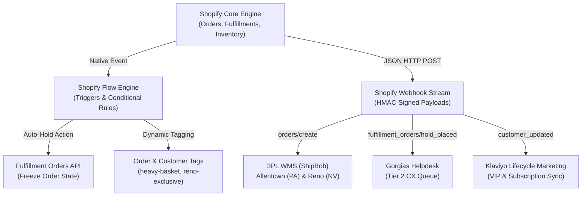
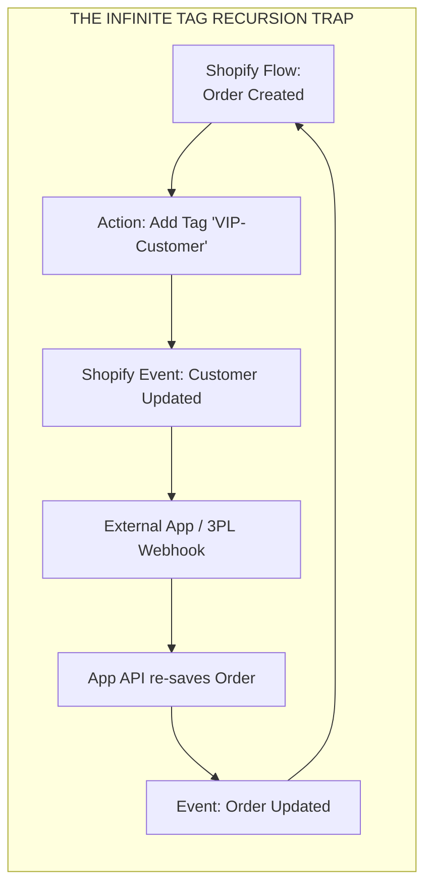
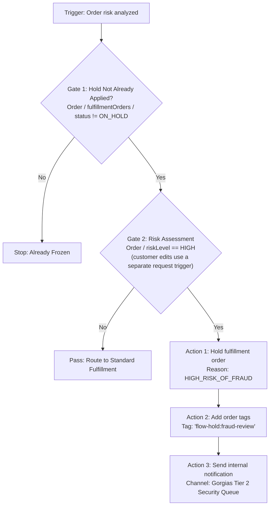
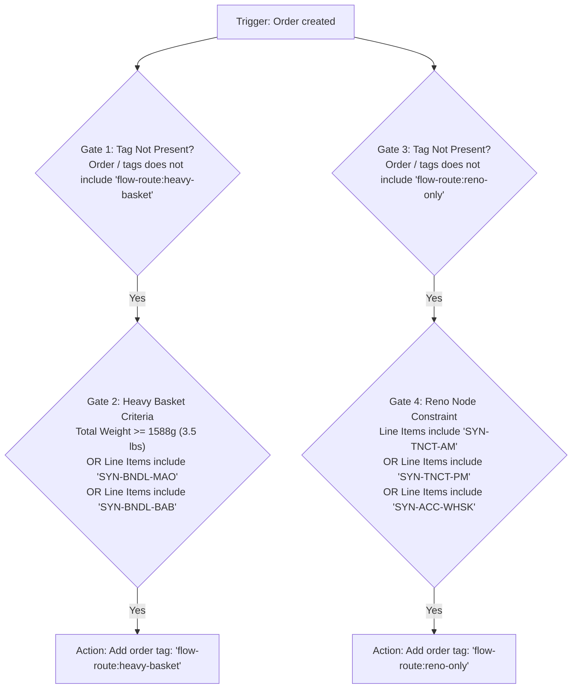
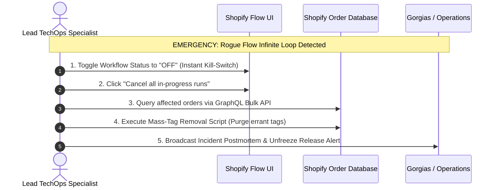
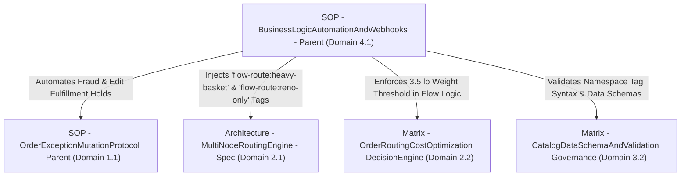

# SOP - BusinessLogicAutomationAndWebhooks - Parent

```
Document ID:     SOP - BusinessLogicAutomationAndWebhooks - Parent
Naming Format:   [CATEGORY] - [PURPOSE] - [TIER]
Category:        SOP (Standard Operating Procedure)
Purpose:         BusinessLogicAutomationAndWebhooks
Tier / Level:    Parent (Master Specification)
Status:          Locked 🔒 (Master Baseline)
Target Audience: Lead TechOps Specialists, Automation Engineers, Systems Coordinators
Ecosystem Scope: Shopify Flow, Shopify Webhooks API, Gorgias, 3PL WMS (ShipBob), Klaviyo
Business Unit:   Synapse Botanicals (Automation & Systems Infrastructure)
```

---

## 1. Purpose, Scope & Automation Governance

### 1.1 Purpose
This Standard Operating Procedure (SOP) defines the mandatory engineering standards for constructing, deploying, monitoring, and debugging business logic automations and webhook integrations across Synapse Botanicals. Strict adherence to this protocol prevents:
* **Infinite Tag Recursion Loops:** Runaway automations that continuously mutate order and customer tags, depleting Shopify API rate limits and flooding audit logs.
* **Silent Webhook Dropouts:** Unmonitored 3PL endpoints that exceed failure thresholds, causing Shopify to permanently disable data transmission without notifying customer support.
* **Asynchronous State Drift:** Automations executing actions based on stale order data following a time delay (e.g., releasing a hold on an order that was canceled while waiting).
* **Security & Payload Tampering:** Unverified webhook endpoints processing spoofed or malicious HTTP requests.

### 1.2 System Architecture & Event Flow
The Synapse Botanicals event-driven ecosystem connects customer actions on Shopify to distributed operations:



---

## 2. The Two Fatal Automation Traps & Architectural Safeguards

### 2.1 Trap A: The Infinite Flow Tag Recursion Loop



> [!CAUTION]
> **THE RUNAWAY AUTOMATION CASCADE**  
> In Shopify's event model, adding a tag to a customer or order triggers an `orders/updated` or `customers/updated` event. If a second automation or third-party app listens to that update and modifies the record, an infinite loop is born. Within 15 minutes, a runaway loop can:  
> 1. Consume 100% of your store's Shopify API rate limit bucket (API-specific app/store limits; do not confuse bucket capacity with requests per second).  
> 2. Lock up checkout and customer account portal response times.  
> 3. Generate over 50,000 spam entries in the Shopify Order Timeline.

#### The Mandatory Safeguard: The Idempotency & Negative Check Rule
Every Shopify Flow that adds a tag, updates a metafield, or places a hold **must implement a strict negative condition** checking that the target state does *not* already exist:
* **Rule:** Never execute an `Add order tags` action without first validating:  
  `Order tags` $\rightarrow$ `does not include` $\rightarrow$ `[TARGET_TAG]`
* **Rule:** Never execute a customer tag mutation from an order trigger without checking customer tags first.

---

### 2.2 Trap B: Transport Retry Contracts

| Transport | Response contract | Failure handling |
| :--- | :--- | :--- |
| Shopify HTTPS webhook | 1-second connection timeout; 5 seconds for the complete request; non-2xx is failure | Eight retries over four hours. Admin-API-configured subscriptions can be deleted after persistent failure; warning email goes to the emergency developer contact. |
| Flow Send HTTP request | Waits up to 30 seconds per request | Retry/fail/ignore options; configured retries can continue up to 24 hours. This is separate from webhook delivery. |
| Middleware → WMS worker | Application-defined timeout and retry policy | Persist attempts, idempotency keys and terminal failures independently of Shopify delivery. |

Authenticate and durably persist the event before returning 2xx. If persistence fails, return an error so Shopify can retry. Acknowledgment confirms receipt, not successful warehouse processing. Monitor subscription health, worker lag, delivery failures and reconciliation gaps; a periodic manual health check alone cannot cover a four-hour failure window.

## 3. SOP - BusinessLogicAutomationAndWebhooks - Protocol A: Shopify Flow Architecture & Standard Design Patterns

Shopify Flow automations in Synapse Botanicals must follow strict structural guidelines to maintain clarity, prevent race conditions, and guarantee predictable execution.

### 3.1 Standard Trigger $\rightarrow$ Condition $\rightarrow$ Action Design Schema

```
┌────────────────────────────────────────────────────────────────────────┐
│                        FLOW DESIGN HIERARCHY                           │
├────────────────────────────────────────────────────────────────────────┤
│  1. TRIGGER:     Specific system event (e.g., Order created)           │
│  2. GATE 1:      Safety / Negative Check (Does target tag NOT exist?)  │
│  3. GATE 2:      Business Criteria (Weight, SKU, Fraud recommendation)  │
│  4. WAIT DELAY:  Optional buffer window for customer self-service edits│
│  5. RE-GATE:     Re-verify order state post-delay                      │
│  6. ACTION:      Execute mutation (Fulfillment Hold, Add Tag)          │
└────────────────────────────────────────────────────────────────────────┘
```

### 3.2 Managing Asynchronous Wait Delays & State Drift

> [!NOTE]
> **Fresh state:** Re-read current order and fulfillment-order data after a delay. Conditions evaluated against a stale trigger snapshot do not provide a fresh-state gate. Use operation version checks and preserve unrelated holds.

When utilizing Shopify Flow's native **Wait** action (e.g., delaying fulfillment for 15 minutes to allow customer address corrections):
1. **Never assume the order is in the same state post-delay.**
2. A customer may have canceled their order, or Tier 2 CX may have already applied a manual hold during the 15-minute window.
3. **Mandatory Post-Delay Re-Check:** Always place a condition directly after the `Wait` node verifying:  
   `Order / fulfillmentStatus` is equal to `UNFULFILLED` **AND**  
   `Order / cancelledAt` is `null`.

---

### 3.3 Production Blueprint 1: High-Risk Order Fraud & Hold Automation

> [!NOTE]
> **Risk timing:** Use Order risk analyzed because the risk assessment may not exist at Order created. Until the risk decision is complete, warehouse release requires an explicit business gate. Evaluate each fulfillment order and record each hold ID; a tag is not a hold.


This automation protects store revenue by automatically intercepting suspicious orders before warehouse distribution centers can pick or pack them.



> [!NOTE]
> **System Architecture Dependency:**  
> The fulfillment hold reason and manual release gates triggered by Action 1 operate under the strict operational protocols defined in **[SOP - OrderExceptionMutationProtocol - Parent (Domain 1.1)](SOP-OrderExceptionMutationProtocol-Parent.md)** and the state machine in **[Matrix - OrderStatePointOfNoReturn - Master (Domain 1.2)](Matrix-OrderStatePointOfNoReturn-Master.md)**.

---

### 3.4 Production Blueprint 2: Heavy-Basket & Location Tagging Automation

This flow inspects new orders to dynamically assign operational tags that govern multi-node warehouse allocation.



> [!NOTE]
> **System Architecture Dependency:**  
> The `flow-route:heavy-basket` tag requests review; `flow-route:reno-only` records a location constraint that must be enforced by an explicit integration consumer in **[Architecture - MultiNodeRoutingEngine - Spec (Domain 2.1)](Architecture-MultiNodeRoutingEngine-Spec.md)** based on the 3.5 lb breakeven curve modeled in **[Matrix - OrderRoutingCostOptimization - DecisionEngine (Domain 2.2)](Matrix-OrderRoutingCostOptimization-DecisionEngine.md)**.

---

## 4. SOP - BusinessLogicAutomationAndWebhooks - Protocol B: Loop Circuit-Breakers & Tag Hygiene

To prevent app conflicts and runaway tag loops, all tags created by automated systems must follow the Synapse Botanicals **Tag Namespace Taxonomy**.

### 4.1 Standardized Tag Namespace Taxonomy

| Tag Prefix | Intended Creator | Purpose & Downstream Consumer | Example Tag | Deletion Rule |
| :--- | :--- | :--- | :--- | :--- |
| `flow-hold:` | Shopify Flow | Identifies active automated fulfillment holds for Tier 2 CX | `flow-hold:fraud-review`, `flow-hold:address-verify` | Removed automatically upon hold release |
| `flow-route:`| Shopify Flow | Signals order routing engine logic directives | `flow-route:heavy-basket`, `flow-route:reno-only` | Permanent audit record; do not delete |
| `sys:` | 3PL WMS / Integrations | Confirms external warehouse sync state | `sys:shipbob-allocated`, `sys:shipbob-allocated` | Read-only; managed by webhook payload |
| `cs:` | Gorgias / Tier 2 CX | Manual operator intervention tags | `cs:manual-audit-cleared`, `cs:address-override` | Managed by customer experience staff |

### 4.2 The 3-Point Circuit-Breaker Rule
Before activating any Shopify Flow that mutates data, the author must confirm all three circuit breakers are present:
1. **Negative Existence Check:** Condition explicitly checks that the action has not already run on this object.
2. **Namespace Isolation:** The automation only triggers on or modifies tags within its designated prefix (e.g., `flow-route:`), never modifying generic un-prefixed tags.
3. **Custom execution cap:** Middleware must implement the proposed five-actions-per-object-per-minute limit and alerting. This is not a documented native Flow termination guarantee. Make the business operation idempotent and test concurrent runs.

> [!NOTE]
> **Data Governance Reference:**  
> Tag formatting rules, kebab-case syntax, and non-colliding namespace constraints are enforced under **[Matrix - CatalogDataSchemaAndValidation - Governance (Domain 3.2)](Matrix-CatalogDataSchemaAndValidation-Governance.md)**.

---

## 5. SOP - BusinessLogicAutomationAndWebhooks - Protocol C: Webhook Endpoint Configuration & HMAC Security

Webhooks broadcast real-time operational events from Shopify to external cloud services. Every webhook subscription must be rigorously configured and cryptographically authenticated.

### 5.1 Mandatory Webhook Subscriptions for Synapse Botanicals

| Webhook Event Topic | Primary Receiving Endpoint | Format | API Version | Operational Purpose |
| :--- | :--- | :---: | :---: | :--- |
| `orders/create` | 3PL WMS (ShipBob) | JSON | `2026-10` | Ingests new orders into warehouse picking queues |
| `orders/updated` | 3PL WMS & Gorgias | JSON | `2026-10` | Synchronizes address corrections and variant line-item edits |
| `fulfillment_orders/hold_placed` | Gorgias & Slack Alerts | JSON | `2026-10` | Alerts CX team that an order is frozen downstream |
| `inventory_levels/connect` | Master ERP Ledger | JSON | `2026-10` | Tracks multi-location inventory provisioning at PA and NV nodes |

### 5.2 Cryptographic HMAC Verification Standard
To prevent attacker-spoofed webhook payloads from injecting fake orders or altering inventory counts, every endpoint receiving Shopify webhooks must execute cryptographic SHA-256 HMAC verification before parsing the request body.

```
┌────────────────────────────────────────────────────────────────────────────────────────┐
│                        HMAC DIGITAL SIGNATURE VALIDATION FLOW                          │
├────────────────────────────────────────────────────────────────────────────────────────┤
│ 1. Extract raw byte body from incoming HTTP POST request.                              │
│ 2. Compute HMAC-SHA256 hash using the shared store secret key.                         │
│ 3. Base64-encode the resulting hash.                                                   │
│ 4. Compare calculated hash to header: X-Shopify-Hmac-Sha256.                           │
│ 5. If MATCH: Durably enqueue, then return 2xx. If queue write fails: return error. If MISMATCH: return 401 & abort. │
└────────────────────────────────────────────────────────────────────────────────────────┘
```

#### Production Verification Code (Node.js Reference):
```javascript
const crypto = require('crypto');
function verifyShopifyWebhook(rawBody, hmacHeader, appClientSecret) {
  if (!Buffer.isBuffer(rawBody) || typeof hmacHeader !== 'string') return false;
  const expected = crypto.createHmac('sha256', appClientSecret)
    .update(rawBody).digest('base64');
  const received = Buffer.from(hmacHeader, 'utf8');
  const calculated = Buffer.from(expected, 'utf8');
  return received.length === calculated.length &&
    crypto.timingSafeEqual(received, calculated);
}
```

Verify the exact raw request bytes with the app client secret. Missing/malformed signatures must fail safely rather than throw a buffer-length exception. Flow/custom middleware requests require their own configured authentication; do not assume Shopify's native webhook HMAC headers are attached.

## 6. SOP - BusinessLogicAutomationAndWebhooks - Protocol D: Triage, Run-Log Diagnostics & Emergency Kill-Switches

When an automation or integration fails, TechOps must isolate and resolve the issue within standard Service Level Agreements ($< 15\text{ minutes}$).

### 6.1 Diagnosing Shopify Flow Execution Run Logs
To investigate why an automated action failed or why a condition evaluated unexpectedly:
1. In Shopify Admin, navigate to **Apps $\rightarrow$ Shopify Flow**.
2. Click on the target workflow $\rightarrow$ Select the **Run History** tab.
3. Locate the target Order ID or timestamp.

| Run Log Status | Technical Meaning | Root Cause Diagnosis | Immediate Remediation Action |
| :--- | :--- | :--- | :--- |
| **`Completed`** | All actions executed successfully | Normal execution | None required |
| **`Action failed`** | Trigger and conditions passed, but an action threw an API error | API field constraint violated (e.g., trying to place a hold on an already fulfilled order) | Review action payload; verify order state prior to action |
| **`Waiting`** | Workflow is currently paused inside a `Wait` node | Asynchronous delay timer is running | Normal; check scheduled resume timestamp |
| **`Timed out`** | Action or external call took $> 30$ seconds to respond | Downstream endpoint latency or GraphQL query timeout | Optimize GraphQL payload; verify app server responsiveness |

### 6.2 Webhook Delivery Audit & HTTP Error Triage
To inspect failing webhook event deliveries:
1. Navigate to **Shopify Admin $\rightarrow$ Settings $\rightarrow$ Notifications $\rightarrow$ Webhooks**.
2. Locate endpoints displaying warning indicators or consecutive failure counts.

| HTTP Status Code | Meaning | Root Cause | Triage & Remediation Protocol |
| :---: | :--- | :--- | :--- |
| **`401 Unauthorized`** | Authentication Failure | Shared secret key mismatch or expired app token | Re-generate API secret in receiving app; update webhook subscription |
| **`422 Unprocessable`** | Schema Rejection | Missing mandatory field in payload or invalid format | Verify payload matches endpoint schema (e.g., missing address postal code) |
| **`500 Server Error`** | Internal Server Crash | Unhandled exception in receiving app's database handler | Inspect 3PL server error logs; fix unhandled null values |
| **`504 Gateway Timeout`**| Response Window Exceeded | Receiving server took $> 5$ seconds to respond | Verify signature, durably enqueue, then acknowledge 2xx; process WMS work asynchronously |

### 6.3 Emergency Automation Kill-Switch Protocol

If an active flow triggers an infinite loop, spams customer tags, or errantly freezes all store orders:



1. **Step 1: Deactivate the Workflow Immediately:**  
   Open the workflow inside **Shopify Flow** $\rightarrow$ Click **Turn off workflow** in the upper right corner.
2. **Step 2: Terminate In-Progress Delayed Queues:**  
   Click **Cancel scheduled runs** to purge all orders currently sitting in `Wait` nodes, preventing delayed actions from firing.
3. **Step 3: Execute Tag Remediation:**  
   Use Matrixify to export orders tagged within the incident window $\rightarrow$ Clear errant tags $\rightarrow$ Re-import via `MERGE`.

> [!NOTE]
> **Audit Trail Reference:**  
> For the companion error response triage engine and circuit-breaker state diagrams, consult **[Matrix - AutomationLogicAndWebhookTriage - Engine (Domain 4.2)](Matrix-AutomationLogicAndWebhookTriage-Engine.md)**.

---

## 7. Master Domain Interconnectivity Matrix

This Master SOP establishes foundational event-driven connectivity across all Synapse Botanicals technical operational suites:



* **[SOP - OrderExceptionMutationProtocol - Parent (Domain 1.1)](SOP-OrderExceptionMutationProtocol-Parent.md):**  
  * **Section 2.2 & 6.1:** Automated hold placements defined in Blueprint 1 (Section 3.3) trigger the formal order exception holding lifecycle.
* **[Architecture - MultiNodeRoutingEngine - Spec (Domain 2.1)](Architecture-MultiNodeRoutingEngine-Spec.md):**  
  * **Section 3.2:** Dynamic basket tags (`heavy-basket`, `reno-exclusive`) injected by Blueprint 2 (Section 3.4) govern Rule 1 and Rule 2 routing evaluations.
* **[Matrix - OrderRoutingCostOptimization - DecisionEngine (Domain 2.2)](Matrix-OrderRoutingCostOptimization-DecisionEngine.md):**  
  * **Section 2.2:** Supplies the empirical 3.5 lb weight threshold applied in the Flow condition gate.
* **[Matrix - CatalogDataSchemaAndValidation - Governance (Domain 3.2)](Matrix-CatalogDataSchemaAndValidation-Governance.md):**  
  * **Section 3 (Field 6) & Section 4:** Regulates the tag formatting standards and custom metafield structures updated by Flow actions.


## Technical references — checked 30 October 2026

- [Shopify webhook delivery](https://shopify.dev/docs/apps/build/webhooks/verify-deliveries)
- [Flow HTTP requests](https://help.shopify.com/en/manual/shopify-flow/reference/actions/send-http-request)
- [Flow risk analysis trigger](https://help.shopify.com/en/manual/fulfillment/managing-orders/protecting-orders/shopify-flow)
- [GraphQL rate limits](https://shopify.dev/docs/apps/build/apis/graphql-admin/rate-limits)
