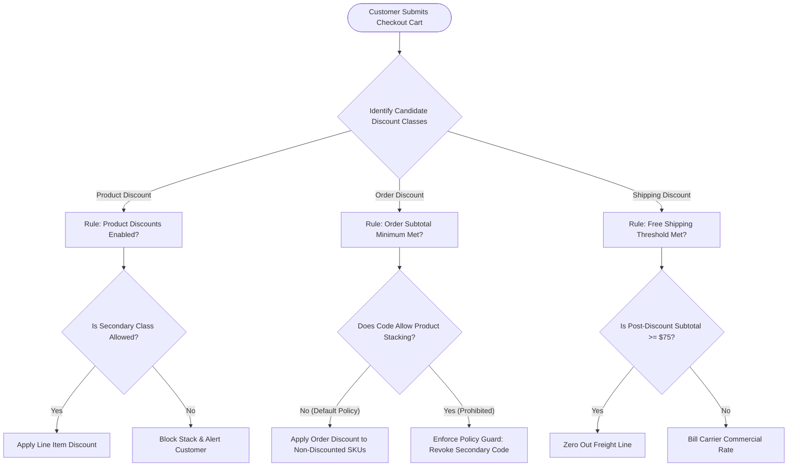
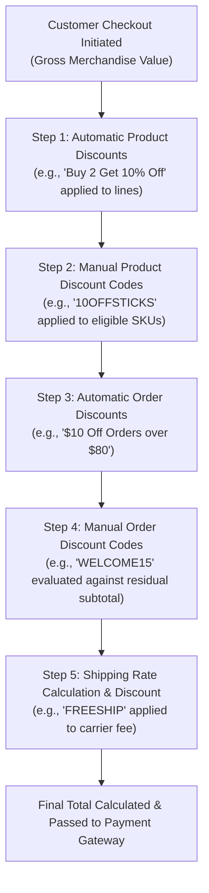
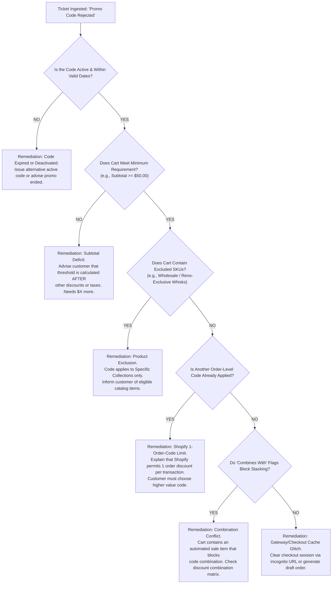

# Matrix - DiscountCombinationsAndMarginProtection - Engine

```
Document ID:     Matrix - DiscountCombinationsAndMarginProtection - Engine
Naming Format:   [CATEGORY] - [PURPOSE] - [TIER]
Category:        Matrix (Algorithmic Evaluation & Margin Governance Engine)
Purpose:         DiscountCombinationsAndMarginProtection
Tier / Level:    Engine (Mathematical Permutations & Stacking Policy)
Status:          Locked 🔒 (Master Baseline)
Target Audience: Lead TechOps Specialists, E-Commerce Growth Directors, Financial Analysts
Ecosystem Scope: Shopify Admin (Discounts Engine), Shopify Checkout API, Carrier Rate Cards, Contribution Margin Modeling
Business Unit:   Synapse Botanicals (Commercial Strategy & Margin Protection)
```

---
## 1. Executive Summary & Promotional Unit Economics

Promotional discounting is one of the most effective revenue drivers in e-commerce, but unconstrained or misconfigured discounting is the fastest driver of margin collapse. In modern multi-node DTC operations, shipping rates, warehouse pick/pack fees, payment processing tolls, and product Cost of Goods Sold (COGS) are fixed physical cash outflows. If marketing promotions stack indiscriminately at checkout, order contribution margins can instantly turn negative.

This document serves as the **authoritative mathematical decision engine** for Synapse Botanicals. It establishes:
1. **The 3x3 Discount Class Permutation Matrix:** A combinatorial ruleset regulating every interaction between Product, Order, and Shipping discount classes.
2. **The Contribution Margin Protection Floor:** Mathematical models establishing the strict **35% minimum contribution margin threshold** across all catalog SKUs.
3. **Cart Evaluation Hierarchy & Conflict Resolution:** The deterministic sequence by which Shopify's calculation engine applies competing promotions.
4. **Diagnostic Triage Response Trees:** Fast-path troubleshooting workflows for resolving "Code Rejected at Checkout" customer escalations.

> [!NOTE]
> **System Architecture Dependency:**  
> This decision engine operationalizes the diagnostic protocols established in **[SOP - TechnicalDiagnosisAndAuditLogging - Parent (Domain 5.1)](file:///C:/Users/Riovic%20Matthew/.gemini/antigravity/brain/e77e4d5a-78bd-40a4-88c0-71790432f543/SOP%20-%20TechnicalDiagnosisAndAuditLogging%20-%20Parent.md)** – **Section 5.0** and relies directly on the carrier zone postage baselines defined in **[Matrix - OrderRoutingCostOptimization - DecisionEngine (Domain 2.2)](file:///C:/Users/Riovic%20Matthew/.gemini/antigravity/brain/e77e4d5a-78bd-40a4-88c0-71790432f543/Matrix%20-%20OrderRoutingCostOptimization%20-%20DecisionEngine.md)** – **Section 2.0**.

---

## 2. The 3x3 Discount Class Permutation & Combination Matrix

Shopify separates discounts into three discrete classes: **Product Discounts** (line-item level), **Order Discounts** (cart subtotal level), and **Shipping Discounts** (delivery rate level). Each discount rule contains explicit *"Combines with"* configuration checkboxes.

> [!NOTE] **Shopify Plus Stacking & Calculation Rules (2026 Architecture):**  
> * **Multiple Code Capability:** Customers can apply up to **five product or order discount codes** and **one shipping discount code**, subject to eligibility rules. A second order discount does not universally replace the first.
> * **Subtotal Compounding Mechanics:** Multiple percentage order discounts calculate on the same post-product-discount subtotal: for example, 10% + 20% on $100.00 leaves $70.00. A 20% product discount followed by a 15% order discount leaves $68.00 ($100 × 0.80 × 0.85).
> * **Shipping Rates:** Multiple shipping codes cannot stack on the same shipping rate line.

The matrix below governs all permitted, conditional, and strictly prohibited permutations across the Synapse Botanicals storefront:

```
Permutation Taxonomy:
• [PERMITTED]  : Approved for standard storefront operations.
• [CONDITIONAL]: Requires specific order threshold ($50.00+) or margin verification.
• [PLATFORM-X] : Technically blocked by Shopify core architecture.
• [POLICY-X]   : Prohibited by Synapse Botanicals financial governance.
```

| Primary Applied Class | Secondary Candidate Class | Combination Setting in Admin | Shopify Platform Behavior | Synapse Botanicals Governance Policy | Operational Rationale |
| :--- | :--- | :--- | :--- | :--- | :--- |
| **Product Discount**<br>*(e.g., 20% Off Sitewide)* | **Product Discount**<br>*(e.g., BOGO 50% Off)* | Checkbox: `Product discounts` | Stacks on separate line items; Plus can support configured same-line combinations. | **[POLICY-X] PROHIBITED**<br>*(Must leave box unchecked)* | Prevents compounding line-item discounts (e.g., 20% sitewide + 25% VIP SKU discount = 40% margin destruction). |
| **Product Discount**<br>*(e.g., 20% Off Sitewide)* | **Order Discount**<br>*(e.g., WELCOME15)* | Checkbox: `Order discounts` | Subtotal discount applies to the net post-product-discount balance. | **[POLICY-X] PROHIBITED**<br>*(Disabled during flash sales)* | Dual stacking on $85+ baskets erodes contribution margin below our mandatory 35% floor. |
| **Product Discount**<br>*(e.g., 20% Off Sitewide)* | **Shipping Discount**<br>*(e.g., FREESHIP)* | Checkbox: `Shipping discounts` | Free or discounted delivery rate applied at carrier selection. | **[CONDITIONAL] PERMITTED**<br>*(Min. Cart $75.00+)* | Approved provided post-discount merchandise total reaches $75.00 to absorb carrier freight. |
| **Order Discount**<br>*(e.g., WELCOME15)* | **Order Discount**<br>*(e.g., RETENTION10)* | Supported natively on Plus | Applies multiplicatively on net subtotal. | **[POLICY-X] PROHIBITED**<br>*(Single order code policy)* | Blocks coupon aggregation from browser extensions (e.g., Honey, CapitalOne Shopping). |
| **Order Discount**<br>*(e.g., WELCOME15)* | **Shipping Discount**<br>*(e.g., FREESHIP)* | Checkbox: `Shipping discounts` | Subtotal reduced by 15%; freight rate reduced to $0.00. | **[CONDITIONAL] PERMITTED**<br>*(Subtotal ≥ $75.00)* | Flagship acquisition funnel. Requires strict $75.00 post-discount threshold for free delivery. |
| **Shipping Discount**<br>*(e.g., FREESHIP)* | **Shipping Discount**<br>*(e.g., Expedited Upgrade)* | N/A | Shopify blocks dual shipping discounts on a single rate. | **[PLATFORM-X] BLOCKED**<br>*(Engine restriction)* | Single shipping promotion limit per checkout session. |



---

## 3. Contribution Margin Protection Floor & Mathematical Modeling

Synapse Botanicals operates under an immutable financial constraint: **No promotional order may fall below a 35% Net Contribution Margin (CM)**.

### 3.1 The Order Contribution Margin Formula

$$\text{Contribution Margin (\%)} = \frac{\text{Net Revenue} - (\text{COGS} + \text{Pick/Pack Fee} + \text{Packaging} + \text{Carrier Freight} + \text{Gateway Toll})}{\text{Net Revenue}} \times 100$$

Where:
* **Net Revenue:** Collected merchandise total + collected customer shipping (excluding sales tax).
* **Pick/Pack Fee:** $2.75 for first SKU pick + $0.50 per additional item unit.
* **Packaging:** $0.75 for standard mailer; $1.25 for custom corrugated shipper box.
* **Carrier Freight:** Actual carrier cost billed to merchant (UPS Ground Commercial Base / Commercial Plus).
* **Gateway Toll:** Shopify Payments credit card toll calculated at **2.9% of total transaction + $0.30**.

### 3.2 SKU Unit Economics & Maximum Allowable Discount Thresholds

The table below calculates maximum allowable discount thresholds across active SKUs based on post-migration catalog pricing ($44 Stick Packs, $38 Tinctures, $34 Tumblers, $16 Whisks, $82 Bundles):

| SKU Code | Product Title | Retail Price | Unit COGS | Base 3PL Pick + Box | Transcon Freight (Zone 8) | Gateway Toll (2.9% + $0.30) | Net Floor Cost | Max Safe Discount (%) |
| :--- | :--- | ---: | ---: | ---: | ---: | ---: | ---: | ---: |
| `SYN-FSTK-MY` | Focus Stick Packs (30-Pk) | $44.00 | $8.50 | $3.50 | $5.65 | $1.58 | $19.23 | **42.5%** |
| `SYN-TNCT-AM` | Adaptogen Tincture (60ml) | $38.00 | $9.20 | $3.50 | $6.20 | $1.40 | $20.30 | **35.0%** |
| `SYN-TMBL-BW` | Insulated Travel Tumbler | $34.00 | $7.00 | $3.50 | $7.10 | $1.29 | $18.89 | **30.0%** |
| `SYN-ACC-WHSK` | Frother Handheld Whisk | $16.00 | $3.10 | $3.25 | $4.80 | $0.76 | $11.91 | **15.0%** |
| `SYN-BNDL-MAO` | Protocol Starter Bundle | $82.00 | $26.50 | $5.00 | $10.80 | $2.68 | $44.98 | **32.0%** |

*Operational Rule:* Any promotional campaign offering discounts higher than the *Max Safe Discount* threshold must require a minimum cart value of $75.00 or exclude carrier freight absorption.

---

## 4. Precedence Hierarchy & Cart Evaluation Order

When a customer arrives at checkout with pre-existing promotional items, automated sales, and enters one or more discount codes, Shopify's calculation engine evaluates the checkout in an immutable, deterministic order:



### 4.1 Evaluation Rules & Conflict Resolution Principles
1. **Subtotal Compounding:** Order-level discounts are calculated against the *net line-item subtotal* remaining after product discounts have already been deducted. They never calculate against original gross retail prices.
2. **Code Precedence on Re-Entry:** If a customer enters Order Discount Code A (`WELCOME15`), and subsequently enters Order Discount Code B (`INFLUENCER10`), Shopify **replaces Code A with Code B**. The engine does not aggregate order codes.
3. **Automatic vs. Manual Priority:** If an Automatic Order Discount exists (e.g., *"Memorial Day \$15 Off"*), and a customer enters a Manual Order Code (`WELCOME15`), Shopify applies the discount that provides the **greatest financial benefit to the customer**, unless the manual code combination settings explicitly permit stacking with automated rules.

---

## 5. Customer "Discount Code Rejected" Diagnostic Decision Tree

When a customer escalates a complaint stating their promo code was rejected at checkout, TechOps and Tier 2 Support specialists must execute this deterministic diagnostic tree:



### 5.1 Quick Reference Triage Scripts for Support Specialists

| Error Message at Checkout | Diagnostic Root Cause | Customer-Facing Explanation Script |
| :--- | :--- | :--- |
| *"This discount has reached its usage limit"* | Usage limit exceeded (Global limit or 1-per-customer limit breached). | *"This exclusive promotional code has reached its maximum authorized redemption limit. We have generated a personal 10% courtesy code for your order today."* |
| *"Enter a valid discount code"* | Typo, casing error, or code not published to active sales channel. | *"The code entered was not recognized. Please verify the spelling or note that this code is exclusive to our email subscriber channel."* |
| *"This code isn't valid for the items in your cart"* | The discount applies to specific collections (e.g., *Stick Packs*), but the cart contains excluded hardware (*Tumbler* or *Whisk*). | *"This promotion applies exclusively to our botanical dietary formulations (Focus Stick Packs & Tinctures) and cannot be applied to hardware or merchandise."* |
| *"Discount cannot be combined with existing promotions"* | Combination flag unchecked; cart already contains an automated sitewide discount. | *"Our checkout automatically applies our best promotional rate. This special code cannot be combined with active sitewide sale pricing."* |

---

## 6. Master Interconnectivity & System Architecture Lineage

The mathematical rules and combination governance matrices in this engine connect directly into the operational architecture across all five TechOps domains:

| Upstream / Downstream Deliverable | Governing Interface / Node | Interconnectivity Mechanism |
| :--- | :--- | :--- |
| **[SOP - OrderExceptionMutationProtocol - Parent (Domain 1.1)](file:///C:/Users/Riovic%20Matthew/.gemini/antigravity/brain/e77e4d5a-78bd-40a4-88c0-71790432f543/SOP%20-%20OrderExceptionMutationProtocol%20-%20Parent.md)** | Post-Purchase Line Item Swaps | When customer service swaps a flavor on an order, this engine governs whether original promotional discount codes carry over to the new variant. |
| **[Matrix - OrderStatePointOfNoReturn - Master (Domain 1.2)](file:///C:/Users/Riovic%20Matthew/.gemini/antigravity/brain/e77e4d5a-78bd-40a4-88c0-71790432f543/Matrix%20-%20OrderStatePointOfNoReturn%20-%20Master.md)** | Financial Ledger & Tax Thresholds | Governs how state sales tax calculations recalculate when discounts adjust net taxable line-item balances. |
| **[Architecture - MultiNodeRoutingEngine - Spec (Domain 2.1)](file:///C:/Users/Riovic%20Matthew/.gemini/antigravity/brain/e77e4d5a-78bd-40a4-88c0-71790432f543/Architecture%20-%20MultiNodeRoutingEngine%20-%20Spec.md)** | Multi-Location Routing Rules | Free shipping threshold discounts (`FREESHIP`) trigger specific fulfillment node allocation across Allentown (`LOC-PA-01`) and Reno (`LOC-NV-02`). |
| **[Matrix - OrderRoutingCostOptimization - DecisionEngine (Domain 2.2)](file:///C:/Users/Riovic%20Matthew/.gemini/antigravity/brain/e77e4d5a-78bd-40a4-88c0-71790432f543/Matrix%20-%20OrderRoutingCostOptimization%20-%20DecisionEngine.md)** | Carrier Zone Rate Benchmark | Supplies the carrier rate baseline (\$5.65 to \$10.80) used in Section 3.2 unit economics and contribution margin modeling. |
| **[Matrix - CatalogDataSchemaAndValidation - Governance (Domain 3.2)](file:///C:/Users/Riovic%20Matthew/.gemini/antigravity/brain/e77e4d5a-78bd-40a4-88c0-71790432f543/Matrix%20-%20CatalogDataSchemaAndValidation%20-%20Governance.md)** | Catalog Pricing & Compare-At Fields | Ensures that `Variant Price` and `Variant Compare At Price` CSV imports do not distort automated discount baseline calculations. |
| **[SOP - BusinessLogicAutomationAndWebhooks - Parent (Domain 4.1)](file:///C:/Users/Riovic%20Matthew/.gemini/antigravity/brain/e77e4d5a-78bd-40a4-88c0-71790432f543/SOP%20-%20BusinessLogicAutomationAndWebhooks%20-%20Parent.md)** | Shopify Flow Automations | Governs Flow Blueprints that tag orders based on discount code application (e.g., tagging influencer referral orders). |
| **[SOP - TechnicalDiagnosisAndAuditLogging - Parent (Domain 5.1)](file:///C:/Users/Riovic%20Matthew/.gemini/antigravity/brain/e77e4d5a-78bd-40a4-88c0-71790432f543/SOP%20-%20TechnicalDiagnosisAndAuditLogging%20-%20Parent.md)** | Diagnostic Standards & Cart APIs | Operates as the diagnostic parent specification, providing the AVS/CVV and Order Timeline rules that validate checkout payment completion. |
| **[CaseStudy - DiscountCollisionAndCartDiagnostics - Analysis (Domain 5.3)](file:///C:/Users/Riovic%20Matthew/.gemini/antigravity/brain/e77e4d5a-78bd-40a4-88c0-71790432f543/CaseStudy%20-%20DiscountCollisionAndCartDiagnostics%20-%20Analysis.md)** | Empirical Simulation & Checkout Proofs | Provides the empirical testing ground executing live storefront checkouts of `WELCOME15` vs `FREESHIP` and documenting cart network traces. |


## Technical references — checked 30 October 2026

- [Shopify discount combinations](https://help.shopify.com/en/manual/discounts/discount-combinations)
- [Storefront Cart API](https://shopify.dev/docs/api/storefront/latest/mutations/cartDiscountCodesUpdate)
