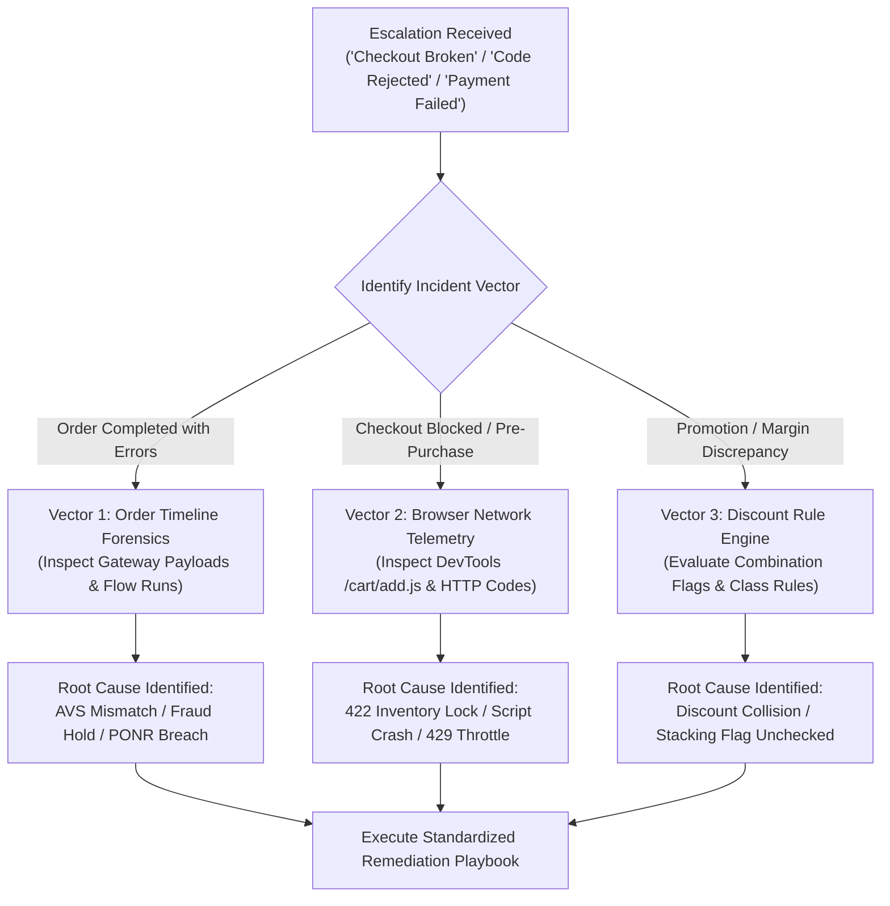

# SOP - TechnicalDiagnosisAndAuditLogging - Parent

```
Document ID:     SOP - TechnicalDiagnosisAndAuditLogging - Parent
Naming Format:   [CATEGORY] - [PURPOSE] - [TIER]
Category:        SOP (Standard Operating Procedure)
Purpose:         TechnicalDiagnosisAndAuditLogging
Tier / Level:    Parent (Master Diagnostic Protocol)
Status:          Locked 🔒 (Master Baseline)
Target Audience: Lead TechOps Specialists, Systems Support Leads, E-Commerce Operations Directors
Ecosystem Scope: Shopify Admin (Order Timeline & Event Log), Chrome DevTools Network Tab, Shopify Payments / Stripe Gateway, Shopify Discounts Engine
Business Unit:   Synapse Botanicals (Technical Operations & Storefront Diagnostics)
```

---

## 1. Purpose, Scope & The "3-Minute Diagnostic" Framework

### 1.1 Purpose & Triage Philosophy
In high-velocity direct-to-consumer (DTC) e-commerce, technical incidents manifest rapidly: a customer cannot add a product to their cart, a payment gateway authorization fails cryptically, an influencer discount code throws a checkout error, or a marketing automation inadvertently destroys unit economics by stacking overlapping promotions.

When these escalations occur, junior operators often guess, clear browser cookies needlessly, or escalate tickets to engineering without evidence. A senior TechOps specialist operates as a **Shopify Detective**, leveraging deterministic diagnostic tools to isolate the exact root cause in **under 3 minutes**.

This Standard Operating Procedure (SOP) defines the mandatory forensic protocols across three diagnostic vectors:
1. **The Order Timeline as One Correlated Evidence Source:** Extracting raw payment gateway transaction payloads, AVS/CVV risk codes, and automated mutation receipts.
2. **Storefront Browser DevTools & Network Telemetry:** Capturing live AJAX Cart API failures (`/cart/add.js`, `/cart/change.js`), evaluating HTTP response status codes (`422 Unprocessable Entity`, `429 Too Many Requests`), and identifying crashing third-party scripts.
3. **Discount Stacking & Combination Governance:** Resolving discount collision conflicts, managing Shopify's three discount classes (Product, Order, Shipping), and enforcing margin protection floors.

### 1.2 The 3-Minute Triage Architecture



---

## 2. The Order Timeline Forensic Standard

The Shopify Order Timeline is an important event source, but not a complete cryptographically tamper-evident cross-system ledger. Correlate it with Flow runs, gateway transactions, webhook delivery records and WMS/carrier events; fields and timestamp precision depend on the source.

### 2.1 Anatomy of an Order Timeline Event

For each available event, capture the metadata the source actually provides:
1. **Source timestamp:** Record timezone and available precision; normalize to UTC without inventing milliseconds.
2. **Actor Classification:** Distinguishes between:
   * **System:** Native Shopify core engine actions (e.g., inventory reservations, payment settlement).
   * **Customer:** Storefront actions initiated via checkout sessions.
   * **App / API Client:** Programmatic actions performed via Admin API (e.g., Gorgias CRM, ShipBob WMS, Klaviyo).
   * **Staff User:** Manual actions executed by logged-in human operators (includes staff email address).
3. **Transaction Details Modal:** Collapsible technical metadata containing raw gateway strings and API response objects.
4. **Visibility Scope:** Public customer communication (emails/SMS sent) vs. internal operational notes.

---

### 2.2 Inspecting Gateway Payment Transactions & Raw Gateway Strings

When a payment fails, succeeds partially, or triggers an unexpected authorization hold, operators must not rely on the high-level summary. They must inspect the underlying gateway authorization payload:

```
Step-by-Step Gateway Inspection Protocol:
1. Open Order in Shopify Admin.
2. Scroll to the "Timeline" section at the bottom of the page.
3. Locate the payment entry: "A $XX.XX USD payment was processed on [Gateway]..."
4. Click the small disclosure arrow [ > ] to expand the transaction summary.
5. Click "Gateway Information" or "Transaction details" to view the raw JSON payload.
```

#### Raw Gateway Transaction Payload (Shopify Payments / Stripe Backend)

> [!NOTE]
> **Schema scope:** This is an illustrative Stripe-style charge object. Shopify payment detail visibility and field names vary by provider; do not assume every Timeline event exposes this raw structure or a staff email. Correlate the fields actually available.

```json
{
  "id": "ch_3Nxy82LK41890aB1089201a",
  "object": "charge",
  "amount": 8000,
  "amount_captured": 8000,
  "currency": "usd",
  "payment_method_details": {
    "card": {
      "brand": "visa",
      "last4": "4242",
      "country": "US",
      "exp_month": 12,
      "exp_year": 2028,
      "checks": {
        "address_line1_check": "unchecked",
        "address_postal_code_check": "fail",
        "cvc_check": "pass"
      }
    },
    "type": "card"
  },
  "outcome": {
    "network_status": "approved_by_network",
    "reason": null,
    "risk_level": "elevated",
    "risk_score": 68,
    "seller_message": "Shopify Payments: Elevated risk detected due to postal code mismatch.",
    "type": "manual_review"
  },
  "status": "succeeded"
}
```

#### Forensic Interpretation Guidelines:
* **`network_status` vs. `status`:** Notice above that the issuing bank *approved* the transaction (`approved_by_network`), and the charge *succeeded* technically, but the fraud engine flagged it for `manual_review` because `address_postal_code_check` was `"fail"`.
* **AVS Postal Check:** Indicates that the cardholder entered a billing zip code that does not match the file on record at the card issuer (common indicator of card-not-present fraud or customer relocation).

> [!NOTE]
> **System Architecture Dependency (Order Lifecycle Holds):**  
> When a gateway transaction evaluates to elevated risk with an AVS postal code failure, a configured workflow can request a fulfillment hold and record `flow-hold:fraud-review` for visibility. The tag itself does not stop the WMS. For details on how this hold suspends 3PL fulfillment, refer to **[SOP - OrderExceptionMutationProtocol - Parent (Domain 1.1)](SOP-OrderExceptionMutationProtocol-Parent.md)**.

---

### 2.3 Identifying App vs. Flow vs. Human Actions in the Timeline

A major source of confusion during operational audits is determining *who* modified an order. The table below provides the visual forensic indicators used to distinguish actors in the Order Timeline:

| Actor Type | Visual Indicator in Timeline | Raw Event Metadata | Typical Operational Scenarios |
| :--- | :--- | :--- | :--- |
| **Native System** | Shopify bag icon (`Shopify Core`) | `event.app_id: null`<br>`event.author: "Shopify"` | Payment capture, automatic tax calculation, native shipping rate calculation. |
| **Shopify Flow** | Flow lightning bolt icon | `event.author: "Shopify Flow"`<br>`event.message: "Flow [Name] ran"` | Automated tagging (`flow-hold:fraud-review`), automatic fulfillment hold injection. |
| **Third-Party App** | App logo or generic API plug icon | `event.app_id: 1829410`<br>`event.client_id: "shipbob_wms"` | 3PL order ingestion, tracking number synchronization, Gorgias ticket creation. |
| **Human Staff** | User avatar / initials with staff name | `event.user_id: 88129410`<br>`event.email: "ops@synapse.com"` | Manual refunds, address overrides, manual line-item swaps, hold releases. |

---

## 3. SOP - TechnicalDiagnosisAndAuditLogging - Protocol A: Browser DevTools & Storefront Network Telemetry

When a customer reports: *"I can't add items to my cart"*, *"The checkout button is spinning indefinitely"*, or *"My screen goes blank when I enter a discount"*, inspect both the browser and the relevant server/app records. An HTTP response can originate at Shopify, an app or a proxy; a browser symptom does not establish the failing layer.

### 3.1 The Cart API Lifecycle & Endpoint Architecture

> [!NOTE]
> **Session and route scope:** Use locale-aware URLs such as window.Shopify.routes.root + cart/add.js. Reproduce within the same session; a cURL request without the browser’s cookies uses a different cart. Re-fetch /cart.js after an error because an add request can still affect cart quantity. Cart contents are not a universal inventory reservation.


The Synapse Botanicals storefront communicates with Shopify's native checkout and cart engines using four standard JSON endpoints:

| Endpoint Path | HTTP Method | Payload Parameters | Purpose & Operational Function |
| :--- | :---: | :--- | :--- |
| `/cart/add.js` | `POST` | `id` (Variant ID), `quantity`, `properties` | Ingests a variant into the current session's shopping cart. |
| `/cart/change.js` | `POST` | `id` (or `line`), `quantity` | Updates line item quantities (increment, decrement, or remove). |
| `/cart/clear.js` | `POST` | None | Empties the shopping cart session completely. |
| `/cart.js` | `GET` | None | Retrieves current cart state, total price, discounts, and item array. |

---

### 3.2 HTTP Status Code Matrix for Storefront Operations

TechOps specialists must inspect the **Network** tab in Chrome DevTools to triage failed API requests:

```
DevTools Network Inspection Procedure:
1. Open Google Chrome in Incognito mode.
2. Navigate to https://synapsebotanicals.com.
3. Press [F12] or [Ctrl+Shift+I] (Cmd+Option+I on Mac) to open DevTools.
4. Select the "Network" tab.
5. In the filter box, type "cart" and select the "Fetch/XHR" filter pill.
6. Re-create the customer's action (e.g., click "Add to Cart" on a PDP).
7. Inspect the resulting request entry in the table.
```

| HTTP Status Code | Response Classification | Root Cause at Synapse Botanicals | Storefront Manifestation | Immediate TechOps Action |
| :--- | :--- | :--- | :--- | :--- |
| **`200 OK`** | Nominal Success | Request accepted and processed cleanly by Shopify cart engine. | Cart slide-out opens; line item appears with updated subtotal. | None required. Cart state healthy. |
| **`422 Unprocessable Entity`** | Business Logic Rejection | **Inventory Ceiling Breached:** Attempting to add an out-of-stock SKU, or requested quantity exceeds available inventory across all nodes. | Button text changes to *"Sold Out"* or displays inline warning toast. | Verify Available-to-Sell (ATS) inventory balance in Shopify Admin for the variant SKU. |
| **`429 Too Many Requests`** | Rate Limit / Bot Block | Client IP triggered Shopify's automated bot protection or rate-limiting filter. | Page freezes or returns a Cloudflare / Shopify captcha challenge. | Verify if the user is behind a corporate VPN or executing rapid automated script requests. |
| **`400 Bad Request`** | Client Payload Error | Malformed JSON request body or missing mandatory `id` parameter. | Nothing happens on click; console logs uncaught JavaScript error. | Inspect theme JavaScript (`theme.js` / cart drawer component) for broken serialization. |
| **`500 Server Error`** | Server-side Failure | Shopify/app/proxy returned a server failure; a client JavaScript exception alone does not generate HTTP 500. | Cart button spins forever; cart drawer never opens. | Inspect **Console** tab for `Uncaught TypeError` originating from third-party app bundles. |

#### Real-World 422 Unprocessable Entity Payload Inspection
When an item is sold out or locked, `/cart/add.js` returns an explicit error payload:

```json
{
  "status": 422,
  "message": "You can't add more Synapse Adaptogen Tincture (60ml) - AM Focus to the cart.",
  "description": "All 0 remaining units are currently allocated to pending checkouts or fulfillments.",
  "error": "out_of_stock"
}
```
*Diagnostic Verdict:* This is not a "broken checkout" or theme bug; it is an inventory depletion event. The customer is attempting to buy units of `SYN-TNCT-AM` when available-to-sell inventory at `LOC-NV-02` is `0`.

---

### 3.3 Terminal cURL Diagnostic Probe

To bypass client-side theme issues and directly verify whether a variant ID can be added to a cart via raw Shopify API:

```bash
# Diagnostic Cart Injection Probe:
curl -s -X POST "https://synapse-botanicals.myshopify.com/cart/add.js" \
  -H "Content-Type: application/json" \
  -H "Accept: application/json" \
  -d '{
    "items": [
      {
        "id": 482194120912,
        "quantity": 1
      }
    ]
  }' | jq .
```
* If this returns `{"items": [...]}` with HTTP `200`, the Shopify backend is functioning properly, proving the bug resides in the storefront JavaScript theme layer.
* If this returns `{"status": 422}`, inspect the error body, variant, market, inventory policy, requested quantity and current cart. The code alone does not prove inventory is the cause.

---

## 4. SOP - TechnicalDiagnosisAndAuditLogging - Protocol B: Payment Gateway Authorization & Fraud Diagnostic Protocol

When a customer contacts support claiming their payment was declined, TechOps must rapidly identify whether the failure is a **Soft Decline** (customer or bank retryable) or a **Hard Decline** (terminal failure requiring an alternate card).

### 4.1 Payment Failure Taxonomy & Response Codes

> [!IMPORTANT]
> **Checkout Failure vs. Order Timeline Location:**  
> If payment fails during initial checkout, Shopify does not generate an Order. The event is recorded under **Orders $\rightarrow$ Abandoned checkouts $\rightarrow$ Timeline**. If an authorization capture, post-purchase upsell, or deferred invoice payment fails, it is recorded directly on the active **Order Timeline**.

| Shopify Admin Enum & Raw Gateway Code | Failure Class | Detailed Technical Root Cause | Customer Resolution Script | TechOps Remediation |
| :--- | :--- | :--- | :--- | :--- |
| **`DO_NOT_HONOR`**<br>`(do_not_honor)` | Hard Decline | **The #1 Bank Decline:** Issuer rejected authorization without sharing private financial details. | *"Your card issuer declined the charge with a 'Do Not Honor' notice. Please contact your bank to authorize transactions from Synapse Botanicals, or try an alternate card."* | Merchant cannot override bank fraud/credit algorithms. Direct buyer to issuing bank. |
| **`AUTHENTICATION_REQUIRED`**<br>`(authentication_required)` | Soft Decline | **3D Secure / SCA Failure:** Customer failed or closed the SMS OTP / banking app biometric verification window. | *"Your bank required identity verification (3D Secure) that was not completed. Please try again and complete the security prompt sent to your phone or banking app."* | Verify that Shopify Payments 3DS settings are active and edge WAF rules do not block 3DS iframes. |
| **`INSUFFICIENT_FUNDS`**<br>`(insufficient_funds)` | Soft Decline | Available account balance or credit line cannot cover the charge total. | *"The transaction could not be completed due to insufficient funds. Please check your account balance or select another payment method."* | Suggest splitting order or using an alternative digital wallet (Shop Pay / Apple Pay). |
| **`INCORRECT_CVC`**<br>`(incorrect_cvc / invalid_cvc)` | Soft Decline | The 3- or 4-digit security code entered does not match issuer records. | *"The security code (CVV/CVC) was incorrect. Please double-check the back of your card and re-enter your payment details."* | Check if browser autofill corrupted the security code field. |
| **`EXPIRED_CARD`**<br>`(expired_card)` | Hard Decline | The expiration date entered is in the past. | *"The payment card entered has expired. Please use a valid, current card."* | Guide customer to enter updated card details. |
| **`CARD_DECLINED`**<br>`(generic_decline)` | Hard Decline | Generic card refusal by the network or issuing bank. | *"Your payment was declined by the card processor. Please try an alternate card or payment method."* | Direct customer to try digital wallet or alternate card. |
| **`CALL_ISSUER`**<br>`(call_issuer)` | Hard Decline | The issuing bank flagged the transaction and requires verbal authorization from the cardholder. | *"Your bank has requested that you call them directly to approve this transaction before it can proceed."* | Inform customer this is a standard bank safety hold. |
| **`PICK_UP_CARD` / `FRAUD_SUSPECTED`**<br>`(stolen_card / lost_card)` | Terminal / Security | The card has been flagged as lost, stolen, or compromised. | *"This card cannot be processed. Please use an alternate payment method."* | **Immediate Security Action:** Check customer IP, shipping address, and order velocity for card-testing patterns. |
| **`PROCESSING_ERROR`**<br>`(processing_error)` | Soft Decline (Transient) | Temporary network timeout between Shopify Payments and card brand rails. | *"A temporary banking network timeout occurred. Please wait 2 minutes and attempt checkout once more."* | Check `status.shopify.com` for active gateway disruptions. |

---

### 4.2 Address Verification System (AVS) & CVV Response Code Matrix

Shopify Payments parses AVS and CVV signals from global card networks and presents them across the Admin Fraud Analysis sidebar, the GraphQL `CardPaymentDetails` API, and the Timeline raw transaction JSON.

#### AVS (Address Verification System) Matrix
| Code (`avsResultCode`) | Timeline JSON (`checks`) | Admin Fraud Analysis Display | Technical Meaning | Risk Assessment & Handling |
| :---: | :--- | :--- | :--- | :--- |
| **`Y`** | `line1: pass`<br>`postal: pass` | Street and postal code match | Street address and 5-digit ZIP both match. | **Low Risk:** Green-light fulfillment. |
| **`X`** | `line1: pass`<br>`postal: pass` | Street and 9-digit ZIP match | Street address and full 9-digit ZIP match. | **Low Risk (Highest Match):** Green-light fulfillment. |
| **`A`** | `line1: pass`<br>`postal: fail` | Street address matches; postal mismatch | Street matches; ZIP code fails. | **Medium Risk:** Common when buyer relocates. Permit if CVV is `pass`. |
| **`Z`** | `line1: fail`<br>`postal: pass` | Postal code matches; street mismatch | 5-digit ZIP matches; street address fails. | **Medium Risk:** Common with PO Boxes or missing Apt/Suite numbers. |
| **`W`** | `line1: fail`<br>`postal: pass` | 9-digit postal matches; street mismatch | 9-digit ZIP matches; street address fails. | **Medium Risk:** Verify apartment/suite number before shipping. |
| **`N`** | `line1: fail`<br>`postal: fail` | Neither street nor postal code match | Both street and postal code mismatch bank file. | **Risk signal:** Follow configured fraud review policy and apply an actual hold if required; mismatch alone is not proof of a stolen card. |
| **`G` / `S`** | `line1: unavailable`<br>`postal: unavailable` | AVS not supported by issuer | Global/International issuer does not participate in AVS. | **Neutral / Low:** Standard for non-US international orders. Rely on CVV + 3DS. |
| **`D` / `P`** | `line1: pass` (D)<br>`postal: pass` (P) | International address / postal match | Street and postal match (D) or postal only (P) for international card. | **Low / Medium Risk:** Standard cross-border verification. |
| **`U` / `R`** | `line1: unavailable`<br>`postal: unavailable` | Address information unavailable | System timeout or bank-side verification offline. | **Low Risk:** Transient bank-side unavailability. |

#### CVV (Card Verification Value) Matrix
| Code (`cvvResultCode`) | Timeline JSON (`cvc_check`) | Admin Fraud Analysis Display | Technical Meaning | Risk Assessment & Handling |
| :---: | :--- | :--- | :--- | :--- |
| **`M`** | `"pass"` | CVV is correct | Security code matches bank file. | **Low Risk:** Physical card or authenticated credential verified. |
| **`N`** | `"fail"` | CVV isn't correct | Security code entered does not match issuer file. | **Risk signal:** Review with gateway risk data and store policy; a CVV result alone does not establish card possession or fraud. |
| **`P`** | `"unchecked"` | CVV wasn't available | **Tokenized / Digital Wallet:** Not processed because payment used Apple Pay, Google Pay, or Shop Pay. | **Low Risk:** Normal for biometric/tokenized checkouts. Do NOT flag as missing security code. |
| **`U`** | `"unavailable"` | CVV not supported | Issuer is not certified or does not support CVV verification. | **Neutral:** Common with niche corporate cards or international cards. |
| **`S`** | `"fail"` | CVV suspicious | Card requires CVV, but merchant request omitted it. | **Medium Risk:** Investigate checkout integration for bypassed input field. |

> [!TIP]
> **Shopify Payments Automated Protection Settings:**  
> In Shopify Admin under **Settings $\rightarrow$ Payments $\rightarrow$ Shopify Payments (Manage) $\rightarrow$ Fraud prevention**, merchants can toggle:  
> 1. *"Decline charges that fail AVS postal code verification"* (Auto-rejects `checks.address_postal_code_check == "fail"`).  
> 2. *"Decline charges that fail CVV verification"* (Auto-rejects `checks.cvc_check == "fail"`).  
> *Caution:* Enabling AVS postal decline will block legitimate customers who recently moved and have not updated their bank billing address.

---

## 5. SOP - TechnicalDiagnosisAndAuditLogging - Protocol C: Discount Stacking, Combinations & Margin Collision Governance

The most financially dangerous technical trap in Shopify occurs when multiple discount promotions collide at checkout. Without rigorous configuration of Shopify's modern **Discount Combinations Engine**, customers can stack multiple codes, driving order contribution margins below zero.

### 5.1 The Three Modern Discount Classes in Shopify

Shopify categorizes all promotional discounts into three distinct classes:

```
┌────────────────────────────────────────────────────────────────────────┐
│                      SHOPIFY DISCOUNT CLASSES                          │
├────────────────────────────────┬───────────────────────────────────────┤
│ 1. PRODUCT DISCOUNTS           │ Applies to specific variants or       │
│    (e.g., 20% Off Stick Packs) │ collections. Computed at line level.  │
├────────────────────────────────┼───────────────────────────────────────┤
│ 2. ORDER DISCOUNTS             │ Applies to the aggregate cart subtotal│
│    (e.g., WELCOME15 - 15% Off) │ after product discounts are deducted. │
├────────────────────────────────┼───────────────────────────────────────┤
│ 3. SHIPPING DISCOUNTS          │ Applies strictly to the shipping rate │
│    (e.g., FREESHIP - Free Grd) │ calculated at checkout.               │
└────────────────────────────────┴───────────────────────────────────────┘
```

---

### 5.2 The Combination Rules Engine (The Combinations Checkbox)

In Shopify, discounts do *not* combine by default. Each individual discount rule contains an explicit **"Combines with"** governance configuration. Operators must configure these settings according to the matrix below:

| Discount Class Being Created | Can Combine with: Other Product Discounts? | Can Combine with: Order Discounts? | Can Combine with: Shipping Discounts? | Synapse Botanicals Governance Standard |
| :--- | :---: | :---: | :---: | :--- |
| **Product Discounts** | **NO** (Unchecked) | **CONDITIONAL** | **YES** (Checked) | Never allow product discounts to stack on other product discounts (prevents double-dipping on sale items). |
| **Order Discounts** | **CONDITIONAL** | **NO** (Unchecked) | **YES** (Checked) | Shopify explicitly prohibits two Order-level discounts from combining on the same cart. |
| **Shipping Discounts** | **YES** (Checked) | **YES** (Checked) | **NO** (Unchecked) | Eligible product, order and shipping discounts can combine when all flags allow it; the $75 threshold is this store’s policy, not a platform rule. |

---

### 5.3 The Double-Dip Margin Collision Trap (Worked Example)

> [!NOTE]
> **Denominator and scenario:** This uses the $98 component-picked bundle fixture and $26.50 landed COGS, consistent with the discount matrix. The contribution denominator is the $66.64 discounted revenue, not the $98 list price. Failing a 35% floor is not the same as negative contribution.


To illustrate why discount combinations represent a critical TechOps responsibility, consider the following real-world failure scenario:

```
THE FATAL PROMOTIONAL STACKING COLLAPSE
─────────────────────────────────────────────────────────────────────────────
Cart Composition: 
  1x The Daily Protocol Starter Bundle (SYN-BNDL-MAO) 
  Retail Price: $98.00 | COGS: $26.50 | Shipping Cost: $10.80

Promotion Alpha (Automated):  "Spring Flash Sale" -> 20% Off Sitewide (Product Discount)
Promotion Bravo (Promo Code): "WELCOME15"         -> 15% Off Cart      (Order Discount)
Promotion Charlie (Threshold): "FREESHIP"          -> Free Shipping     (Shipping Discount)

IF ALL THREE ARE PERMITTED TO COMBINE:
1. Product Price:                    $98.00
2. Spring Flash Sale (-20%):        -$19.60 -> Subtotal: $78.40
3. WELCOME15 Code (-15% on $78.40): -$11.76 -> Subtotal: $66.64
4. FREESHIP Code Applied:           -$10.80 absorbed by merchant
─────────────────────────────────────────────────────────────────────────────
TOTAL REVENUE COLLECTED:             $66.64
LESS: Product COGS:                 -$26.50
LESS: Paid Carrier Postage (UPS):   -$10.80
LESS: 3PL Handling + Packaging:      -$5.00
LESS: Credit Card Processing (2.9%): -$2.23
─────────────────────────────────────────────────────────────────────────────
NET CONTRIBUTION MARGIN:             $22.11 (33.18% of $66.64 — Below Minimum 35% Threshold!)
─────────────────────────────────────────────────────────────────────────────
```

#### The Mandatory Margin Protection Standard:
* **The Rule:** Order discounts (`WELCOME15`) must **never** check the box *"Combines with product discounts"* if the store is running an active sitewide sale.
* **The Safeguard:** During active sitewide promotional events, all order-level discount codes must have their combination settings audited and set to:  
  `Combines with: None` (or Shipping Discounts only).

---

## 6. Master Interconnectivity & System Architecture Lineage

This diagnostic SOP connects directly into the surrounding operational matrices and run sheets of the Synapse Botanicals TechOps suite:

| Upstream / Downstream Deliverable | Governing Interface / Node | Interconnectivity Mechanism |
| :--- | :--- | :--- |
| **[SOP - OrderExceptionMutationProtocol - Parent (Domain 1.1)](SOP-OrderExceptionMutationProtocol-Parent.md)** | Exception Holds & Address Swaps | Timeline diagnostics identify whether an order is in pre-PONR hold or has locked in warehouse fulfillment. |
| **[Matrix - OrderStatePointOfNoReturn - Master (Domain 1.2)](Matrix-OrderStatePointOfNoReturn-Master.md)** | Physical Warehouse Fulfillment Gates | Timeline transaction entries display the exact moment an order transitioned to `PROCESSING` at `LOC-PA-01` or `LOC-NV-02`. |
| **[Matrix - OrderRoutingCostOptimization - DecisionEngine (Domain 2.2)](Matrix-OrderRoutingCostOptimization-DecisionEngine.md)** | Carrier Zone Economics & Margins | Supplies the carrier rate baseline ($10.80 Transcon) utilized in Section 5.3 margin erosion calculations. |
| **[Matrix - CatalogDataSchemaAndValidation - Governance (Domain 3.2)](Matrix-CatalogDataSchemaAndValidation-Governance.md)** | Catalog Schema & Variant Mapping | Verifies that variant IDs targeted in Cart API diagnostic probes match the canonical production catalog. |
| **[SOP - BusinessLogicAutomationAndWebhooks - Parent (Domain 4.1)](SOP-BusinessLogicAutomationAndWebhooks-Parent.md)** | Flow Triggers & Fraud Holds | Timeline entries record the firing of Blueprint 1 (Fraud hold) and Blueprint 2 (Heavy-basket tagging) automations. |
| **[Matrix - AutomationLogicAndWebhookTriage - Engine (Domain 4.2)](Matrix-AutomationLogicAndWebhookTriage-Engine.md)** | HTTP Status Code Triage | Supplies the standard status code triage definitions (`422`, `429`, `500`) applied to storefront network inspection. |
| **[Matrix - DiscountCombinationsAndMarginProtection - Engine (Domain 5.2)](Matrix-DiscountCombinationsAndMarginProtection-Engine.md)** | Mathematical Discount Stacking Matrix | Codifies the complete multi-tier permutation matrix and margin protection formulas evaluated in Protocol C. |
| **[CaseStudy - DiscountCollisionAndCartDiagnostics - Analysis (Domain 5.3)](CaseStudy-DiscountCollisionAndCartDiagnostics-Analysis.md)** | Empirical Simulation & Forensic Case Study | Executes live checkout tests of `WELCOME15` vs `FREESHIP`, documenting Order Timeline and Network tab proofs. |


## Technical references — checked 30 October 2026

- [Ajax Cart API](https://shopify.dev/docs/api/ajax/reference/cart)
- [Shopify discount combinations](https://help.shopify.com/en/manual/discounts/discount-combinations)
