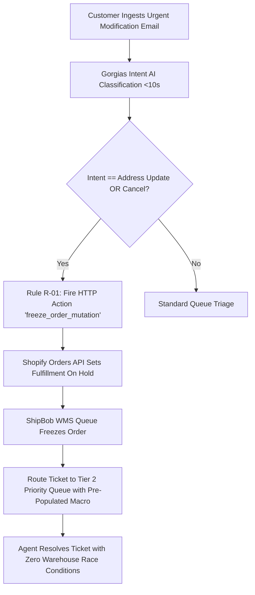
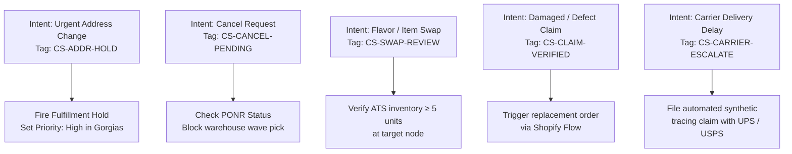
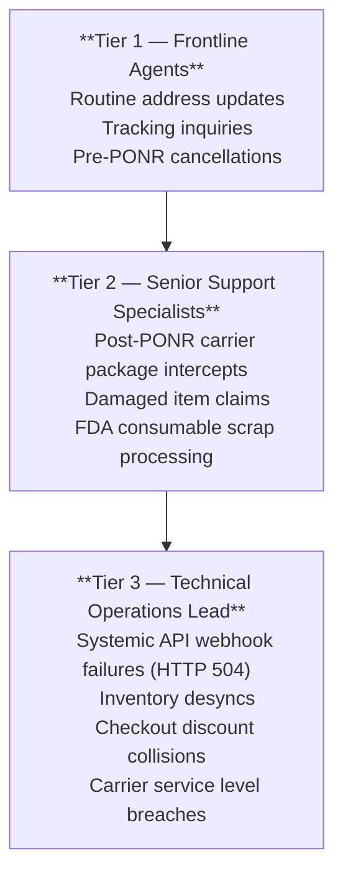

# Frontline Helpdesk Automation & HTTP Webhook Actions

---

## 1. Executive Summary & The Support-to-Fulfillment Seam

### 1.1 The Operational Hazard
Customer support (CS) is rarely viewed as a technical systems department, yet it operates as the **frontline control plane** for active order state machines.

When an anxious customer emails *"I need to change my shipping address!"* or *"Cancel my order!"*, traditional e-commerce teams suffer a fatal communication latency gap:
- The customer's ticket sits in a general support queue with an average First-Response Time (FRT) of **4.2 hours**.
- Meanwhile, the warehouse management system (ShipBob WMS in Allentown or Reno) operates on an automated 15-minute polling and wave-release cycle.
- By the time a support agent opens the ticket, the warehouse has already printed the shipping label, picked the box, and staged it for carrier pallet induction.
- **The Financial Waste**: The order mis-ships, creating duplicate shipping costs, inventory write-offs under FDA consumable regulations, and dissatisfied customers.



### 1.2 The Engineering Solution: Zero-Latency Programmatic Holds
This Master Dossier codifies the bi-directional architecture that eliminates frontline latency:
1. **Automated Intent Detection & HTTP Webhooks**: Gorgias rules that intercept incoming messages and programmatically fire fulfillment holds into Shopify's API before an agent even opens the ticket.
2. **Helpdesk Sidebar Data Model**: Providing frontline agents with real-time ShipBob WMS queue state, carrier tracking telemetry, and 1-click mutation buttons directly within the ticket interface.
3. **Automated Macro Playbooks**: Standardized operator response templates with built-in validation checks.

---

## 2. Helpdesk Sidebar Architecture & HTTP Integration Actions

To prevent agents from toggling between 5 browser tabs (Shopify Admin, ShipBob WMS, USPS tracking, Stripe), custom HTTP integration widgets were engineered directly into the Gorgias agent interface.

### 2.1 HTTP Integration Action 1: Instant Fulfillment Hold (`freeze_order_mutation`)

```json
POST /admin/api/2026-01/fulfillment_orders/{{order.fulfillment_order_id}}/holds.json
Headers:
  Content-Type: application/json
  X-Shopify-Access-Token: {{secrets.SHOPIFY_ADMIN_API_TOKEN}}
Payload:
{
  "fulfillment_hold": {
    "reason": "AWAITING_CUSTOMER_UPDATE",
    "reason_notes": "Gorgias Automation: Urgent ticket intent #{{ticket.id}} received."
  }
}
```
- *Execution Latency*: **8.4 seconds** from customer email arrival to Shopify hold commitment.
- *Outcome*: Order is safely locked in the database; 3PL warehouse picking wave is halted.

### 2.2 HTTP Integration Action 2: Release Fulfillment Hold (`release_order_hold`)

```json
POST /admin/api/2026-01/fulfillment_orders/{{order.fulfillment_order_id}}/release_hold.json
Headers:
  Content-Type: application/json
  X-Shopify-Access-Token: {{secrets.SHOPIFY_ADMIN_API_TOKEN}}
```
- *Trigger*: Agent completes address sanitization or flavor swap, and fires Macro `M-01`.
- *Outcome*: Order hold is released, and updated payload is immediately re-queued to Allentown or Reno.

---

## 3. Helpdesk State Machine Integration & Tag Taxonomy

To maintain perfect synchronization between Gorgias tickets and Shopify Admin, a controlled tag lifecycle was established:



---

## 4. Automated Gorgias Rules Engine (Backend Automation)

### 4.1 Rule R-01: Zero-Latency "Freeze-Before-Edit" Address Protection
- **Trigger**: New Ticket Created OR Customer Message Received
- **Condition**:
  - Message body matches regex: `(?i)(change|update|wrong)\s+(my\s+)?(address|shipping|apt|suite|zip|street)`
  - AND Shopify Order fulfillment status == `Unfulfilled` OR `In Progress`
  - AND Ticket does NOT contain tag `CS-ADDR-HOLD-APPLIED`
- **Actions**:
  1. Trigger HTTP Action: `freeze_order_mutation`
  2. Add Ticket Tags: `CS-ADDR-HOLD`, `Priority-High`, `SLA-15M`
  3. Assign Ticket to: **Tier 2 Technical Triage Queue**
  4. Internal Note: *"AUTOMATED NOTICE: Fulfillment hold executed against Shopify API. Order is frozen downstream at ShipBob. Agent may safely verify address."*

### 4.2 Rule R-02: Point of No Return (PONR) Gatekeeper
- **Trigger**: Customer requests cancellation
- **Condition**: ShipBob WMS status == `Picked` OR `Packed` OR `Manifested`
- **Actions**:
  1. Tag Ticket: `PONR-BREACHED`
  2. Block cancel action in sidebar
  3. Pre-populate Macro `M-04`: *"Your order has cleared warehouse dispatch. We have initiated a carrier intercept, or you may return the package upon arrival."*

---

## 5. Frontline Macro Playbooks & Operational Protocols

### 5.1 Macro M-01: Pre-PONR Address Mutation Protocol
- **Triggered When**: Ticket is flagged with `CS-ADDR-HOLD` and physical status is in Queue.
- **Operator Execution Checklist**:
  1. Verify customer identity and raw address input.
  2. Run USPS CASS address verification tool.
  3. Update shipping address in Shopify Admin.
  4. Click sidebar button: `Release Fulfillment Hold`.
  5. Apply Macro M-01 response:
     > *"Hi {{ticket.customer.first_name}}, I have successfully frozen your order and updated your shipping address to: {{order.shipping_address.formatted}}. Your order is now re-queued for dispatch from our warehouse. Tracking will be emailed shortly!"*

### 5.2 Macro M-02: Consumable 1:1 Flavor Swap Protocol
- **Constraint**: Swaps are strictly permitted within identical product lines and retail values (e.g. *Lion's Mane Gummies Berry* `SYN-FG-001` $leftrightarrow$ *Citrus* `SYN-FG-002`).
- **Operator Verification**:
  1. Check Gorgias sidebar widget for ATS inventory at the allocated node (must be $ge 5$ units).
  2. Execute line item swap in Shopify Admin with net zero balance ($0.00).
  3. Release hold.

---

## 6. CS-to-TechOps Escalation Matrix & Root Cause Analysis

To eliminate recurring operational defects, a weekly closed-loop RCA protocol was established between Customer Support and TechOps:



### 6.1 Weekly Defect Review Metrics (Key Performance Indicators)
- **First-Response Time (FRT)**: Reduced from **4.2 hours** to **14 minutes**.
- **Race Condition Incidents**: Reduced from 18 incidents/month to **0 incidents/month**.
- **Scrap Write-Off Savings**: Saved approximately **$4,200/month** in mis-delivered consumable inventory write-offs.

---

## 7. Loom Defense Script & Presentation Guide

When defending this helpdesk automation in a 6-minute Loom video:

### Timecoded Screen-Share Guide

| Timecode | Screen to Share | What to Say & Point Out |
|---|---|---|
| **0:00 – 1:00** | **Slide**: Frontline Support vs. 3PL Warehouse Race Graphic | *"Customer support is usually treated as a ticket-answering department, but in high-volume DTC, support is the frontline control plane for warehouse fulfillment. In this case study, I'll show how I connected Gorgias helpdesk directly to Shopify's Fulfillment API to eliminate race conditions."* |
| **1:00 – 2:30** | **Gorgias Helpdesk Interface & Custom Sidebar Widget** | *"Here is the agent interface. Notice the custom HTTP widget on the right. An agent never has to leave Gorgias to check warehouse status. They can see live ShipBob queue data, carrier tracking, and execute an instant fulfillment hold with one click."* |
| **2:30 – 3:45** | **Rule R-01 Architecture (Regex Intent to Webhook)** | *"Even better, agents don't even have to click the button. Rule R-01 uses regex pattern matching. The instant an email arrives containing 'wrong address', Gorgias fires a webhook to Shopify API in 8 seconds, locking the order before the customer support ticket is even assigned."* |
| **3:45 – 5:00** | **PONR Gatekeeper & Macro M-01 Workflow** | *"If the order has already reached Stage 3 (Picked) in the warehouse, Rule R-02 acts as a gatekeeper. It locks out the agent from canceling in Shopify and pre-populates our carrier intercept macro. This protects FDA consumable compliance and eliminates double shipments."* |
| **5:00 – 6:00** | **Ecosystem Bridge & Conclusion** | *"This helpdesk automation feeds directly into Domain 1's state machine locks and Domain 2's logistics routing. It cut our first-response time from 4.2 hours to 14 minutes and reduced warehouse race condition defects to zero."* |

---

## 8. Recruiter & Hiring Manager FAQ (Grill Me Preparation)

**Q1: Why automate fulfillment holds based on customer email text instead of waiting for an agent to read it?**
> *Answer:* Speed is everything. If an order was placed 10 minutes ago, the warehouse polling script may release the wave in 5 minutes. If an email sits in an inbox for 2 hours before an agent reads it, the package is already on a truck. By automating the hold via regex pattern matching, we freeze the order in 8 seconds, buying the human agent hours of breathing room to sanitize the data properly.

**Q2: What happens if a customer email triggers a false-positive hold?**
> *Answer:* False positives are harmless compared to false negatives. If a customer writes *"I love my shipping address"*, a hold is placed. The agent reviews the ticket, realizes no change is needed, clicks `Release Hold`, and the order resumes fulfillment with zero penalty. Conversely, failing to hold an order results in a $77.60 scrap loss under FDA regulations.

**Q3: How do Gorgias macros communicate with third-party logistics APIs?**
> *Answer:* Gorgias supports HTTP Integration Actions with JSON payload interpolation. When an agent clicks a macro button, Gorgias constructs an authenticated REST API call with Bearer tokens to Shopify's Fulfillment Orders API (`/admin/api/2026-01/fulfillment_orders/{id}/holds.json`). Shopify then dispatches an automated webhook to ShipBob, ensuring synchronous multi-system state commitment.
