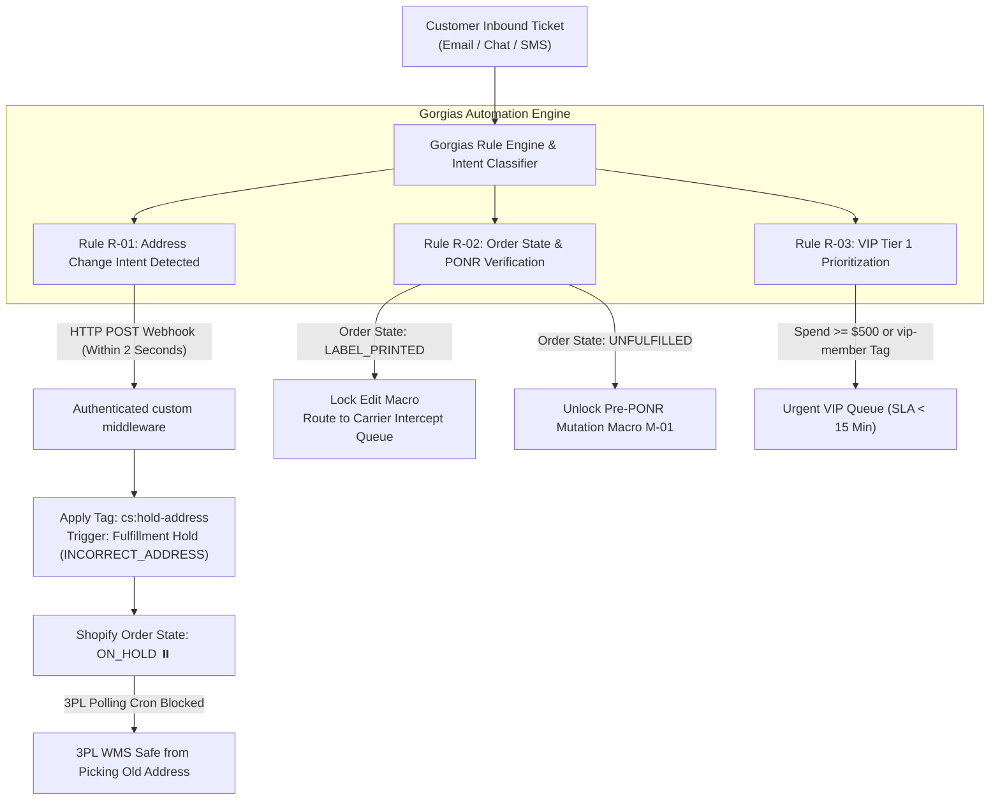
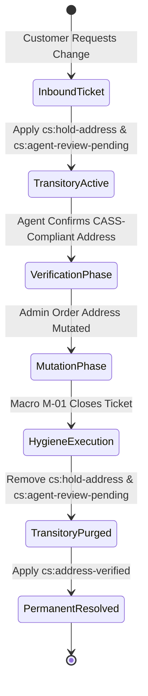
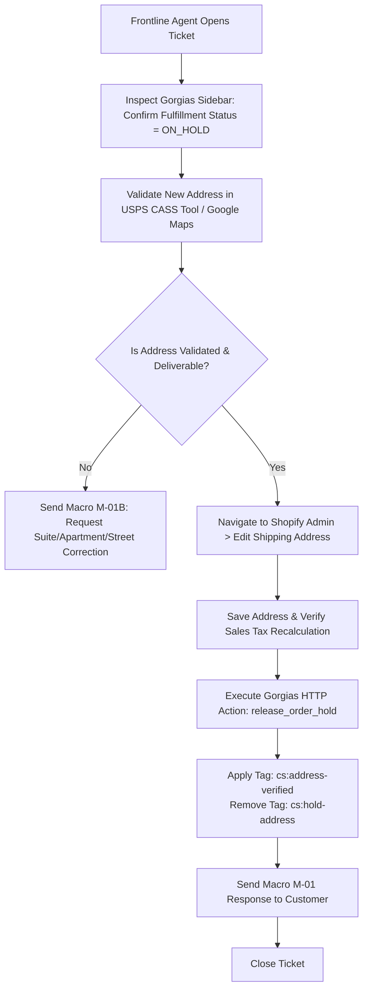
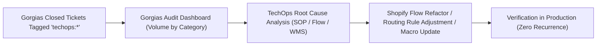

# SOP - HelpdeskOperationsAndMacroAutomation - Parent

```
Document ID:     SOP - HelpdeskOperationsAndMacroAutomation - Parent
Naming Format:   [CATEGORY] - [PURPOSE] - [TIER]
Category:        SOP (Standard Operating Procedure)
Purpose:         HelpdeskOperationsAndMacroAutomation
Tier / Level:    Parent (Master Helpdesk Governance & Triage Protocol)
Status:          Locked 🔒 (Master Baseline)
Target Audience: Lead TechOps Specialists, Customer Support Leads, Support Operations Specialists, Warehouse Integrators
Ecosystem Scope: Gorgias Helpdesk API & Rules Engine, Shopify Admin GraphQL API, Shopify Flow, ShipBob / 3PL WMS (Allentown LOC-PA-01, Reno LOC-NV-02)
Business Unit:   Synapse Botanicals (Customer Experience & Fulfillment Operations)
```

---

## 1. Executive Summary & Strategic Architecture

### 1.1 The Operational Challenge & Frontline Triage Philosophy

Customer support agents are the frontline operators of an e-commerce platform's state machine. Every customer inquiry regarding an address modification, order cancellation, flavor swap, or missing parcel represents an asynchronous mutation event against live inventory and physical fulfillment pipelines.

When customer service operates in an isolated ticketing silo without direct, real-time programmatic hooks into the Shopify order state machine, systemic operational failures inevitably occur:
1. **The Polling Window Trap:** Frontline agents draft a friendly reply to a customer requesting an address change, but because no fulfillment hold was placed, the automated 15-minute 3PL polling cron releases the order to the warehouse floor, shipping the parcel to an outdated destination.
2. **Post-PONR Mutation Violations:** Agents attempt to cancel or edit orders that have already reached the physical **Point of No Return (PONR)** (`LABEL_PRINTED` / `PACKED`), desynchronizing warehouse management systems (WMS) and inducing phantom inventory write-offs.
3. **Manual Overhead & Friction:** Agents manually copy-paste tracking numbers, query inventory balances across multiple facilities, and guess shipping zones instead of leveraging dynamic sidebar context and rule-driven webhook actions.

This Standard Operating Procedure (SOP) defines the technical architecture, bi-directional API integrations, automated rule logic, and frontline macro workflows connecting **Gorgias Helpdesk** to **Shopify Admin** and **Synapse Botanicals' Multi-Node Fulfillment Network**.



### 1.2 System Topology & Bi-Directional Data Flow

The Synapse Botanicals customer service ecosystem connects four primary software components into a coordinated, event-driven architecture. 

The following matrix defines the primary responsibilities, communication protocols, and specific **two-way action capabilities** across all integrated components:

| System Component | Primary Function | Integration Protocols | Sync Direction & Two-Way Action Capabilities |
| :--- | :--- | :--- | :--- |
| **Gorgias Helpdesk** | Omnichannel ticket ingestion, intent classification, customer messaging, and agent macro execution | HTTP REST Integration Actions, Shopify App Bridge, Gorgias Webhook triggers | **Full Two-Way (Bi-Directional):**<br>• *Inbound (Read):* Ingests real-time customer profile, order history, financial/fulfillment status, applied tags, and live tracking info from Shopify.<br>• *Outbound (Write/Action):* Executes automated and manual mutations back into Shopify via HTTP integration actions (places/releases fulfillment holds, appends/removes order tags, cancels orders, issues refunds). |
| **Shopify Admin** | Single source of truth (SSOT) for order lifecycle state machine, financial ledger, and discount allocations | GraphQL Admin API (2026-10), REST Admin API, Event Webhook Bus | **Full Two-Way (Central Orchestration Hub):**<br>• Accepts incoming mutations from Gorgias and Shopify Flow.<br>• Broadcasts event triggers (`orders/create`, `orders/updated`, `fulfillments/create`) downstream to Gorgias, Flow, and 3PL WMS. |
| **Shopify Flow** | Event-driven automation engine for tag-based routing, hold rules, and idempotency anti-loop guards | Internal Shopify Event Bus, Admin GraphQL Mutations, Outbound HTTP Webhooks | **Full Two-Way (Bi-Directional Internal):**<br>• *Inbound (Read):* Listens to event triggers across orders, customers, and fulfillments.<br>• *Outbound (Write/Action):* Mutates Shopify records (appends tags, triggers fulfillment holds, updates customer records) and emits outbound webhooks. |
| **3PL WMS**<br>*(Allentown & Reno)* | Physical inventory pick, pack, and ship operations, wave allocation, and carrier label generation | 15-minute polling cron (`orders.json`), Fulfillment Order API, Carrier Manifest Webhooks | **Two-Way Asymmetric (Polling Inbound / Webhook Outbound):**<br>• *Inbound (Read/Ingest):* Polls Shopify Admin for open, unheld orders every 15 minutes. *(Note: Cannot read Gorgias directly).*<br>• *Outbound (Write/Action):* Pushes fulfillment completions, tracking numbers, and physical inventory reconciliations back to Shopify Admin. |

```mermaid
sequenceDiagram
    autonumber
    actor Customer as Customer
    participant Gorgias as Gorgias Helpdesk
    participant HTTP as Gorgias HTTP Integration
    participant Shopify as Shopify Admin API
    participant Flow as Shopify Flow Engine
    participant 3PL as 3PL WMS (PA / NV)

    Customer->>Gorgias: Sends Ticket: "Wrong shipping address on order #1084"
    Note over Gorgias: Rule R-01 matches regex intent & unfulfilled status
    Gorgias->>HTTP: Execute Webhook Action: freeze_order_mutation
    HTTP->>Shopify: POST /admin/api/2026-10/graphql.json (fulfillmentOrderHold)
    Shopify->>Flow: order_updated webhook triggered
    Flow->>Shopify: Add Order Tag: "cs:hold-address"
    Shopify-->>Gorgias: Inspect GraphQL data, userErrors and fulfillment-order status
    Note over 3PL: 15-Minute Polling Cron runs
    3PL->>Shopify: GET /admin/api/orders.json (Open Fulfillments)
    Shopify-->>3PL: Returns fulfillment state; connector must explicitly exclude held work
    Note over 3PL: Warehouse floor picking PREVENTED
    Gorgias-->>Customer: Auto-Confirmation: "We have paused your order to verify your address."
```

> [!NOTE]
> **Cross-Domain Reference:**  
> The underlying fulfillment hold mechanics, Point of No Return (PONR) stages, and multi-node warehouse jurisdictions referenced in this document are codified in **[SOP - OrderExceptionMutationProtocol - Parent (Domain 1.1)](SOP-OrderExceptionMutationProtocol-Parent.md)**, **[Architecture - MultiNodeRoutingEngine - Spec (Domain 2.1)](Architecture-MultiNodeRoutingEngine-Spec.md)**, and **[CaseStudy - AsynchronousOrderMutationAndWebhookFailure - Analysis (Capstone)](CaseStudy-AsynchronousOrderMutationAndWebhookFailure-Analysis.md)**.

---

## 2. Helpdesk Sidebar Architecture & Data Model

### 2.1 Gorgias Customer & Order Widget Configuration

To ensure frontline support specialists operate with complete situational context without navigating away to the Shopify Admin, the Gorgias Shopify sidebar widget is configured with structured data attributes:

| Widget Data Field | Underlying GraphQL / REST Source | Operational Relevance |
| :--- | :--- | :--- |
| **Order ID & Name** | `Order.id` / `Order.name` | Master audit reference across Shopify, Gorgias, and 3PL portals. |
| **Financial Status** | `Order.displayFinancialStatus`<br>*(e.g., `PAID`, `AUTHORIZED`, `REFUNDED`)* | Verifies paid status; prevents modifying or fulfilling unpaid orders. |
| **Fulfillment State** | `Order.displayFulfillmentStatus`<br>*(e.g., `UNFULFILLED`, `ON_HOLD`, `FULFILLED`)* | Distinguishes open vs. locked transit stages for instant triage. |
| **Fulfillment Node** | `FulfillmentOrder.assignedLocation`<br>*(tags are supplemental metadata)* | Identifies which warehouse facility has jurisdiction over the order. |
| **Active State Tags** | `Order.tags`<br>*(e.g., `flow-hold:customer-edit`, `sys:edit-rejected-ponr`, `flow-route:heavy-basket`)* | Warns frontline agents of active automated holds or PONR breaches. |
| **Customer LTV** | `Customer.totalSpent` | Evaluates eligibility for courtesy replacements and VIP routing. |
| **Customer Segment** | `Customer.tags`<br>*(e.g., `cs:vip-tier-1`, `risk:high-dispute`)* | Drives queue SLA prioritization and fraud caution protocols. |
| **Carrier Tracking** | `Fulfillment.trackingInfo[].number`<br>`Fulfillment.trackingInfo[].url` | Surfaces live carrier tracking links (UPS Ground / USPS). |

### 2.2 HTTP Integration Actions & Webhook Data Flow

> [!NOTE]
> **App ownership and scopes:** Choose fulfillment-order read/write scopes for the locations the app actually manages. Assigned-fulfillment scopes cover the fulfillment service’s own assignments; an order-management app may require merchant-managed or third-party fulfillment-order scopes. Test hold/release permissions explicitly. Broad write_fulfillments alone is not a substitute for the required ownership-specific scope.


Gorgias executes mutations against Shopify via dedicated **HTTP Integration Actions** using private custom app credentials scoped strictly to minimal necessary permissions:
- `write_orders`, `read_orders`
- `write_fulfillments`, `read_fulfillments`
- `write_assigned_fulfillment_orders`

#### Integration Action 1: Instant Fulfillment Hold (`freeze_order_mutation`)
- **Endpoint:** `POST https://synapse-botanicals.myshopify.com/admin/api/2026-10/graphql.json`
- **Headers:** `Content-Type: application/json`, `X-Shopify-Access-Token: {{secrets.SHOPIFY_ADMIN_TOKEN}}`
- **GraphQL Payload:**
```graphql
mutation FulfillmentOrderHold($id: ID!) {
  fulfillmentOrderHold(
    id: $id,
    fulfillmentHold: {
      reason: INCORRECT_ADDRESS,
      reasonNotes: "Automated Gorgias Helpdesk Hold: Customer address modification ticket pending agent review."
    }
  ) {
    fulfillmentOrder {
      id
      status
    }
    userErrors {
      field
      message
    }
  }
}
```

#### Integration Action 2: Release Fulfillment Hold (`release_order_hold`)

> [!NOTE]
> **Hold ownership:** Record the hold IDs created by the edit operation, reject an empty list, and supply only those IDs. Omitting holdIds can release all holds. Process each relevant fulfillment order; preserve unrelated fraud/payment holds and inspect userErrors before claiming success.

- **Endpoint:** `POST https://synapse-botanicals.myshopify.com/admin/api/2026-10/graphql.json`
- **GraphQL Payload:**
```graphql
mutation FulfillmentOrderReleaseHold($id: ID!, $holdIds: [ID!]!) {
  fulfillmentOrderReleaseHold(id: $id, holdIds: $holdIds) {
    fulfillmentOrder {
      id
      status
    }
    userErrors {
      field
      message
    }
  }
}
```

---

## 3. Helpdesk State Machine Integration & Tag Taxonomy

### 3.1 State Machine Mapping: CS Ticket Intents to Shopify Order Tags

All customer support interactions must write standard tags back to the Shopify Order timeline. Tags dictate routing, trigger Shopify Flow automations, and signal warehouse supervisors:

```
[LIFECYCLE STATUS]: [INTENT / RESOLUTION]
```

| Ticket Intent / Scenario | Primary Shopify Tag | Secondary Tag | Downstream Automation Impact |
| :--- | :--- | :--- | :--- |
| **Address Update Requested** | `flow-hold:customer-edit` | `cs:agent-review-pending` | Requests an actual fulfillment hold through the configured action; tag alone has no hold effect. |
| **Address Mutated & Verified** | `cs:address-verified` | *(Removes `flow-hold:customer-edit`)* | Records completion after owned holds release and WMS acknowledgment. |
| **Flavor / Line-Item Swap** | `cs:flavor-swap-pending` | `cs:inventory-hold` | Pauses fulfillment until SKU exchange and tax balance resolve. |
| **Cancellation Pre-PONR** | `cs:cancel-requested` | `cs:void-payment` | Requests cancellation, reconciles stock, and voids uncaptured authorization or refunds captured payment as appropriate. |
| **Mutation Post-PONR** | `sys:edit-rejected-ponr` | `cs:intercept-failed` | Locks Shopify order edits; triggers carrier intercept protocol. |
| **Consumable Quality Defect** | `cs:quality-lot-quarantine` | `fda:adverse-event-log` | Triggers lot quarantine review (FDA 21 CFR Part 111). |
| **Split-Shipment Inquiry** | `cs:split-shipment-explained` | `logistics:multi-node` | Closes ticket with dual tracking educational payload. |

### 3.2 Transitory Tag Lifecycle & Hygiene Governance

Transitory tags exist only while a ticket is active. If transitory tags persist after ticket resolution, they contaminate Shopify Flow condition trees and skew e-commerce analytics.



#### Tag Hygiene Governance Rules:
1. **Rule of Mutual Exclusion:** A completed address-edit operation clears its transient tags only after actual hold release. A historical cs:address-verified tag must not block a later, distinct change request; use an operation ID/version.
2. **Automated Cleanup via Shopify Flow:** A dedicated Shopify Flow listens for `Order Tag Added: cs:address-verified`. Upon detection, it automatically evaluates:
   - Condition: Does `order.tags` contain `flow-hold:customer-edit`?
   - Action: `Remove order tags: flow-hold:customer-edit, cs:hold-address, cs:agent-review-pending` after owned hold release.
3. **Weekly Orphan Tag Sweep:** TechOps runs a scheduled query every Sunday at 23:00 EST identifying orders marked `flow-hold:customer-edit` where order age exceeds 72 hours and Gorgias ticket status is `closed`. Orphaned holds are escalated directly to Support Operations Leads.

### 3.3 Idempotency & Anti-Loop Guardrails

As established in Domain 4 governance, automated tag addition can create recursive execution loops between Gorgias rules and Shopify Flow.

> [!CAUTION]
> **Anti-Loop Architecture Standard:**
> 1. Gorgias HTTP Integration calls must include the custom header `X-Triggered-By: Gorgias-Rules-Engine`.
> 2. Shopify Flow automations listening to `Order updated` must verify that the updated tag does not already match the target tag before re-evaluating.
> 3. Gorgias rules must never trigger on ticket updates caused by internal Gorgias bot macros unless explicit human agent intervention is registered.

---

## 4. Automated Gorgias Rules Engine (Backend Automation & Triage)

### 4.1 Rule R-01: Zero-Latency "Freeze-Before-Edit" Address Protection

> [!NOTE]
> **Integration pseudocode:** The regex, template paths and rule fields illustrate adapter logic; map them to supported Gorgias fields/actions. Treat the two-second goal as a latency target. Send a hold-confirmed message only after both Shopify and WMS business-state acknowledgment.


* **Business Objective:** Prevent orders from being picked and packed at the 3PL warehouse with an incorrect address during the customer service response delay.
* **Trigger:** Customer sends inbound message via Email, Chat, or Contact Form.
* **Conditions:**
  1. `ticket.message.body` matches regex pattern:
     ```regex
     (?i)\b(wrong address|change address|update address|shipping address|apartment number|suite number|delivered to the wrong|put the wrong street|typo in my address)\b
     ```
  2. `ticket.order.fulfillment_status` is equal to `unfulfilled` OR `on_hold`.
  3. This specific request/version has not already completed; an old cs:address-verified tag does not exempt a new request.
* **Actions:**
  1. **HTTP Action:** Execute `freeze_order_mutation` (GraphQL `fulfillmentOrderHold`).
  2. **Shopify Admin Action:** Add Order Tag `flow-hold:customer-edit`.
  3. **Gorgias Ticket Action:**
     - Set Ticket Priority: `High`.
     - Add Ticket Tag: `intent:address-change`.
     - Assign to Group: `Tier 1: Logistics & Order Modifications`.
  4. **Auto-Reply (Customer Assurance Notification):**
     > *"Hi {{ticket.customer.firstname}}, we have received your address-change request and are checking whether our warehouse can pause fulfillment. A specialist will confirm the hold and update status shortly."*

### 4.2 Rule R-02: Point of No Return (PONR) Gatekeeper & Intercept Triage

* **Business Objective:** Eliminate invalid frontline mutation attempts on orders that have already reached physical carrier custody or label generation.
* **Trigger:** Customer sends message containing cancellation or address change intent.
* **Conditions:**
  1. `ticket.message.body` matches cancellation OR address modification regex.
  2. `ticket.order.fulfillment_status` is equal to `fulfilled` OR `ticket.order.fulfillments[0].tracking_number` is NOT empty OR `ticket.order.tags` contains `wms:label-printed`.
* **Actions:**
  1. **Shopify Admin Action:** Add Order Tag `sys:edit-rejected-ponr`.
  2. **Gorgias Ticket Action:**
     - Add Ticket Tag: `sys:edit-rejected-ponr`.
     - Set Ticket Priority: `Urgent`.
     - Assign to Group: `Tier 2: Logistics Escalations`.
  3. **Internal Note (Frontline Warning Banner):**
     > `🚨 TECH OPS PONR ALERT:`  
     > *This order has reached the physical Point of No Return (`LABEL_PRINTED` or in carrier transit). Do NOT attempt to edit the address in Shopify Admin. Refer to Macro M-04 for carrier intercept protocols or return-to-sender courtesy replacement guidelines.*

### 4.3 Rule R-03: VIP Tier 1 Priority Routing & SLA Acceleration

* **Business Objective:** Guarantee white-glove response times (under 15 minutes) for high-value customers to maximize retention and customer lifetime value (LTV).
* **Trigger:** Inbound ticket created from any customer channel.
* **Conditions:**
  - `ticket.customer.tags` contains `cs:vip-tier-1`  
    **OR**  
  - `ticket.customer.total_spent` is greater than or equal to 500.00
* **Actions:**
  1. **Gorgias Ticket Action:**
     - Set Ticket Priority: `Urgent`.
     - Add Ticket Tag: `cs:vip-tier-1`.
     - Route to View: `VIP Concierge Queue`.
  2. **Notification Action:** Trigger Slack notification to `#cs-vip-escalations` via Gorgias Slack webhook.

### 4.4 Rule R-04: Automated Tracking & Delivery Exception Alerts

* **Business Objective:** Deflect routine "Where Is My Order?" (WISMO) tickets and automatically alert customers to carrier transit exceptions (e.g., carrier delay or incorrect postal code).
* **Trigger:** Inbound message contains tracking inquiry keywords (`tracking`, `where is my order`, `has it shipped`, `delivery date`).
* **Conditions:**
  1. `ticket.order.fulfillment_status` is equal to `fulfilled`.
  2. `ticket.order.fulfillments[0].tracking_number` is NOT empty.
* **Actions:**
  1. **Auto-Reply (Self-Service WISMO Deflection):**
     > *"Hi {{ticket.customer.firstname}}, your order has shipped! You can track your package in real-time via the carrier portal here: {{ticket.order.fulfillments[0].tracking_url}}. If you have any additional delivery questions or carrier notes, reply directly to this email."*
  2. Set Ticket Status: `Snoozed` (Duration: 48 hours).

---

## 5. Frontline Macro Playbooks & Operational Protocols

### 5.1 Macro M-01: Pre-PONR Address Mutation Protocol

> [!NOTE]
> **Cross-system commit gate:** Before releasing any hold, sync/read back the new address in the WMS and reconcile tax/payment balances. Check all affected fulfillment orders. The Shopify edit and address-verified tag do not establish that the warehouse record changed.


* **Applicability:** Used when customer requests an address modification and `ticket.order.fulfillment_status` is `on_hold` or `unfulfilled` (Pre-PONR).
* **Prerequisites:** Inspect current WMS physical state and confirm an actual hold. Missing tracking or tags alone does not establish edit safety.



#### Step-by-Step Execution Protocol:
1. **Verify Hold Status:** Confirm Gorgias sidebar displays `Fulfillment Status: ON_HOLD` and tag `flow-hold:customer-edit`. If hold is missing, manually execute Gorgias HTTP Action `freeze_order_mutation`.
2. **Address Standardization:** Paste customer's provided address into the USPS Address Validation Tool (CASS-certified):
   - Verify Street Name, Secondary Unit (Apt/Suite/Unit), City, State, and 9-digit ZIP (`ZIP+4`).
   - If unit number is missing on an apartment building, pause execution and request clarification.
3. **Execute Shopify Mutation:**
   - In Shopify Admin, navigate to **Orders $\rightarrow$ [Order #] $\rightarrow$ Edit Shipping Address**.
   - Input the standardized CASS address. Save changes.
   - Verify that state sales tax does not require a re-authorization adjustment.
4. **Release Fulfillment Hold:**
   - In Gorgias, trigger HTTP Action `release_order_hold`.
   - Update order tags: Remove `flow-hold:customer-edit`, add `cs:address-verified`.
5. **Customer Macro Response:**

```markdown
Subject: Update Confirmed: Shipping Address Updated for Order {{ticket.order.name}}

Hi {{ticket.customer.firstname}},

Thank you for confirming your updated address details! 

We have successfully updated the delivery address on file for order {{ticket.order.name}} to:

{{new_street_address_line1}}
{{new_street_address_line2}}
{{new_city}}, {{new_state}} {{new_zip}}

The temporary fulfillment hold has been released, and your package is now queued for picking at our warehouse. You will receive an automated tracking notification email the moment your shipping label is generated.

Please let us know if we can assist you with anything else!

Best regards,  
{{agent.first_name}} | Synapse Botanicals Support Operations
```

---

### 5.2 Macro M-02: Consumable Flavor Swap Protocol

> [!NOTE]
> **Freeze before swap:** Place Shopify holds on affected fulfillment orders, obtain WMS stop acknowledgment, then swap. Before release, reconcile new SKU/quantity in both systems, inventory and the actual balance including discounts/taxes. The $44 rule is post-migration; older $42 examples remain pre-migration.


* **Applicability:** Customer requests swapping a flavor variant on an unfulfilled `Synapse Focus Stick Packs (30-Pack)` order prior to WMS allocation.
* **Governing Rules:** Swaps are strictly 1:1 between equivalent price SKUs (\$44.00 MSRP).

| Original Ingested SKU | Authorized 1:1 Swap SKUs | Node Availability Check |
| :--- | :--- | :--- |
| `SYN-FSTK-MY` (Matcha Yuzu) | `SYN-FSTK-BO` (Blood Orange)<br>`SYN-FSTK-WB` (Wild Blueberry)<br>`SYN-FSTK-GA` (Crisp Green Apple) | Check inventory ledger at assigned facility (`LOC-PA-01` / `LOC-NV-02`). |

#### Step-by-Step Execution Protocol:
1. **Verify Stock Availability:** Check Gorgias sidebar inventory widget to confirm target flavor variant has more than 10 units available at the assigned warehouse.
2. **Execute Line-Item Swap:**
   - In Shopify Admin, click **Edit Order**.
   - Add new variant (e.g., `SYN-FSTK-BO`). Quantity: 1.
   - Remove old variant (e.g., `SYN-FSTK-MY`). Reason: `Customer requested change`.
   - Confirm balance difference is **\$0.00**.
   - Click **Update Order**.
3. **Audit Inventory Impact:** Verify the inventory balance adjustment decrements `SYN-FSTK-BO` and increments `SYN-FSTK-MY`.
4. **Customer Macro Response:**

```markdown
Subject: Flavor Preference Updated: Order {{ticket.order.name}}

Hi {{ticket.customer.firstname}},

You got it! We have updated the flavor preference on your open order {{ticket.order.name}}. 

Swapped Item:
- Removed: Synapse Focus Stick Packs (30-Pack) - Matcha Yuzu
- Added: Synapse Focus Stick Packs (30-Pack) - Blood Orange

Your order total remains unchanged, and your items are currently queued for fulfillment. You will receive a tracking link as soon as our fulfillment team packages your order.

Enjoy your Focus routine!

Warmly,  
{{agent.first_name}} | Synapse Botanicals Support Operations
```

---

### 5.3 Macro M-03: Split-Shipment Multi-Node Educational Macro

> [!NOTE]
> **Customer-message gate:** Use the two-package wording only after verifying two fulfillment records and both tracking states. Do not promise both parcels are in transit based on product topology alone; render the current status for each package.


* **Applicability:** Customer opens an inquiry expressing confusion or concern because they received an order containing only one of their purchased items (e.g., received Focus Stick Packs, but Adaptogen Tincture is missing).
* **Root Operational Cause:** Synapse Botanicals operates two fulfillment nodes. Tinctures (`SYN-TNCT-AM`, `SYN-TNCT-PM`) and Electric Whisks (`SYN-ACC-WHSK`) are stocked exclusively at **Reno, NV (`LOC-NV-02`)**. Stick Packs are stocked at both **Allentown, PA (`LOC-PA-01`)** and Reno. Some orders may have multiple fulfillments because of the chosen routing configuration or stock availability. Under Alpha, the eligible pair consolidates at Reno. Inspect actual fulfillment records before using this macro.

#### Customer Macro Response:

```markdown
Subject: Update on your Synapse Botanicals delivery (Order {{ticket.order.name}})

Hi {{ticket.customer.firstname}},

Thank you for reaching out! Please rest assured that your complete order is on its way to you—it is arriving in two separate packages.

To ensure your botanical products arrive as fresh and quickly as possible, we fulfill orders from two dedicated logistics hubs:
1. Our East Coast Facility (Allentown, PA)
2. Our Specialized Tincture Lab (Reno, NV)

Because our Adaptogen Tinctures require specialized climate-controlled storage, they ship exclusively from our Reno facility, while your Focus Stick Packs were dispatched from our closest regional facility.

Here are your individual tracking numbers for each package:
- Package 1 (Focus Stick Packs): {{tracking_link_package_1}} (Carrier: {{carrier_1}})
- Package 2 (Adaptogen Tincture): {{tracking_link_package_2}} (Carrier: {{carrier_2}})

Both shipments are currently in transit. Please let us know if you have any questions while tracking either delivery!

Best regards,  
{{agent.first_name}} | Synapse Botanicals Support Operations
```

---

### 5.4 Macro M-04: Post-PONR Carrier Intercept & Return-to-Sender (RTS) Workflow

* **Applicability:** Customer requests cancellation or address modification on an order where `ticket.order.tags` contains `sys:edit-rejected-ponr` or fulfillment status is `fulfilled`.
* **Technical Constraint:** Once a tracking label is generated (`LABEL_PRINTED`), a label contains the recorded shipment details. An Admin address change alone does not update the physical parcel; a permitted carrier/warehouse process is required.

```mermaid
flowchart TD
    PostPONRStart["Post-PONR Inquiry Received"] --> EvaluateCarrier{"Carrier Service Level"}
    
    EvaluateCarrier -->|UPS Ground / Priority| CheckEligibility{"Carrier Eligibility Confirmed?"}
    EvaluateCarrier -->|USPS Ground Advantage| IneligibleIntercept["Check USPS Intercept Eligibility<br/>Apply cost/benefit policy"]
    
    CheckEligibility -->|Yes| ExecuteIntercept["Tier 2 Submits UPS Web Intercept ($17.50 Fee)"]
    CheckEligibility -->|No| RerouteRefused["Review carrier options and policy"]
    
    ExecuteIntercept --> InterceptOutcome{"Intercept Status"}
    InterceptOutcome -->|Success (RTS Confirmed)| IssueReplacement["Create $0 Draft Order with Correct Address"]
    InterceptOutcome -->|Failed / Delivered| FileClaim["File Carrier Misdelivery Claim"]
    
    RerouteRefused --> SendMacroM04["Send Macro M-04 Explaining Transit Status & RTS Protocol"]
```

#### Step-by-Step Execution Protocol:
1. **Audit Carrier & Service Class:** Inspect tracking details in Gorgias sidebar.
   - **UPS Shipments:** If the current carrier service and tracking state are eligible, escalate to Tier 2 to initiate a **UPS Package Intercept** request to return the parcel to Reno (`LOC-NV-02`) or Allentown (`LOC-PA-01`).
   - **USPS Shipments:** check current USPS Package Intercept eligibility and charges; the service is not guaranteed.
2. **Tag Order:** Apply tag `cs:intercept-attempted` or `cs:rts-pending`.
3. **Customer Macro Response:**

```markdown
Subject: Important update regarding your modification request for Order {{ticket.order.name}}

Hi {{ticket.customer.firstname}},

Thank you for reaching out to us. We received your request to modify your order details; however, our logistics team moves very quickly, and your package has already completed final packing and been handed over to the carrier (Tracking: {{ticket.order.fulfillments[0].tracking_number}}).

The parcel is already in the carrier network, so an address change requires an eligible carrier intercept or delivery-change request and cannot be guaranteed.

Here is what we have done to resolve this for you:
1. We have flagged your parcel with the carrier for a Return-to-Sender (RTS) notice.
2. If the package is returned to our facility, we will immediately re-dispatch your order to your correct address at no additional shipping charge.
3. If you have active USPS / UPS forwarding set up at your prior residence, forwarding depends on the carrier, service, sender restrictions and eligibility; please confirm directly with the carrier.

Please keep an eye on your tracking link: {{ticket.order.fulfillments[0].tracking_url}}. Once the carrier tracking updates or if the parcel is marked delivered to an inaccessible location, reply directly to this email and our team will issue an immediate replacement.

Thank you for your patience and understanding!

Sincerely,  
{{agent.first_name}} | Synapse Botanicals Support Operations
```

---

## 6. Escalation Pathways, CS-TechOps Governance & Quality Control

### 6.1 CS-to-TechOps Escalation Matrix

When operational exceptions exceed routine frontline capabilities, tickets must be escalated to TechOps with structured diagnostic payloads:

| Incident Classification | Trigger Threshold | Target SLA | Required Diagnostics |
| :--- | :--- | :--- | :--- |
| **Silent Webhook Failure** | 2+ orders in `UNFULFILLED` > 4h with no WMS sync tag | Under 60 Minutes | Order ID, WMS sync log status, Shopify Flow execution ID. |
| **Discount Margin Breach** | Net margin < 35% or stacked illegal promotional codes | Under 2 Hours | Applied promo codes, cart lines, checkout error snippet. |
| **Routing Deadlock** | Order unfulfilled despite inventory at PA or NV | Under 4 Hours | Target SKU, Location Node ID, rule priority rank. |
| **Checkout Payment Spike** | Repeated `422` or payment gateway decline spike | Under 30 Minutes | Browser network payload, gateway decline code, AVS/CVV status. |

### 6.2 Weekly Closed-Loop Defect & Root Cause Analysis (RCA) Protocol

To drive continuous improvement across platform automations, Support Operations and TechOps conduct a weekly 45-minute audit meeting every Monday at 10:00 EST.



#### Weekly Review Agenda:
1. **Top Ticket Drivers:** Analyze volume breakdown across `intent:address-change`, `intent:split-shipment`, and `intent:discount-failure`.
2. **Zero-Latency Hold Performance:** Audit success rate of Rule R-01 (percentage of orders successfully frozen prior to 3PL WMS wave picking). Target: greater than 98.5%.
3. **False-Positive Tag Review:** Identify and resolve any recursive tag loops or orphaned `flow-hold:customer-edit` tags.
4. **Macro Refresh:** Update macro template language to reflect upcoming seasonal promotional rules or carrier holiday shipping cutoffs.

### 6.3 Operator Compliance Checklist & Audit Certification

Every Support Specialist must complete this verification sequence before closing an order mutation ticket:

- [ ] **State Machine Hold Released:** Confirm the operation’s specific hold IDs were released and WMS state reconciles; other holds may legitimately remain.
- [ ] **Tag Hygiene Completed:** Ensure `flow-hold:customer-edit` is purged and `cs:address-verified` is applied.
- [ ] **CASS Standardization:** Verified address against USPS 9-digit postal guidelines.
- [ ] **Ledger Neutrality:** Verified that variant swaps have a \$0.00 outstanding balance and properly updated inventory ledger.
- [ ] **Customer Communication:** Delivered standardized macro confirmation with zero typographical errors.


## Technical references — checked 30 October 2026

- [Fulfillment hold release](https://shopify.dev/docs/api/admin-graphql/latest/mutations/fulfillmentOrderReleaseHold)
- [USPS Package Intercept](https://www.usps.com/manage/package-intercept.htm)
- [Order editing considerations](https://help.shopify.com/en/manual/fulfillment/managing-orders/editing-orders/considerations)
